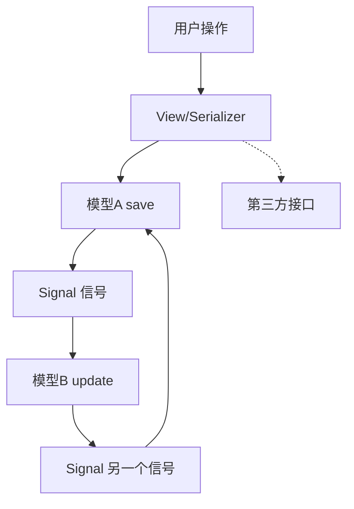
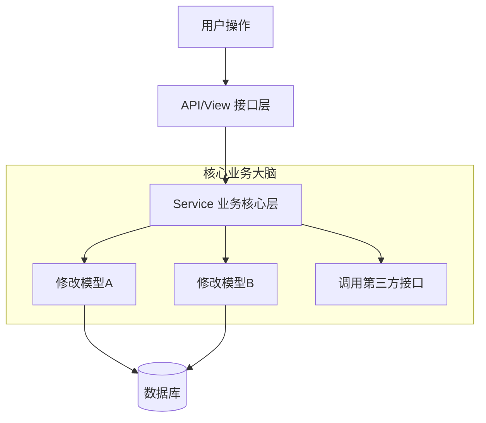

# 目录与简介

## 📋 文档概览

本文档是 Django Styleguide 的完整中文翻译版本。这是一份由 [HackSoft](https://hacksoft.io) 团队基于多年 Django 项目经验总结而成的最佳实践指南。

**翻译说明：**

- ✅ 本翻译保留了所有原文内容和代码示例
- 📝 添加了详细的中文注解和难点说明
- 🔖 对专有名词提供了解释
- 💡 标注了关键要点和注意事项

---

## 📚 完整目录

- [模型层（Models）](./01_模型层.md)
- [服务层（Services）](./02_服务层和选择器.md)
- [APIs 和序列化器](./03_API和序列化器.md)
- [URLs](./04_URL和配置.md)
- [配置（Settings）](./04_URL和配置.md)
- [错误和异常处理](./05_错误和异常处理.md)
- [测试](./06_测试和Celery.md)
- [Celery（异步任务）](./06_测试和Celery.md)
- [实用技巧集（Cookbook）](./07_实用技巧和资源.md)
- [开发者体验（DX）](./07_实用技巧和资源.md)
- [实际应用案例](./07_实用技巧和资源.md)
- [其他资源 / 替代方案](./07_实用技巧和资源.md)
- [灵感来源](./07_实用技巧和资源.md)

---

## 概览

Django Styleguide 的核心可以总结如下：

**在 Django 中，业务逻辑应该位于：**

- **Services（服务）** - 函数，主要负责向数据库**写入**数据。
- **Selectors（选择器）** - 函数，主要负责从数据库**读取**数据。
- **Model properties（模型属性）**（有一些例外）。
- **Model `clean` 方法**用于额外验证（有一些例外）。

**在 Django 中，业务逻辑不应该位于：**

- ❌ APIs 和 Views
- ❌ Serializers 和 Forms
- ❌ Form tags
- ❌ Model 的 `save` 方法
- ❌ 自定义 managers 或 querysets
- ❌ Signals（信号）

> 🔖 **核心概念解释 (Business Logic & Architecture)**
>
> - **业务逻辑（Business Logic）**：应用程序处理核心业务规则的代码。
>   - ✅ **属于业务逻辑**：计算订单总价、验证业务权限、复杂状态流转、更新库存。
>   - ❌ **不属于业务逻辑**：API 路由分发、JSON 序列化/反序列化（Serializers）、HTTP 状态码处理、底层数据库连接管理。这些属于**基础设施/胶水代码**。
> - **Services vs Selectors**：
>   - **Services**：写操作（Create, Update, Delete）。
>   - **Selectors**：读操作（Read, Query）。
> - **分离关注点（Separation of Concerns）**：将核心业务行为从接口层（API）和持久层（Model）中抽离，让代码不再是一团乱麻。
> - **控制反转（IoC/DI）与逻辑纯度**：
>   - 💡 **进阶建议**：对于复杂的外部依赖（如短信网关、第三方支付 SDK），可以通过**依赖注入**的方式传入 Service，而不是在 Service 内部硬编码实例化。
>   - **目的**：防止底层实现细节“污染”核心业务逻辑。这样在测试时，我们只需传入一个 Mock 对象即可，无需真正连接网络。
> - **⚠️ 架构适用范围说明**：
>   - 本指南的最佳实践主要针对**单体架构或垂直单机逻辑**。在分布式架构中，涉及到跨服务的分布式事务（TCC/Saga）、最终一致性等逻辑，其复杂度和处理方式会有本质不同。
>
> ---

> - **业务逻辑（Business Logic）**：指应用程序中处理核心业务规则的代码，例如：
>   ⚠️ **N+1 查询问题详解**
>
> 这是 ORM 中常见的性能问题。当你在循环中访问一个**关联对象字段**（如 ForeignKey 或 OneToOneField）且没有提前加载它时，就会发生这种现象：
>
> ```python
> # 错误示例：会产生 N+1 查询
> # 假设 User 模型有一个 profile 关联字段
> for user in User.objects.all():  # 第 1 次查询：获取所有 User
>     # 每次循环都会去数据库查一次对应的 Profile (N 次重复操作)
>     print(user.profile.bio)
>
> # 正确示例：使用 select_related (针对普通外键和一对一字段)
> # 通过 SQL JOIN 一次性把 User 和 Profile 的数据都拿回来
> for user in User.objects.select_related('profile'):  # 仅 1 次查询 (JOIN)
>     print(user.profile.bio)      # 内存中直接获取，不会额外查询
> ```

**总体思路是"分离关注点"，以便这些关注点可以被维护和测试。**

---

## 为什么不建议将逻辑分散在各处？

> 🤔 **为什么不把业务逻辑放在传统的 APIs / Views / Serializers / Forms 中？**

### 🚩 默认“脚手架”的陷阱

当你运行 `python manage.py startapp my_app` 时，Django 会为你生成如下结构：

```text
my_app/
├── admin.py
├── apps.py
├── migrations/
├── models.py       # ❌ 这里的后果：肥大的 Model
├── tests.py
└── views.py        # ❌ 这里的后果：臃肿的视图函数
```

如果你再引入 DRF，通常还会增加：

```text
├── serializers.py  # ❌ 这里的后果：充满副作用的校验逻辑
└── urls.py
```

**为什么这种结构不合理？**
Django 默认的 MTV（Model-Template-View）设计初衷是处理“快速原型开发”。在复杂的商业环境下，这种结构由于**缺乏独立的“业务层（Service Layer）”**，导致开发者被迫将逻辑强行塞入上述文件中：

1. **逻辑碎片化（Fragmentation）**：业务逻辑散落在 `views.py`、`serializers.py` 和 `models.py` 中。追踪一个简单的“支付成功”流程需要你像侦探一样在三四个文件间反复跳转。
2. **重度依赖黑盒抽象**：为了在 View 层修改一个小逻辑，你不得不深入研究 DRF `CreateAPIView` 的内部生命周期。而且，最关键的是——这些逻辑**无法脱离 HTTP 请求环境运行**。如果你想在 Celery 异步任务、管理命令或其他非 API 场景复用代码，你会发现它们被锁死在了 View 里。

---

> 💡 **实际案例**
>
> 想象一个用户注册流程：
>
> **不好的做法（逻辑分散）：**
>
> ```python
> # 在 serializer 中
> class UserSerializer(serializers.ModelSerializer):
>     def create(self, validated_data):
>         user = User.objects.create(**validated_data)
>         # 发送欢迎邮件？创建用户资料？
>         return user
>
> # 在 view 中
> class UserCreateView(CreateAPIView):
>     def perform_create(self, serializer):
>         user = serializer.save()
>         # 还要在这里做些什么？
>
> # 在 model 中
> class User(models.Model):
>     def save(self, *args, **kwargs):
>         # 还有更多逻辑？
>         super().save(*args, **kwargs)
> ```
>
> **好的做法（集中在 service）：**
>
> ```python
> def user_create(*, email: str, password: str) -> User:
>     """用户注册的所有逻辑都在这里"""
>     user = User(email=email)
>     user.set_password(password)
>     user.full_clean()
>     user.save()
>
>     profile_create(user=user)
>     send_welcome_email(user=user)
>
>     return user
> ```

通用的 APIs 和 Views，结合 serializers 和 forms，是 Django 默认脚手架提供的标准装备。它们对于处理“一写一读”的最直接模型 CRUD（增删改查）非常高效。

但根据我们的实战经验，在严肃的商业项目中，单纯的增删改查几乎不存在。一旦逻辑稍微跳出简单的 CRUD 路径（比如：创建用户的同时要发邮件、初始化多张关联表、调用外部风控 API），代码就会迅速变得臃肿且混乱。

一旦事情变得混乱，你就需要更多的**架构“文件夹”（我们姑且称之为“逻辑盒子”）**，以更科学的方式把代码安家落户。

本风格指南的核心目标即是：

1. 为你定义这些**核心“盒子”**（例如 Services 和 Selectors）。
2. 帮助你建立一种思维习惯，学会根据业务深度，拆分出适合你自己的**逻辑容器**。

此外，感谢 GitHub 社区的这段精彩评论（[Issue #170](https://github.com/HackSoftware/Django-Styleguide/issues/170)），它提出了一个更有力的视角：

**业务逻辑与“你是如何调用它”的方式（传输层/入口）应当完全无关。**

这是一种非常清晰的界限：

- **入口（Interface）**：可以是 API 接口、Admin 动作、管理脚本、甚至是 Celery 异步任务。它们只是“触发器”。
- **核心（Core）**：Service 函数。它不应该知道自己是被 HTTP 请求触发的还是被一段定时脚本触发的。

> 💡 **为什么要分离？**
>
> 如果你把业务逻辑写在 API 视图（View）里，当你某天需要在后台脚本（Management Command）里重执行这段逻辑时，你不得不去模拟网络请求、伪造请求头或创建一个“API 工具用户”。这种对 HTTP 环境的强制依赖，就是典型的**代码耦合陷阱**。

因此，我们希望在此彻底分离关注点：**“核心（Core）” vs “接口（Interface）”**。

当然，有些情况下事情会纠缠在一起，但是，思考这种分离的一个好的基准是 - **"核心" vs "接口"**。

> 🔖 **架构概念：核心与接口**
>
> - **核心（Core）**：业务规则和逻辑，独立于外部世界。
> - **接口（Interface）**：与外部交互的方式（API、CLI、Web UI 等）。
>
> 💡 **实战案例：为什么这对多端开发至关重要？**
>
> 想象一下，你的项目现在需要同时支持：**Web 后台**、**微信小程序**和**移动端 APP**：
>
> - **如果没有 Service 层**：你可能需要为这三端分别写三个 View。为了实现同一个“下单逻辑”，你不得不在这三个地方进行 **Copy-Paste**。当订单规则变动时，你需要同步修改三个文件，漏掉任何一个都会导致多端数据或逻辑不一致。
> - **有了 Service 层**：不论是 Web 请求、小程序点击还是 APP 调用，它们在 Interface 层处理完各自的权限和格式后，最终都会汇聚到同一个 Core 层方法：`order_create_service()`。
>
> **这种做法不仅解决了解耦问题，更是保障“多端业务一致性”的唯一出路。**

---

> ---
>
> 🤔 **为什么不把业务逻辑放在自定义 managers 和/或 querysets 中？**

这实际上是个好主意，对于**纯粹的数据过滤和查询增强**（例如 `Order.objects.active().by_user(user)`），自定义 manager 是最佳归宿。

> 🔖 **概念科普：Manager vs QuerySet 到底是什么？**
>
> - **Manager（管理器）**：它是 Model 的数据库操作入口（表级入口）。它的职责是**发起查询**。
> - **QuerySet（查询集）**：它是从数据库查出的对象集合。它的特点是类似函数式编程的**声明式链式调用**（如 `.filter().exclude()`）。
>
> **为什么开发者会被“诱惑”在其中写入逻辑？**
>
> 这种写法具有极强的**语义化美感**。例如 `Order.objects.create_with_gift(...)`。这种写法看起来业务逻辑紧贴数据实体，非常符合直觉。
>
> **但这种“美感”是有代价的：**
>
> 1. **过度抽象带来的语义坍塌**：QuerySet 的链式调用是一种声明式编程。当你把复杂的“核销、扣费、通知”都埋在里面时，这个链条就变成了黑盒。你无法一眼看出调用这行代码会带来多少隐蔽的数据库写入或外部 API 动作。
> 2. **调试地狱（Debugging Hell）**：Django 的 QuerySet 是 **Lazy（惰性求值）** 的。这意味着：
>    - **非线性执行**：你在 Manager 里打断点看逻辑时，数据库其实还没动；等你真正需要数据时（比如在模板里），逻辑才爆发。这种执行与响应的脱节，会让你的调试堆栈信息（Stack Trace）变得支离破碎，极难定位问题。
>    - **无法复用与测试**：由于这种逻辑被死死绑定在 QuerySet 的特定状态下，你很难在没有数据库环境的情况下进行纯粹的单元测试。
>
> **结论**：Managers 是用来 **“描述数据”** 的；而业务逻辑需要 **“编排动作”**。后者应该交给平铺直叙、过程清晰的 **Service 层**。

但是，试图将所有业务逻辑（特别是涉及多表操作的生命周期）都塞进 Manager 绝非良策：

1. **职责错位**：Manager 属于**持久层/数据访问层**。它的核心任务是“如何与数据库打交道”，而不应该关心“如何核销优惠券”或“如何计算复杂的会员费率”。
2. **循环依赖陷阱（跨模型问题）**：
   - 假设一个“下单”逻辑涉及到 `User`、`Product` 和 `Order` 三个模型。
   - 如果你把逻辑放在 `OrderManager` 里，它就必须 import `User` 和 `Product`。
   - 这种跨模型的相互引用，在 Django 项目变大后会引发灾难性的**循环导入错误**。
   - **Service 层**则作为独立的“第三方代理”，可以从容地调用这些模型，保持模型层的纯净和单向引用。
3. **不可控的副作用（Side Effects）**：跨系统调用（如发送短信、调用支付网关）不应该出现在数据操作层。否则，当你仅仅是为了写个统计脚本或跑个简单的单元测试而创建对象时，你的代码可能会由于误触外部 API 而导致严重的后果。

> 💡 **实际示例**
>
> ```python
> # 不好的做法：在 manager 中混杂太多业务逻辑
> class OrderManager(models.Manager):
>     def create_order(self, user, items):
>         # 创建订单
>         order = self.create(user=user)
>         # 添加商品
>         for item in items:
>             order.items.add(item)
>         # 发送邮件（这不应该在 manager 中！）
>         send_mail(...)
>         # 调用支付 API（这也不应该在这里！）
>         payment_gateway.charge(...)
>         # 更新库存（跨越多个模型）
>         Inventory.objects.update(...)
>         return order
>
> # 好的做法：在 service 中组织业务逻辑
> def order_create(*, user: User, items: List[Item]) -> Order:
>     order = Order.objects.create(user=user)
>     order.items.add(*items)
>
>     inventory_update_for_order(order=order)
>     payment_process(order=order)
>     order_confirmation_email_send(order=order)
>
>     return order
> ```

**核心思想是让你的领域独立于数据模型和 API 层而存在。**

如果我们将拥有自定义 queryset/manager 的想法与让领域独立存在的想法结合起来，我们最终会得到我们所说的"服务层"。

**Services 可以是函数、类、模块，或者任何对你的具体情况有意义的东西。**

考虑到所有这些，自定义 managers 和 querysets 是非常强大的工具，应该用于为你的模型暴露更好的接口。

> ✅ **最佳实践建议**
>
> 在 Manager/QuerySet 中放置：
>
> - 数据访问逻辑
> - 复杂的查询构建
> - 查询优化（select_related, prefetch_related）
>
> 在 Service 中放置：
>
> - 跨模型的业务逻辑
> - 外部 API 调用
> - 发送邮件/通知
> - 复杂的业务规则

---

> 🤔 **为什么不把业务逻辑放在 signals 中？**

在所有可用选项中，也许这个选项会最快地把你带到一个非常糟糕的地方：

1. **Signals 是连接那些本不应该相互了解、但你又希望它们连接起来的事物的好工具。**
2. **Signals 也是在业务逻辑层之外处理缓存失效的好工具。**
3. 如果我们开始对紧密连接的事物使用 signals，我们只是让连接变得更加隐式，使得追踪数据流变得更加困难。

> 💡 **深度解析：Signal 的机制与“避雷针”**
>
> - **功能定义**：Signals 是 Django 内置的“观察者模式”实现。它像一个全项目共享的 **“广播电台”**：当某个 Model 发生改变时，它喊一嗓子，全项目所有监听这个信号的地方都会被动触发。但这种“被动响应”在复杂业务面前有三大致命雷点：
> - **雷点 1：不可见的“幽灵逻辑”**：你在代码里写 `user.save()`，以为它只改了一个字段。但在你看不到的地方，可能有 5 个信号点正在偷偷修改其他关联表。当你排查数据错误时，你得翻遍全项目搜 `post_save`，这种**逻辑断层**是调试者的噩梦。
> - **雷点 2：批量操作的“集体失灵”**：这是最隐蔽的技术坑。Django 的 `QuerySet.update()` 和 `bulk_create` **完全不会触发 `save()` 信号**。如果你把核心逻辑（如“发放奖励”）写在信号里，当你用脚本批量刷数据时，系统逻辑会悄无声息地全部失效，导致严重的数据不一致。
> - **雷点 3：性能与循环暗礁**：信号是串行执行的。一个简单的保存动作可能因为牵扯了 10 个信号监听器而变得极其沉重；更糟的是，如果 A 的信号修改了 B，B 又由于某种逻辑反过来触改了 A，会引发死循环或性能雪崩。
>
> **核心铁律：** 信号应只用于 **“关注”**（如日志记录、缓存清理、ES 索引刷新）；绝对不应被用于 **“驱动”** 核心业务流程。

> ⚠️ **Signals 的陷阱**
>
> ```python
> # 不好的做法：使用 signal 处理紧密相关的逻辑
> @receiver(post_save, sender=User)
> def create_user_profile(sender, instance, created, **kwargs):
>     if created:
>         Profile.objects.create(user=instance)
>         # 几个月后，另一个开发者添加了...
>
> @receiver(post_save, sender=User)
> def send_welcome_email(sender, instance, created, **kwargs):
>     if created:
>         send_mail(...)
>         # 又有人添加了...
>
> @receiver(post_save, sender=User)
> def create_user_settings(sender, instance, created, **kwargs):
>     # 现在用户创建逻辑分散在 4 个地方！
>     # 很难理解完整的流程
> ```
>
> **好的做法：**
>
> ```python
> def user_create(*, email: str, password: str) -> User:
>     """所有用户创建逻辑都在这里，清晰明了"""
>     user = User(email=email)
>     user.set_password(password)
>     user.save()
>
>     profile_create(user=user)
>     user_settings_create(user=user)
>     welcome_email_send(user=user)
>
>     return user
> ```

这就是为什么我们建议在非常特定的用例中使用 signals，但总的来说，**我们不建议使用它们来构建领域/业务层。**

---

## 🏗️ 现代软件开发：两大“黄金准则”

为什么我们要如此费劲地拆分 Service 层？因为在现代大型系统的演进中，有两个无法逾越的黄金准则：

### 1. 单向数据流（Unidirectional Data Flow）

数据应该像河流一样，有明确的上下游，而不是互相关联、反复触发的混乱网状结构。

- **坏模式**：模型 A 改变 -> 触发信号 -> 修改模型 B -> 触发信号 -> 又改了模型 A。这种“死亡循环”是极其难以调试的。
- **好模式**：所有变更都经过 **Service 层** 这个唯一的阀门，流向数据库。

### 2. 状态集中管理（Centralized State Management）

业务状态的改变应该有且只有一个 **“真相来源（Single Source of Truth）”**。

- 如果逻辑分散在 View、Model 和 Signal 中，你永远无法确定“是谁在什么时候改了我的数据”。
- 在本指南中，**Service 层就是系统唯一的逻辑大脑**。

### 架构流程对比

#### ❌ 传统混乱模式（多源触发）

数据流向是杂乱交织的，容易产生副作用。



#### ✅ Service 模式（单向且集中）

数据流向是垂直且清晰的，一切皆可预测。



---

---

## Cookie Cutter（项目模板）

我们建议使用某种 cookiecutter 来开始每个新项目。从一开始就拥有适当的结构会带来回报。

> 🔖 **专有名词：Cookiecutter**
>
> Cookiecutter 是一个用于从项目模板创建项目的命令行工具。它可以快速搭建出具有标准结构的新项目。

**几个示例：**

- 你可以使用 [`Styleguide-Example`](https://github.com/HackSoftware/Styleguide-Example) 项目作为起点。
- 你也可以使用 [`cookiecutter-django`](https://github.com/pydanny/cookiecutter-django)，因为它内部有大量好东西。
- 或者你可以创建适合你情况的东西，并将其转变为一个 [cookiecutter](https://cookiecutter.readthedocs.io/en/latest/) 项目。

> 💡 **项目模板的价值**
>
> 使用项目模板的好处：
>
> 1. **节省时间**：避免重复配置相同的东西
> 2. **标准化**：团队成员都使用相同的结构
> 3. **最佳实践**：模板通常包含社区验证的最佳实践
> 4. **减少错误**：避免配置错误
>
> 建议：
>
> - 小团队：使用现有的成熟模板
> - 大团队/公司：创建自己的定制模板

---

## 📖 文档结构说明

本翻译文档被拆分为以下文件：

1. **00\_目录和简介.md**（当前文件）- 目录、简介和核心概念
2. **01\_模型层.md** - 完整的 Models 章节翻译
3. **02\_服务层和选择器.md** - 完整的 Services 和 Selectors 章节翻译
4. **03_API和序列化器.md** - 完整的 APIs 和 Serializers 章节翻译
5. **04_URL和配置.md** - URLs 和 Settings 章节翻译
6. **05\_错误和异常处理.md** - 完整的错误处理章节翻译
7. **06\_测试和Celery.md** - Testing 和 Celery 章节翻译
8. **07\_实用技巧和资源.md** - Cookbook、DX 和其他资源

每个文件都包含：

- ✅ 完整的内容翻译
- ✅ 详细的代码示例
- ✅ 中文注解和说明
- ✅ 难点解释
- ✅ 最佳实践建议

---

## 📝 结语

本文档介绍了 Django Styleguide 的核心理念和使用方式。主要要点：

1. **灵活应用**：根据项目实际情况选择合适的实践
2. **分离关注点**：将业务逻辑、数据访问、API 接口分开
3. **清晰的架构**：Services 负责写入，Selectors 负责读取
4. **避免常见陷阱**：不要将业务逻辑分散在多处
5. **使用项目模板**：从标准结构开始新项目

**接下来的文档将详细介绍每个部分的具体实现。建议按顺序阅读，以获得完整的理解。**

---

👉 **下一章：[模型层 (Models)](./01_模型层.md)**

---

**翻译日期：** 2026
**原文版本：** Latest (as of translation date)
**翻译质量：** 完整翻译，包含所有原文内容和代码示例
**维护者：** 社区贡献