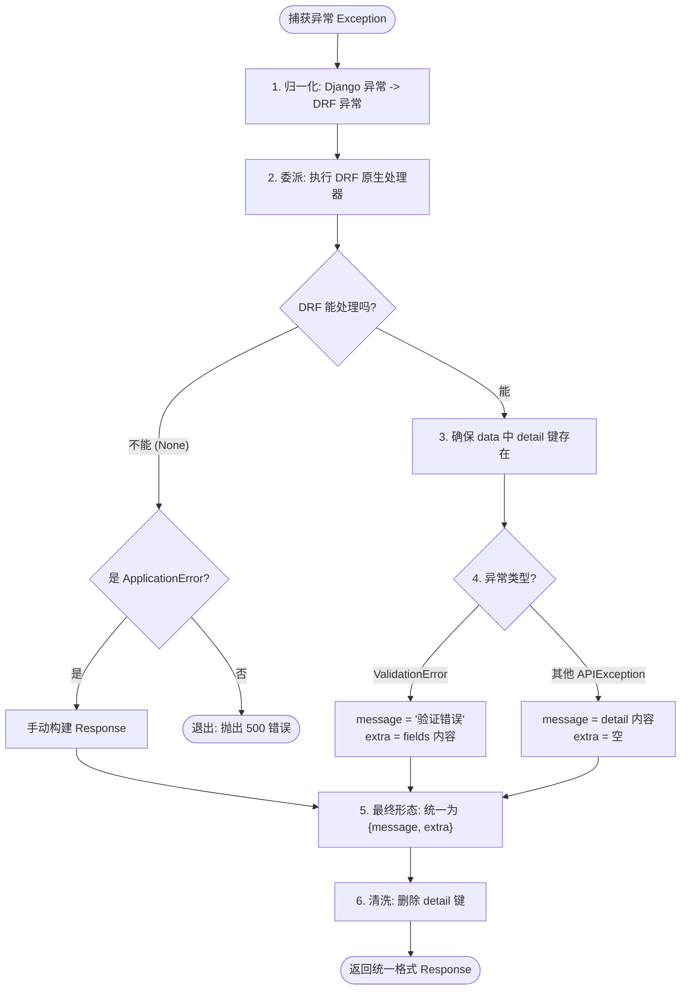

# Django Styleguide 中文翻译 - 错误和异常处理

## 概述

> 👀 **完整代码示例：** [Styleguide-Example - exception_handlers.py](https://github.com/HackSoftware/Styleguide-Example/blob/master/styleguide_example/api/exception_handlers.py)

错误和异常处理是一个大话题，而且通常情况下，细节是特定于给定项目的。

因此，我们将内容分为两部分：**通用指南**，然后是一些**具体方法**。

### 📋 通用指南

我们的通用指南包括：

1. ✅ **了解异常处理的工作原理**（我们将在 Django Rest Framework 的上下文中说明）
2. ✅ **描述你的 API 错误将如何呈现**
3. ✅ **知道如何改变默认的异常处理行为**

### 🛠️ 具体方法

然后是一些具体的方法：

1. **方法 1：** 使用 DRF 的默认异常，只做很少的修改
2. **方法 2：** HackSoft 提出的方法

### 📚 标准参考

如果你正在寻找一种标准的方式来构造错误响应，**请查看 RFC7807**：

- 📄 [RFC7807 - Problem Details for HTTP APIs](https://datatracker.ietf.org/doc/html/rfc7807)
- 💬 [相关讨论](https://github.com/HackSoftware/Django-Styleguide/issues/133)

---

## 🎯 为什么需要集中统一的错误处理？

在深入技术细节之前，我们需要理解：**异常处理不只是为了“不崩溃”，它是后端工程与外界沟通的“契约”**。进行集中统一处理有以下核心优势：

### 1. 前端契约的一致性 (Frontend Friendliness)

只有后端返回的错误格式是**确定且结构化**的，前端才能编写健壮的全局拦截器（Axios Interceptors）。如果后端有时返回 `{"error": "..."}`，有时返回 `["message"]`，前端代码会充斥着大量的类型检查，极易崩溃。

通过在全局异常处理器中**集中统一错误的数据结构**，前端可以实现“一套方法解析所有”——无论业务层抛出的异常来自哪里，前端只需通过单一的逻辑即可解析并优雅地展示后端传回的错误信息。

### 2. 把“错误”当作“信息” (Error as Information)

异常不应该是代码的“意外死亡”，而应该是业务逻辑的一部分。

- **传统做法**：通过函数返回 `None` 或特定的错误码，调用者需要写大量的 `if result is None:`。
- **集中式做法**：直接在业务深处 `raise ApplicationError`。异常处理器会将其转换成带 Code 的 JSON。这种方式减少了层层传递“None”或逻辑判断的心智负担。

### 3. 净化业务逻辑 (Clean Business Logic)

集中处理后，你的 Service 层可以保持 **“理想路径（Happy Path）”** 的可读性。你不再需要为了防止 500 错误而在每一行代码周围包裹 `try...except`。如果某些数据不符合预期，直接抛出异常，外层架构会自动处理成友好的 400 响应。

### 4. 消除防御性编程的噪音

很多开发者为了避免空指针，会写出类似 `if user and user.profile and ...` 的代码。在成熟的架构中，你可以直接假设数据存在，若不存在，让底层的捕获机制统一抛出 `NotFound` 异常。这种“激进”的写法实际上让核心逻辑变得更加干净透明。

---

## 异常处理工作原理（DRF 上下文）

> 📖 **必读：** DRF 有关于异常处理的优秀指南，请务必先阅读：
> [DRF - Exceptions](https://www.django-rest-framework.org/api-guide/exceptions/)

### 异常处理流程图

以下是异常处理过程的概览图：


### 📝 异常处理的 5 个步骤

对照上图，我们可以清晰地看到一个异常从产生到被处理（或导致崩溃）的完整生命周期：

1.  **Request (请求)**：客户端发起 API 调用。
2.  **Call (视图调用)**：API 视图接收请求并调用底层的 Service 层或业务逻辑。
3.  **Raise Exception (抛出异常)**：Service 层在处理业务时，如果发现不符合逻辑的情况（如权限不足、输入错误），会主动 `raise` 一个异常。
4.  **Call Exception Handler (拦截异常)**：DRF 的框架机制会捕获这个异常，并将其传递给我们定义的 `Exception Handler`（异常处理器）。
5.  **Response / 500 Error (响应与终点)**：
    - **成功处理**：处理器识别并处理了该异常，将其转化为结构化的响应数据（如 400 Bad Request）返回给客户端。
    - **未处理 (Returns None)**：如果处理器不知道如何处理该异常，它会返回 `None`。此时，异常会直接排到框架底层。

---

### 💡 深度探讨：500 错误的哲学

从上述第 5 步我们可以看到，当异常处理器返回 `None` 时，最终的出口是 **`500 Server Error`**。这引出了我们对系统健壮性的深层思考。

#### 1. 500 错误意味着什么？

在工程化视角中，**500 错误代表“由于不可预见的因素导致的流程崩溃”**。它不应该在系统的正常业务逻辑中被“预期”到：

- **基础设施/环境故障**：数据库连接断开、网络波动、第三方服务挂掉、磁盘空间不足。
- **核心代码 Bug**：引用了未定义的变量、数组越界、逻辑死循环、未捕获的类型转换失败。

#### 2. 为什么业务逻辑层不该产生 500？

我们的目标是：**所有业务层面的冲突，都应该是“有序的通信”，而非“暴力的崩溃”**。

- 如果用户余额不足，这是一个 **状态信息**（对应 400），不是 **系统崩溃**（500）。
- 如果出现 500，它应该是一个响亮的警报，意味着：“我们要么需要修复 Bug，要么需要检查服务器环境”。
- 这种区分有助于我们快速定位错误来源：4xx 通常是客户端输入或业务态问题；500 则是我们作为开发者必须要介入干预的技术事故。

#### 3. 把“错误”当作“特殊数据”

这里的核心思维转变是：**将 Expected Errors（预期内异常）从“控制流劫持”转变为“结构化数据通讯”**。

这非常符合现代编程语言（如 **Rust** 或 **Go**）的处理原则。例如在 Rust 中，错误是通过 `Result<T, E>` 类型返回的，错误本身就是一种和正常结果平级的数据类型。

- 虽然 Python 语法上使用的是“抛出（raise）”这一中断控制流的方式，但通过 **集中式异常处理器**，我们实际上在架构层模拟了“返回错误数据”的行为。
- **业务层**：直接 `raise ApplicationError`。这本质上是发送一个带有特定“故障载荷”的信号。
- **处理层（Exception Handler）**：拦截该信号，将其从“异常”降级为“数据”，格式化为 JSON 返回。
- **结果**：业务流程虽然终止了，但系统并没有真正“崩溃”，它优雅地完成了一次关于故障信息的有序交付。

这种 **“错误即数据”** 的设计，极大地降低了开发者处理各种边界情况（Corner Cases）的心智负担：你不再是在处理“灾难”，而是在处理“带有不同状态的数据”。

**关键点：**

- ✅ **明确界限**：业务规则破坏归 4xx（数据），底层环境/逻辑缺陷归 500（事故）。
- ✅ **坚持暴露 500**：不要为了追求“API 全绿”而用全局 `try...except` 吞掉 500。暴露 500 是系统健康的体现，确保了底层严重故障不会被静默。
- ⚠️ **可观测性**：确保所有 500 错误必须自动进入 Sentry 或日志系统，因为它们是系统“坏了”的唯一信号。

---

### 现在，有一些需要注意的怪异之处

#### DRF 的 ValidationError

##### 示例 1：字符串形式

如果我们简单地抛出一个 `rest_framework.exceptions.ValidationError`：

```python
from rest_framework import exceptions


def some_service():
    raise exceptions.ValidationError("Some message")
```

**响应结果：**

```json
["Some message"]
```

> ⚠️ **注意：** 这看起来很奇怪，因为返回的是一个数组！

---

##### 示例 2：字典形式

如果我们这样做：

```python
from rest_framework import exceptions


def some_service():
    raise exceptions.ValidationError({"error": "Some message"})
```

**响应结果：**

```json
{
  "error": "Some message"
}
```

> 📝 **说明：** 这就是我们作为 `ValidationError` 的 `detail` 传递的内容。
> 但它与初始数组是不同的数据结构。

---

##### 示例 3：其他 DRF 内置异常

如果我们抛出另一个 DRF 的内置异常：

```python
from rest_framework import exceptions


def some_service():
    raise exceptions.NotFound()
```

**响应结果：**

```json
{
  "detail": "Not found."
}
```

> ⚠️ **问题：** 这与 `ValidationError` 的行为完全不同，可能会导致问题。

---

### 📊 默认 DRF 行为总结

到目前为止，默认的 DRF 行为可能会给我们：

| 异常类型                          | 响应格式            | 数据结构       |
| --------------------------------- | ------------------- | -------------- |
| `ValidationError("msg")`          | `["msg"]`           | 数组           |
| `ValidationError({"key": "msg"})` | `{"key": "msg"}`    | 字典           |
| `NotFound()` 等其他异常           | `{"detail": "..."}` | 特定格式的字典 |

#### 😱 这种不一致性对前端有多糟糕？

想象一下，前端开发者在处理一个简单的表单提交。如果后端响应不一致，典型的 **TypeScript** 错误处理代码会变成一场灾难：

```typescript
// ❌ 糟糕的体验：前端需要写大量的类型检查和保护逻辑
try {
  await api.post("/users/register", data);
} catch (error: any) {
  const responseData = error.response.data;
  let errorMessage = "未知错误";

  if (Array.isArray(responseData)) {
    // 处理情况 1：数组格式 ["msg"]
    errorMessage = responseData[0];
  } else if (typeof responseData === "object" && responseData.detail) {
    // 处理情况 2：详情格式 {"detail": "..."}
    errorMessage = responseData.detail;
  } else if (typeof responseData === "object") {
    // 处理情况 3：字段格式 {"email": "..."}
    errorMessage = Object.values(responseData)[0] as string;
  }

  toast.error(errorMessage);
}
```

**对比统一后的体验：**

```typescript
// ✅ 优雅的体验：结构永远固定，前端心智负担极低
try {
  await api.post("/users/register", data);
} catch (error: any) {
  // 我们知道结构永远是 { message: string, ... }
  const { message } = error.response.data;
  toast.error(message);
}
```

**结论：** 这种“随机”的响应结构会迫使前端写出及其脆弱且难以维护的防御性代码。**集中化统一错误结构不仅是后端的优雅，更是对前端开发体验（DX）的巨大提升。**

---

### Django 的 ValidationError

> ⚠️ **重要：** DRF 的默认异常处理不能很好地处理 Django 的 `ValidationError`。

#### 问题演示

##### 场景 1：直接抛出 Django 的 ValidationError

```python
from django.core.exceptions import ValidationError as DjangoValidationError


def some_service():
    raise DjangoValidationError("Some error message")
```

**结果：**

- ❌ 导致未处理的异常
- ❌ 产生 **`500 Server Error`**

---

##### 场景 2：模型验证中的 ValidationError

```python
def some_service():
    user = BaseUser()
    user.full_clean()  # 抛出 ValidationError
    user.save()
```

**结果：**

- ❌ 同样导致 **`500 Server Error`**

---

### 解决方案：自定义异常处理器

如果我们想要像处理 `rest_framework.exceptions.ValidationError` 一样处理 Django 的 `ValidationError`，我们需要实现自己的[自定义异常处理器](https://www.django-rest-framework.org/api-guide/exceptions/#custom-exception-handling)：

```python
from django.core.exceptions import ValidationError as DjangoValidationError

from rest_framework.views import exception_handler
from rest_framework.serializers import as_serializer_error
from rest_framework import exceptions


def custom_exception_handler(exc, ctx):
    # 将 Django 的 ValidationError 转换为 DRF 的 ValidationError
    if isinstance(exc, DjangoValidationError):
        exc = exceptions.ValidationError(as_serializer_error(exc))

    # 调用 DRF 的默认异常处理器
    response = exception_handler(exc, ctx)

    # 如果发生意外错误（服务器错误等）
    if response is None:
        return response

    return response
```

#### 📝 代码详解

**核心转换逻辑：**

```python
if isinstance(exc, DjangoValidationError):
    exc = exceptions.ValidationError(as_serializer_error(exc))
```

**关键工具：**

- `as_serializer_error()` - DRF 内部使用的工具函数
- 作用：在序列化器中映射 Django 的 `ValidationError` 到 DRF 的格式
- 我们直接复用这个逻辑

**效果：**

- ✅ Django 的 `ValidationError` 现在可以被 DRF 的异常处理器正确处理
- ✅ 不会再产生 500 错误
- ✅ 返回标准的 400 错误响应

---

## 定义 API 错误的格式

> 🎯 **核心原则：** 这非常重要，应该在任何项目中尽早完成。

### 为什么重要？

这基本上是就你的 API 错误接口达成一致：

- **"错误将如何作为 API 响应呈现？"**
- 前端和后端需要对错误格式有共同的理解

### 参考案例

这是非常特定于项目的，你可以参考一些流行的 API 获取灵感：

- **Stripe API：** [Stripe - Errors](https://stripe.com/docs/api/errors) —— **特点：极致的细粒度**。提供 `type` 和 `code` 双重标识，甚至直接附带相关文档的 `doc_url`。
- **GitHub API：** [GitHub - Errors](https://docs.github.com/en/rest/overview/resources-in-the-rest-api#errors) —— **特点：字段级精确**。使用 `errors` 数组清晰列出每个字段的校验失败原因，极合表单处理。
- **AWS API：** [AWS - Errors](https://docs.aws.amazon.com/zh_cn/general/latest/gr/api-retries.html) —— **特点：强审计性**。强制包含 `RequestId`，这在分布式系统中对于故障回溯至关重要。

---

#### 💡 业界最佳实践总结

| API 范例   | 核心杀手锏                  | 为什么值得学？                                                               |
| :--------- | :-------------------------- | :--------------------------------------------------------------------------- |
| **Stripe** | **双重码位 (Type + Code)**  | 让前端能根据不同子错误码执行不同的交互逻辑（如：跳转支付 vs 重新输入）。     |
| **GitHub** | **结构化 Errors 列表**      | 完美的表单处理方案。不再是返回一个字符串，而是返回“哪个字段、出了什么错”。   |
| **AWS**    | **请求追踪符 (Request ID)** | 生产环境下定位问题的唯一钥匙。哪怕报错消失了，也能通过 ID 在日志中复现现场。 |

---

### 示例：简单的错误格式

作为示例，我们可能决定错误看起来像这样：

#### 格式规范

**1. HTTP 状态码：**

- `400` - 验证错误（Validation errors）
- `401` - 认证错误（Authentication errors）
- `403` - 权限错误（Permission errors）
- `404` - 未找到错误（Not found errors）
- `429` - 限流错误（Throttling errors）
- `500` - 服务器错误（Server errors）
  - ⚠️ 必须小心，不要静默 500 错误
  - ✅ 总是在 Sentry 等服务中报告

**2. 错误响应格式：**

```json
{
  "message": "Some error message here"
}
```

**特点：**

- ✅ 简单 - 只有一个 `message` 键
- ✅ 统一 - 所有错误都是这个格式
- ✅ 易于前端处理

---

### 💡 设计建议

**考虑因素：**

| 因素         | 问题                       | 建议                |
| ------------ | -------------------------- | ------------------- |
| **一致性**   | 所有错误格式是否一致？     | 必须统一            |
| **信息量**   | 是否需要额外的错误详情？   | 根据需求决定        |
| **前端友好** | 前端是否容易解析？         | 简单明了            |
| **国际化**   | 是否支持多语言错误信息？   | 考虑 i18n           |
| **调试信息** | 开发环境是否需要更多信息？ | 可选的 `debug` 字段 |

**示例：更丰富的错误格式**

```json
{
  "message": "Validation failed",
  "code": "VALIDATION_ERROR",
  "fields": {
    "email": ["This field is required."],
    "password": ["Password is too weak."]
  },
  "timestamp": "2024-01-01T12:00:00Z"
}
```

---

**再次强调：这取决于你和你的项目。** 我们将在下面的具体方法中提出类似的东西。

---

## 如何改变默认异常处理行为

> 🎯 **重要性：** 当你决定了错误的呈现方式，你需要实现自定义异常处理。

### 基本步骤

我们已经在上面的段落中提供了一个示例（关于 Django 的 `ValidationError`）。

下面的章节将提供更多示例。

### 配置自定义异常处理器

在 Django 设置中：

```python
# config/django/base.py

REST_FRAMEWORK = {
    'EXCEPTION_HANDLER': 'project.api.exception_handlers.custom_exception_handler'
}
```

---

### ⚖️ 两种异常处理方案的对比与选型

在接下来的章节中，我们将详细介绍两种具体的实现方案。它们代表了对 Django Rest Framework 异常机制的不同理解：

#### 方法 1：DRF 默认增强方案 (The "Polishing" Approach)

- **原则**：承认并尊重 DRF 原生的 `detail` 结构，通过最小化的包装，将不一致的数组、字典和 Django 原生异常“修补”成统一格式。
- **适用场景**：
  - 中小型项目，希望快速上线。
  - 团队已经习惯了原生 DRF 的错误返回方式。
  - 不需要高度自定义的业务异常上下文。

#### 方法 2：HackSoft 推荐重塑方案 (The "Architectural" Approach)

- **原则**：将异常处理视为业务通信的一部分。定义自己的异常基类（如 `ApplicationError`），完全接管响应结构（如使用 `message` 和 `extra`），强制实现语义化错误。
- **适用场景**：
  - 商业级大型系统、需要长期维护。
  - 对前端开发体验（DX）有极致要求，希望前端能零成本解析错误。
  - 业务逻辑复杂，需要异常携带大量额外上下文数据（如报错时附带建议操作、特定 ID 等）。

| 维度           | 方法 1 (修补)          | 方法 2 (重塑)                   |
| :------------- | :--------------------- | :------------------------------ |
| **心智负担**   | 极低，逻辑简单         | 中等（需定义一套异常体系）      |
| **前端友好度** | 一般（结构仍略显松散） | **极高**（结构极其确定）        |
| **业务表达力** | 普通                   | **极强**（支持任意 extra 数据） |
| **工程纯度**   | 依然依赖框架默认行为   | 完全与业务语义解耦              |

---

---

## 方法 1 - 使用 DRF 默认异常（少量修改）

> 🎯 **目标：** DRF 的错误处理很好。如果最终结果总是一致的，那就更好了。

### 目标格式

我们希望错误总是看起来像这样：

**格式 1：单个错误**

```json
{
  "detail": "Some error"
}
```

**格式 2：错误列表**

```json
{
  "detail": ["Some error", "Another error"]
}
```

**格式 3：嵌套结构**

```json
{
  "detail": {
    "key": "... some arbitrary nested structure ..."
  }
}
```

**核心要求：** 确保我们总是有一个包含 `detail` 键的字典。

---

### 实现自定义异常处理器

此外，我们还想处理 Django 的 `ValidationError`。

```python
from django.core.exceptions import ValidationError as DjangoValidationError, PermissionDenied
from django.http import Http404

from rest_framework.views import exception_handler
from rest_framework import exceptions
from rest_framework.serializers import as_serializer_error


def drf_default_with_modifications_exception_handler(exc, ctx):
    # 处理 Django 的 ValidationError
    if isinstance(exc, DjangoValidationError):
        exc = exceptions.ValidationError(as_serializer_error(exc))

    # 处理 Django 的 Http404
    if isinstance(exc, Http404):
        exc = exceptions.NotFound()

    # 处理 Django 的 PermissionDenied
    if isinstance(exc, PermissionDenied):
        exc = exceptions.PermissionDenied()

    # 调用 DRF 的默认异常处理器
    response = exception_handler(exc, ctx)

    # 如果发生意外错误（服务器错误等）
    if response is None:
        return response

    # 确保所有错误都包装在 detail 键中
    if isinstance(exc.detail, (list, dict)):
        response.data = {
            "detail": response.data
        }

    return response
```

#### 📝 代码详解

**1. Django 异常映射：**

```python
# Django ValidationError → DRF ValidationError
if isinstance(exc, DjangoValidationError):
    exc = exceptions.ValidationError(as_serializer_error(exc))

# Django Http404 → DRF NotFound
if isinstance(exc, Http404):
    exc = exceptions.NotFound()

# Django PermissionDenied → DRF PermissionDenied
if isinstance(exc, PermissionDenied):
    exc = exceptions.PermissionDenied()
```

**为什么这样做？**

- ✅ 统一异常类型，都转为 DRF 的 `APIException`
- ✅ 之后可以统一处理（查找 `detail` 属性）

**2. 确保一致的响应格式：**

```python
if isinstance(exc.detail, (list, dict)):
    response.data = {
        "detail": response.data
    }
```

**效果：**

- `["error"]` → `{"detail": ["error"]}`
- `{"key": "value"}` → `{"detail": {"key": "value"}}`
- `{"detail": "error"}` → 保持不变

---

### 测试结果

现在，让我们运行一组测试：

#### 测试 1：Django ValidationError

**代码：**

```python
def some_service():
    raise DjangoValidationError("Some error message")
```

**响应：**

```json
{
  "detail": {
    "non_field_errors": ["Some error message"]
  }
}
```

---

#### 测试 2：Django PermissionDenied

**代码：**

```python
from django.core.exceptions import PermissionDenied

def some_service():
    raise PermissionDenied()
```

**响应：**

```json
{
  "detail": "You do not have permission to perform this action."
}
```

---

#### 测试 3：Django Http404

**代码：**

```python
from django.http import Http404

def some_service():
    raise Http404()
```

**响应：**

```json
{
  "detail": "Not found."
}
```

---

#### 测试 4：DRF ValidationError（字符串）

**代码：**

```python
def some_service():
    raise RestValidationError("Some error message")
```

**响应：**

```json
{
  "detail": ["Some error message"]
}
```

---

#### 测试 5：DRF ValidationError（字典）

**代码：**

```python
def some_service():
    raise RestValidationError(detail={"error": "Some error message"})
```

**响应：**

```json
{
  "detail": {
    "error": "Some error message"
  }
}
```

---

#### 测试 6：序列化器验证错误（嵌套）

**代码：**

```python
class NestedSerializer(serializers.Serializer):
    bar = serializers.CharField()


class PlainSerializer(serializers.Serializer):
    foo = serializers.CharField()
    email = serializers.EmailField(min_length=200)
    nested = NestedSerializer()


def some_service():
    serializer = PlainSerializer(data={
        "email": "foo",
        "nested": {}
    })
    serializer.is_valid(raise_exception=True)
```

**响应：**

```json
{
  "detail": {
    "foo": ["This field is required."],
    "email": [
      "Ensure this field has at least 200 characters.",
      "Enter a valid email address."
    ],
    "nested": {
      "bar": ["This field is required."]
    }
  }
}
```

> 💡 **注意：** 嵌套序列化器的错误也被正确处理。

---

#### 测试 7：限流错误

**代码：**

```python
from rest_framework import exceptions


def some_service():
    raise exceptions.Throttled()
```

**响应：**

```json
{
  "detail": "Request was throttled."
}
```

---

#### 测试 8：模型完整性验证

**代码：**

```python
def some_service():
    user = BaseUser()
    user.full_clean()  # 触发验证错误
```

**响应：**

```json
{
  "detail": {
    "password": ["This field cannot be blank."],
    "email": ["This field cannot be blank."]
  }
}
```

---

### 📊 方法 1 总结

**优点：**

- ✅ 保持 DRF 的默认行为
- ✅ 只做最小的修改
- ✅ 统一所有错误的响应格式
- ✅ 处理 Django 和 DRF 的异常

**缺点：**

- ⚠️ 错误格式仍然是 DRF 的 `detail` 结构
- ⚠️ 如果需要更复杂的错误结构，可能不够灵活

**适用场景：**

- 项目刚开始，错误格式还未确定
- 希望尽量遵循 DRF 标准
- 不需要复杂的错误响应结构

---

## 方法 2 - HackSoft 推荐的方式

> 🎯 **目标：** 提出一个可以轻松扩展的方法，适合你的具体需求。

### 核心思想

**关键理念：**

1. **你的应用将有自己的异常层次结构**，这些异常将由业务逻辑抛出
2. 为了简单起见，假设我们只有 1 个错误 - `ApplicationError`
   - 定义在特殊的 `core` 应用中的 `exceptions` 模块
   - 路径：`project.core.exceptions.ApplicationError`
3. 我们希望让 DRF 默认处理其他所有事情
4. `ValidationError` 现在是特殊的，将被不同地处理
   - `ValidationError` 应该只来自序列化器或模型验证

---

### 错误响应格式

我们将定义以下错误结构：

```json
{
  "message": "The error message here",
  "extra": {}
}
```

**字段说明：**

- `message` - 错误消息（必需）
- `extra` - 额外数据（可选），用于向前端传递信息

---

### 验证错误的特殊格式

例如，每当我们有一个 `ValidationError`（通常来自序列化器或模型），我们将像这样呈现错误：

```json
{
  "message": "Validation error.",
  "extra": {
    "fields": {
      "password": ["This field cannot be blank."],
      "email": ["This field cannot be blank."]
    }
  }
}
```

**这可以与前端沟通，他们可以查找 `extra.fields`，向用户展示这些特定的错误。**

---

### 实现自定义异常处理器

为了实现这一点，自定义异常处理器将如下所示：

```python
from django.core.exceptions import ValidationError as DjangoValidationError, PermissionDenied
from django.http import Http404

from rest_framework.views import exception_handler
from rest_framework import exceptions
from rest_framework.serializers import as_serializer_error
from rest_framework.response import Response

from styleguide_example.core.exceptions import ApplicationError


def hacksoft_proposed_exception_handler(exc, ctx):
    """
    自定义异常处理器，返回格式：
    {
        "message": "Error message",
        "extra": {}
    }
    """
    # 1. 处理 Django 异常 → DRF 异常
    if isinstance(exc, DjangoValidationError):
        exc = exceptions.ValidationError(as_serializer_error(exc))

    if isinstance(exc, Http404):
        exc = exceptions.NotFound()

    if isinstance(exc, PermissionDenied):
        exc = exceptions.PermissionDenied()

    # 2. 调用 DRF 的默认异常处理器
    response = exception_handler(exc, ctx)

    # 3. 如果发生意外错误（服务器错误等）
    if response is None:
        # 处理我们自定义的 ApplicationError
        if isinstance(exc, ApplicationError):
            data = {
                "message": exc.message,
                "extra": exc.extra
            }
            return Response(data, status=400)

        # 其他未处理的异常，返回 None（会导致 500）
        return response

    # 4. 确保响应数据有 detail 键（如果是 list 或 dict）
    if isinstance(exc.detail, (list, dict)):
        response.data = {
            "detail": response.data
        }

    # 5. 转换为我们的标准格式
    if isinstance(exc, exceptions.ValidationError):
        # 验证错误的特殊处理
        response.data["message"] = "Validation error"
        response.data["extra"] = {
            "fields": response.data["detail"]
        }
    else:
        # 其他错误
        response.data["message"] = response.data["detail"]
        response.data["extra"] = {}

    # 6. 删除 detail 键（我们已经用 message 替换了）
    del response.data["detail"]

    return response
```

#### 📝 代码详解

**处理流程：**



**关键逻辑 1：处理 ApplicationError**

```python
if response is None:
    if isinstance(exc, ApplicationError):
        data = {
            "message": exc.message,
            "extra": exc.extra
        }
        return Response(data, status=400)
```

- 在 DRF 无法处理时（response is None）
- 检查是否是我们的 `ApplicationError`
- 直接返回我们定义的格式

**关键逻辑 2：ValidationError 特殊处理**

```python
if isinstance(exc, exceptions.ValidationError):
    response.data["message"] = "Validation error"
    response.data["extra"] = {
        "fields": response.data["detail"]
    }
```

- 将验证错误放在 `extra.fields` 中
- 前端可以轻松找到字段级错误

**关键逻辑 3：其他错误**

```python
else:
    response.data["message"] = response.data["detail"]
    response.data["extra"] = {}
```

- 简单地将 `detail` 作为 `message`
- `extra` 为空对象

---

### ApplicationError 的定义

```python
# project/core/exceptions.py

class ApplicationError(Exception):
    """
    应用层的自定义异常
    """
    def __init__(self, message, extra=None):
        super().__init__(message)
        self.message = message
        self.extra = extra or {}
```

**使用示例：**

```python
from project.core.exceptions import ApplicationError


def some_business_logic():
    if not user.is_eligible():
        raise ApplicationError(
            message="User is not eligible for this action",
            extra={"reason": "account_not_verified"}
        )
```

---

### 测试结果

**仔细查看代码并尝试理解发生了什么。策略是 - 尽可能重用 DRF，然后调整。**

---

#### 测试 1：ApplicationError（我们的自定义异常）

**代码：**

```python
from styleguide_example.core.exceptions import ApplicationError


def trigger_application_error():
    raise ApplicationError(
        message="Something is not correct",
        extra={"type": "RANDOM"}
    )
```

**响应：**

```json
{
  "message": "Something is not correct",
  "extra": {
    "type": "RANDOM"
  }
}
```

> 💡 **这是我们完全自定义的错误格式！**

---

#### 测试 2：Django ValidationError

**代码：**

```python
def some_service():
    raise DjangoValidationError("Some error message")
```

**响应：**

```json
{
  "message": "Validation error",
  "extra": {
    "fields": {
      "non_field_errors": ["Some error message"]
    }
  }
}
```

---

#### 测试 3：Django PermissionDenied

**代码：**

```python
from django.core.exceptions import PermissionDenied

def some_service():
    raise PermissionDenied()
```

**响应：**

```json
{
  "message": "You do not have permission to perform this action.",
  "extra": {}
}
```

---

#### 测试 4：Django Http404

**代码：**

```python
from django.http import Http404

def some_service():
    raise Http404()
```

**响应：**

```json
{
  "message": "Not found.",
  "extra": {}
}
```

---

#### 测试 5：DRF ValidationError（字符串）

**代码：**

```python
def some_service():
    raise RestValidationError("Some error message")
```

**响应：**

```json
{
  "message": "Validation error",
  "extra": {
    "fields": ["Some error message"]
  }
}
```

---

#### 测试 6：DRF ValidationError（字典）

**代码：**

```python
def some_service():
    raise RestValidationError(detail={"error": "Some error message"})
```

**响应：**

```json
{
  "message": "Validation error",
  "extra": {
    "fields": {
      "error": "Some error message"
    }
  }
}
```

---

#### 测试 7：序列化器验证错误（嵌套）

**代码：**

```python
class NestedSerializer(serializers.Serializer):
    bar = serializers.CharField()


class PlainSerializer(serializers.Serializer):
    foo = serializers.CharField()
    email = serializers.EmailField(min_length=200)
    nested = NestedSerializer()


def some_service():
    serializer = PlainSerializer(data={
        "email": "foo",
        "nested": {}
    })
    serializer.is_valid(raise_exception=True)
```

**响应：**

```json
{
  "message": "Validation error",
  "extra": {
    "fields": {
      "foo": ["This field is required."],
      "email": [
        "Ensure this field has at least 200 characters.",
        "Enter a valid email address."
      ],
      "nested": {
        "bar": ["This field is required."]
      }
    }
  }
}
```

> 💡 **前端可以直接使用 `extra.fields` 来展示字段错误！**

---

#### 测试 8：限流错误

**代码：**

```python
from rest_framework import exceptions


def some_service():
    raise exceptions.Throttled()
```

**响应：**

```json
{
  "message": "Request was throttled.",
  "extra": {}
}
```

---

#### 测试 9：模型完整性验证

**代码：**

```python
def some_service():
    user = BaseUser()
    user.full_clean()  # 触发验证错误
```

**响应：**

```json
{
  "message": "Validation error",
  "extra": {
    "fields": {
      "password": ["This field cannot be blank."],
      "email": ["This field cannot be blank."]
    }
  }
}
```

---

### 扩展和定制

现在，这可以扩展并更好地适应你的需求：

#### 1. 更多的自定义异常

```python
# project/core/exceptions.py

class ApplicationError(Exception):
    """基础应用异常"""
    def __init__(self, message, extra=None):
        super().__init__(message)
        self.message = message
        self.extra = extra or {}


class ApplicationValidationError(ApplicationError):
    """应用层验证错误"""
    pass


class ApplicationPermissionError(ApplicationError):
    """应用层权限错误"""
    pass


class ApplicationNotFoundError(ApplicationError):
    """应用层未找到错误"""
    pass
```

**使用示例：**

```python
def user_update(*, user_id: int, data: dict):
    try:
        user = User.objects.get(id=user_id)
    except User.DoesNotExist:
        raise ApplicationNotFoundError(
            message="User not found",
            extra={"user_id": user_id}
        )

    if not user.can_update():
        raise ApplicationPermissionError(
            message="User cannot be updated",
            extra={"reason": "account_locked"}
        )

    # ... 更新逻辑 ...
```

---

#### 2. 不同的 HTTP 状态码

```python
def hacksoft_proposed_exception_handler(exc, ctx):
    # ... 前面的代码 ...

    if response is None:
        if isinstance(exc, ApplicationError):
            # 根据异常类型决定状态码
            status_code = 400  # 默认

            if isinstance(exc, ApplicationNotFoundError):
                status_code = 404
            elif isinstance(exc, ApplicationPermissionError):
                status_code = 403
            elif isinstance(exc, ApplicationValidationError):
                status_code = 400

            data = {
                "message": exc.message,
                "extra": exc.extra
            }
            return Response(data, status=status_code)

    # ... 剩余代码 ...
```

---

#### 3. 添加错误代码

```python
class ApplicationError(Exception):
    """基础应用异常"""
    def __init__(self, message, code=None, extra=None):
        super().__init__(message)
        self.message = message
        self.code = code or "APPLICATION_ERROR"
        self.extra = extra or {}
```

**响应格式：**

```json
{
  "message": "User is not eligible",
  "code": "USER_NOT_ELIGIBLE",
  "extra": {
    "reason": "account_not_verified"
  }
}
```

**前端可以根据 `code` 进行不同的处理：**

```javascript
// 前端代码示例
if (error.code === "USER_NOT_ELIGIBLE") {
  showVerificationPrompt();
} else if (error.code === "PAYMENT_FAILED") {
  showPaymentRetryDialog();
}
```

---

#### 4. 重新实现 DRF 的异常处理器

如果你需要更多控制，可以完全重新实现，而不是重用 DRF 的：

```python
def fully_custom_exception_handler(exc, ctx):
    """
    完全自定义的异常处理器
    """
    # 初始化响应
    data = {}
    status_code = 500

    # 处理我们的自定义异常
    if isinstance(exc, ApplicationError):
        data = {
            "message": exc.message,
            "code": exc.code,
            "extra": exc.extra
        }
        status_code = 400

    # 处理 DRF ValidationError
    elif isinstance(exc, exceptions.ValidationError):
        data = {
            "message": "Validation error",
            "code": "VALIDATION_ERROR",
            "extra": {
                "fields": exc.detail
            }
        }
        status_code = 400

    # 处理其他 DRF 异常
    elif isinstance(exc, exceptions.APIException):
        data = {
            "message": str(exc.detail),
            "code": exc.default_code.upper(),
            "extra": {}
        }
        status_code = exc.status_code

    # 处理 Django 异常
    elif isinstance(exc, DjangoValidationError):
        data = {
            "message": "Validation error",
            "code": "VALIDATION_ERROR",
            "extra": {
                "fields": as_serializer_error(exc)
            }
        }
        status_code = 400

    # 未知异常 - 返回 None，让 Django 处理
    else:
        return None

    return Response(data, status=status_code)
```

---

### 📊 方法 2 总结

**优点：**

- ✅ 完全自定义的错误格式
- ✅ 统一的 `{message, extra}` 结构
- ✅ 易于扩展（添加新的异常类型）
- ✅ 前端友好（字段错误在 `extra.fields` 中）
- ✅ 支持额外的错误信息（`extra` 对象）

**缺点：**

- ⚠️ 需要更多的初始设置
- ⚠️ 团队需要学习新的异常体系
- ⚠️ 需要维护自定义的异常类

**适用场景：**

- 大型项目，需要统一的错误处理
- 前端需要结构化的错误信息
- 需要传递额外的错误上下文
- 希望完全掌控错误响应格式

---

## 更多想法和扩展

### 1. 处理更多异常类型

你可以开始处理更多的异常 - 例如，将 `django.core.exceptions.ObjectDoesNotExist` 转换为 `rest_framework.exceptions.NotFound`：

```python
from django.core.exceptions import ObjectDoesNotExist

def enhanced_exception_handler(exc, ctx):
    # 处理 ObjectDoesNotExist
    if isinstance(exc, ObjectDoesNotExist):
        exc = exceptions.NotFound()

    # ... 其余处理逻辑 ...
```

---

### 2. 日志记录

你甚至可以处理所有异常，但是，你应该确保这些异常被正确记录，否则你可能会静默掉重要的东西：

```python
import logging

logger = logging.getLogger(__name__)


def exception_handler_with_logging(exc, ctx):
    # 记录所有异常
    logger.error(
        f"Exception in {ctx['view'].__class__.__name__}: {exc}",
        exc_info=True,
        extra={
            'view': ctx['view'].__class__.__name__,
            'request': ctx['request'],
        }
    )

    # ... 异常处理逻辑 ...
```

---

### 3. 不同环境的不同行为

```python
from django.conf import settings


def exception_handler_with_debug_info(exc, ctx):
    response = custom_exception_handler(exc, ctx)

    # 在开发环境添加额外的调试信息
    if settings.DEBUG and response is not None:
        response.data['debug'] = {
            'exception_type': type(exc).__name__,
            'view': ctx['view'].__class__.__name__,
            'traceback': traceback.format_exc() if settings.DEBUG else None
        }

    return response
```

**开发环境响应：**

```json
{
  "message": "Something went wrong",
  "extra": {},
  "debug": {
    "exception_type": "ValidationError",
    "view": "UserCreateApi",
    "traceback": "Traceback (most recent call last):\n..."
  }
}
```

---

### 4. 与 Sentry 集成

```python
import sentry_sdk


def exception_handler_with_sentry(exc, ctx):
    response = custom_exception_handler(exc, ctx)

    # 对于 500 错误，发送到 Sentry
    if response is None or response.status_code >= 500:
        sentry_sdk.capture_exception(exc)

    return response
```

---

### 5. 国际化（i18n）

```python
from django.utils.translation import gettext as _


class ApplicationError(Exception):
    def __init__(self, message_key, extra=None):
        self.message_key = message_key
        self.message = _(message_key)  # 翻译
        self.extra = extra or {}
```

**使用：**

```python
raise ApplicationError(
    message_key="errors.user.not_eligible",
    extra={"reason": "account_not_verified"}
)
```

---

### 6. 错误追踪 ID

```python
import uuid


def exception_handler_with_tracking(exc, ctx):
    response = custom_exception_handler(exc, ctx)

    if response is not None:
        # 添加唯一的错误追踪 ID
        error_id = str(uuid.uuid4())
        response.data['error_id'] = error_id

        # 记录到日志
        logger.error(
            f"Error {error_id}: {exc}",
            exc_info=True,
            extra={'error_id': error_id}
        )

    return response
```

**响应：**

```json
{
  "message": "Something went wrong",
  "error_id": "123e4567-e89b-12d3-a456-426614174000",
  "extra": {}
}
```

**用户可以将 `error_id` 报告给支持团队，方便追踪问题。**

---

## 📚 本章总结

### 核心要点

1. **理解 DRF 的异常处理机制**
   - DRF 和 Django 的 ValidationError 是不同的
   - 默认行为可能不一致

2. **尽早定义错误格式**
   - 与前端团队沟通
   - 选择一致的格式
   - 文档化错误结构

3. **自定义异常处理器**
   - 可以完全掌控错误响应
   - 统一不同来源的异常
   - 添加额外的功能（日志、追踪等）

---

### 两种方法对比

| 特性         | 方法 1（DRF + 修改） | 方法 2（HackSoft） |
| ------------ | -------------------- | ------------------ |
| **复杂度**   | 低                   | 中                 |
| **灵活性**   | 中                   | 高                 |
| **学习曲线** | 平缓                 | 陡峭               |
| **前端友好** | 中等                 | 高                 |
| **扩展性**   | 有限                 | 优秀               |
| **适用场景** | 小型项目，快速开发   | 大型项目，长期维护 |

---

### 最佳实践

✅ **DO（推荐）：**

- 尽早定义错误格式并文档化
- 处理 Django 和 DRF 的 ValidationError
- 记录所有 500 错误到监控系统（如 Sentry）
- 为验证错误提供字段级详情
- 保持错误响应的一致性

❌ **DON'T（不推荐）：**

- 静默掉异常（总是返回 200）
- 在不同 API 使用不同的错误格式
- 忽略 500 错误的日志记录
- 向用户暴露敏感的系统信息
- 让前端猜测错误的结构

---

### 快速检查清单

在实施本章建议时，请确保：

- [ ] 定义了清晰的错误响应格式
- [ ] 实现了自定义异常处理器
- [ ] 处理了 Django 的 ValidationError
- [ ] 验证错误包含字段级详情
- [ ] 500 错误被记录到监控系统
- [ ] 错误格式与前端团队沟通过
- [ ] 文档化了可能的错误类型和格式

---

### 决策树：选择哪种方法？

```
开始
  ↓
项目规模大吗？
  ├─ 否 → 使用方法 1（DRF + 修改）
  └─ 是 ↓
       需要复杂的错误处理吗？
         ├─ 否 → 使用方法 1
         └─ 是 ↓
              有时间投资初始设置吗？
                ├─ 否 → 使用方法 1
                └─ 是 → 使用方法 2（HackSoft）
```

---

**总的来说，想清楚你需要什么样的错误处理，然后相应地实现。**

---

## 🔗 相关资源

- [DRF - Exception Handling](https://www.django-rest-framework.org/api-guide/exceptions/)
- [RFC7807 - Problem Details for HTTP APIs](https://datatracker.ietf.org/doc/html/rfc7807)
- [Stripe API - Errors](https://stripe.com/docs/api/errors)
- [Styleguide-Example - exception_handlers.py](https://github.com/HackSoftware/Styleguide-Example/blob/master/styleguide_example/api/exception_handlers.py)

---

**下一章：** [06\_测试和 Celery.md](./06_测试和Celery.md) - 学习 Django 项目的测试策略和最佳实践