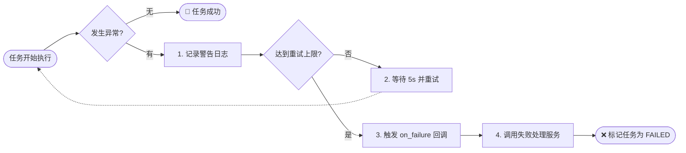

# Django Styleguide 中文翻译 - 测试和 Celery

## Testing（测试）

### 概述

测试是一个有趣且广泛的话题。

#### 🎯 为什么我们需要测试？

测试不仅仅是“发现 Bug”的工具，它更是**项目的长期“保险单”**。

1.  **重构的勇气**：当你修改一个核心服务（Service）时，只有在全套单元测试变绿时，你才敢自信地将其部署到生产环境。没有测试，重构就是一场赌博。
2.  **活的代码文档**：测试用例（特别是以 `test_should_...` 命名的）清晰地描述了业务逻辑在各种边缘情况下的预期行为，比任何过期的 wiki 都可靠。

#### ⛔️ 为什么 Postman 无法取代单元测试？

虽然 Postman 是优秀的 API 调试工具，但它不能替代代码级的测试：

- **黑盒 vs 白盒**：Postman 只能测试“输入 -> 输出”的黑盒行为；单元测试可以深入验证内部逻辑分支、状态变化和 mock 外部调用。
- **运行速度**：运行 1000 个单元测试只需几秒钟，而通过 HTTP 请求运行同样数量的集成测试可能需要几分钟。
- **环境依赖**：Postman 依赖真实运行的服务和数据库状态；而通过 `FactoryBoy` 和 `Mock`，单元测试可以在隔离、干净的环境中瞬间完成。

### 测试分类原则

在我们的 Django 项目中，**我们根据测试代码的类型来拆分测试。**

意思是，我们通常为以下部分编写测试：

- **Models（模型）**
- **Services（服务）**
- **Selectors（选择器）**
- **APIs / Views（API/视图）**

---

### 测试文件结构

标准的文件结构通常如下所示：

```
project_name/
├── app_name/
│   ├── __init__.py
│   ├── models.py
│   ├── services.py
│   ├── selectors.py
│   ├── apis.py
│   └── tests/
│       ├── __init__.py
│       ├── factories.py           # Factory Boy 工厂定义
│       ├── models/
│       │   ├── __init__.py
│       │   └── test_some_model_name.py
│       ├── selectors/
│       │   ├── __init__.py
│       │   └── test_some_selector_name.py
│       └── services/
│           ├── __init__.py
│           └── test_some_service_name.py
└── __init__.py
```

#### 📝 结构详解

**tests/ 目录：**

- `factories.py` - 包含该应用所有模型的 Factory 定义
- `models/` - 模型测试
- `selectors/` - 选择器测试
- `services/` - 服务测试
- `apis/` - API 测试（可选，如果有的话）

**组织原则：**

- ✅ 按照代码类型组织测试
- ✅ 测试目录结构镜像主代码结构
- ✅ 每个测试文件对应一个被测试的对象

---

### 命名规范

我们遵循 2 个通用命名约定：

#### 1. 测试文件名

**格式：**

```
test_the_name_of_the_thing_that_is_tested.py
```

**示例：**

```python
# 被测试的服务
def a_very_neat_service(*args, **kwargs):
    pass
```

**对应的测试文件名：**

```
project_name/app_name/tests/services/test_a_very_neat_service.py
```

---

#### 2. 测试类名

**格式：**

```python
class TheNameOfTheThingThatIsTestedTests(TestCase):
    pass
```

**示例：**

```python
# tests/services/test_a_very_neat_service.py

from django.test import TestCase


class AVeryNeatServiceTests(TestCase):
    """
    测试 a_very_neat_service 服务
    """

    def test_service_does_something_correctly(self):
        # 测试实现
        pass

    def test_service_handles_edge_case(self):
        # 测试实现
        pass
```

---

#### 工具函数的测试

对于工具函数的测试，我们遵循类似的模式。

**示例 1：单个工具模块**

如果我们有：

```
project_name/common/utils.py
```

那么测试文件是：

```
project_name/common/tests/test_utils.py
```

在该文件中放置不同的测试用例。

---

**示例 2：拆分的工具模块**

如果我们将 `utils.py` 模块拆分为子模块：

**源代码：**

```
project_name/common/utils/
├── __init__.py
├── files.py
├── strings.py
└── dates.py
```

**测试代码：**

```
project_name/common/tests/utils/
├── __init__.py
├── test_files.py
├── test_strings.py
└── test_dates.py
```

---

### 💡 核心原则

**我们试图让模块的结构与它们各自测试的结构相匹配。**

| 源代码                       | 测试代码                                   |
| ---------------------------- | ------------------------------------------ |
| `app_name/services.py`       | `app_name/tests/services/test_services.py` |
| `app_name/services/users.py` | `app_name/tests/services/test_users.py`    |
| `app_name/models.py`         | `app_name/tests/models/test_models.py`     |
| `common/utils.py`            | `common/tests/test_utils.py`               |

---

### Factories（工厂模式）

> 🎯 **核心理念：** Factories 是为测试生成数据的强大工具。它可以让你专注于测试逻辑，而不是数据准备的繁琐细节。

#### 🏭 什么是工厂模式？为什么需要它？

在测试语境下，**工厂模式（Factory Pattern）** 是一种将对象创建过程封装起来的设计模式。

- **痛点**：在数据库测试中，创建一个 `Order` 对象可能需要先创建 `User`、`Address`、`PaymentMethod` 等一系列依赖对象。如果你在每个测试用例里都手动写这些 `create(...)` 代码，测试文件会变得极其臃肿且难以维护（Schema 一变，全盘皆输）。
- **解药**：Factory Boy 允许你定义一个“模版”。当你调用 `OrderFactory()` 时，它会自动替你创建所有依赖的关联对象，并为非关键字段填入合理的随机数据。
- **核心思想**：**只在测试代码中显式声明你关心的字段**。如果测试是关于“未支付订单”，你只需写 `OrderFactory(status='unpaid')`，其他字段交给工厂自动填充。

#### 🆚 Factory Boy vs Pytest Fixtures

很多开发者会问：“我用 Pytest 的 fixture 依赖注入不是挺好吗？为什么还要工厂？”
其实，它们是 **互补** 关系，而非 **竞争** 关系。

| 特性         | Pytest Fixtures                    | Factory Boy                                |
| :----------- | :--------------------------------- | :----------------------------------------- |
| **擅长领域** | **环境管理** & **静态资源**        | **动态数据生成** & **复杂关系构建**        |
| **典型场景** | 初始化 DB、API Client、Mock Server | 创建 100 个不同的 `Order`、生成随机 `User` |
| **复用性**   | 全局单例或特定作用域               | 随调随用，通过参数动态覆盖                 |
| **最佳实践** | **Use both!**                      | 在 Fixture 中调用 Factory                  |

**💡 黄金搭档示例：**

```python
@pytest.fixture
def active_user():
    # 在 fixture 中利用 Factory 快速创建复杂对象
    return UserFactory(is_active=True, has_profile=True)

def test_login(client, active_user):
    # 结合使用：client 是 pytest fixture，active_user 是由 factory 生成的 fixture
    client.force_login(active_user)
    ...
```

#### 为什么使用 Factories？

**传统方式的问题：**

```python
# ❌ 不推荐：在每个测试中手动创建对象
class UserServiceTests(TestCase):
    def test_user_can_update_profile(self):
        user = User.objects.create(
            email='test@example.com',
            first_name='John',
            last_name='Doe',
            is_active=True,
            # ... 许多其他字段 ...
        )
        # 测试逻辑

    def test_user_can_delete_account(self):
        user = User.objects.create(
            email='test2@example.com',
            first_name='Jane',
            last_name='Smith',
            is_active=True,
            # ... 又要重复许多字段 ...
        )
        # 测试逻辑
```

**问题：**

- ❌ 大量重复代码
- ❌ 难以维护（字段变化时需要更新很多地方）
- ❌ 测试关注点不清晰
- ❌ 创建复杂对象关系很繁琐

---

**使用 Factories 的方式：**

```python
# ✅ 推荐：使用 Factory
class UserServiceTests(TestCase):
    def test_user_can_update_profile(self):
        user = UserFactory()
        # 测试逻辑 - 关注点清晰

    def test_user_can_delete_account(self):
        user = UserFactory()
        # 测试逻辑

    def test_inactive_user_cannot_login(self):
        # 只覆盖需要的字段
        user = UserFactory(is_active=False)
        # 测试逻辑
```

**优点：**

- ✅ 代码简洁
- ✅ 易于维护
- ✅ 测试意图清晰
- ✅ 易于创建复杂的对象关系

---

#### Factory Boy 基础

**安装：**

```bash
pip install factory_boy
```

**基本 Factory 定义：**

```python
# app_name/tests/factories.py

import factory
from faker import Faker

from app_name.models import User, Profile


fake = Faker()


class UserFactory(factory.django.DjangoModelFactory):
    class Meta:
        model = User

    email = factory.Sequence(lambda n: f'user{n}@example.com')
    first_name = factory.LazyFunction(lambda: fake.first_name())
    last_name = factory.LazyFunction(lambda: fake.last_name())
    is_active = True
    is_staff = False


class ProfileFactory(factory.django.DjangoModelFactory):
    class Meta:
        model = Profile

    user = factory.SubFactory(UserFactory)
    bio = factory.LazyFunction(lambda: fake.text(max_nb_chars=200))
    avatar = factory.django.ImageField(color='blue')
```

**使用示例：**

```python
# 创建一个用户（所有字段使用默认值）
user = UserFactory()

# 覆盖特定字段
admin_user = UserFactory(is_staff=True, email='admin@example.com')

# 创建多个对象
users = UserFactory.create_batch(5)

# 创建带关联的对象
profile = ProfileFactory()  # 自动创建关联的 user

# 只构建对象，不保存到数据库
user = UserFactory.build()
```

---

#### 学习资源

如果你是这个概念的新手，可以参考以下材料：

📚 **推荐阅读：**

- [Improve your Django tests with fakes and factories](https://www.hacksoft.io/blog/improve-your-tests-django-fakes-and-factories)
- [Improve your tests - Django fakes and factories advanced usage](https://www.hacksoft.io/blog/improve-your-tests-django-fakes-and-factories-advanced-usage)

🎥 **推荐视频：**

- [DjangoCon 2022 | factory_boy: testing like a pro](https://www.youtube.com/watch?v=-C-XNHAJF-c)

---

#### 🚀 Factory 进阶技巧：像搭积木一样构造数据

掌握了基础用法后，你会发现真实世界的对象往往“纠缠不清”。以下技巧将帮助你优雅地处理复杂场景。

**1. Traits（特征）：一键切换“人设”**

> 💡 **场景**：你的用户可能有多种身份（管理员、被封禁、已激活）。
>
> - **普通做法**：每次都要手动设置 `is_staff=True, is_superuser=True`，容易漏掉。
> - **Traits 做法**：定义一个开关，像给角色“换皮肤”一样简单。

```python
class UserFactory(factory.django.DjangoModelFactory):
    class Meta:
        model = User

    email = factory.Sequence(lambda n: f'user{n}@example.com')
    # 默认是普通活跃用户
    is_active = True
    is_staff = False

    class Params:
        # 定义 "admin" 特征：一旦开启，自动设置相关的一组字段
        admin = factory.Trait(
            is_staff=True,
            is_superuser=True,
        )
        # 定义 "inactive" 特征
        inactive = factory.Trait(
            is_active=False,
        )

# 🔥 威力展示：
# 给我来个管理员！
admin_user = UserFactory(admin=True)

# 给我来个被封禁的用户！
banned_user = UserFactory(inactive=True)
```

**2. Post Generation：买手机“送”耳机（处理多对多/反向一对多）**

> 💡 **场景**：创建一个 `Order` 时，如果不带几个 `OrderItem`，这个订单在业务上甚至是无效的。
>
> - **难题**：`Order` 还没存进数据库拿到 ID 时，无法创建 `OrderItem`（因为外键需要 ID）。
> - **解法**：`post_generation` 钩子会在 `Order` 创建**完成之后**自动运行，帮你把关联数据补齐。

```python
class OrderFactory(factory.django.DjangoModelFactory):
    class Meta:
        model = Order

    user = factory.SubFactory(UserFactory)
    status = 'pending'

    # 定义一个名为 "items" 的钩子
    @factory.post_generation
    def items(self, create, extracted, **kwargs):
        if not create:
            # 如果只是 build() 而不存库，没法创建关联对象，直接返回
            return

        if extracted:
            # 情况 A：调用者指定了 items -> OrderFactory(items=[item1, item2])
            for item in extracted:
                self.items.add(item)
        else:
            # 情况 B：调用者啥都没给 -> 自动送给你 3 个默认商品！
            OrderItemFactory.create_batch(3, order=self)

# 🔥 威力展示：
# 自动创建一个订单，且它已经带了 3 个商品，可以直接拿去测计算总价逻辑！
order = OrderFactory()
assert order.items.count() == 3
```

**3. Faker：拒绝 "test1", "abc" 这种垃圾数据**

> 💡 **场景**：你的 UI 在显示超长名字时会崩吗？你的搜索功能在面对中文时正常吗？
>
> - **价值**：用真实的随机数据（Faker）填充数据库。这不仅让测试看起来更专业，还能帮你**偶然发现**那些只在特定数据长短/格式下才会暴露的 Bug（比如布局溢出）。

```python
from faker import Faker

# 支持多语言，随机生成中文或英文数据
fake = Faker(['en_US', 'zh_CN'])


class ArticleFactory(factory.django.DjangoModelFactory):
    class Meta:
        model = Article

    # 随机生成一句像样的话作为标题
    title = factory.LazyFunction(lambda: fake.sentence())
    # 随机生成一篇 2000 字的文章
    content = factory.LazyFunction(lambda: fake.text(max_nb_chars=2000))
    # 自动关联一个作者
    author = factory.SubFactory(UserFactory)
    # 随机生成一个今年的发布时间
    published_at = factory.LazyFunction(lambda: fake.date_time_this_year())
```

---

## Celery（异步任务）

### ⚡️ Celery 是什么？

简单来说，Celery 是一个**分布式任务队列系统**。

- **Django 的定位**：Django 本身是同步的请求-响应（Request-Response）框架。这意味着用户发起请求后，必须等待服务器处理完所有逻辑并返回，连接才会结束。
- **Celery 的角色**：它充当了 Django 的“后台分流器”。你可以把那些耗时、不需要即时返回结果的任务（如发送邮件、生成 PDF、训练模型）丢给 Celery，让 Django 立刻响应用户，从而极大提升用户体验。

#### 🚧 Celery vs 消息队列 (Broker)

初学者容易混淆 Celery 和 Redis/RabbitMQ 的关系：

- **Broker (中间人)**：如 RabbitMQ 或 Redis，它们是**传输管道**，负责存储消息（Message）。它们不知道消息里是什么，只负责保管。
- **Celery Worker (处理者)**：它是**消费者**。它不断从 Broker 中拉取消息，并执行 Python 代码。
- **关系**：`Django Producer` --> `RabbitMQ (Broker)` --> `Celery Worker`。Celery 不仅包含 Worker 代码，还包含了一整套定义任务、调度、重试和结果追踪的框架。

> 🎯 **核心原则：** 将 Celery 视为核心逻辑的另一个接口 - 不要在任务中放置业务逻辑。

### 我们使用 Celery 的场景

我们在以下一般情况下使用 [Celery](http://www.celeryproject.org/)：

1. **与第三方服务通信**（发送邮件、通知等）
2. **将较重的计算任务移出 HTTP 周期**
3. **周期性任务**（使用 Celery Beat）

---

### 基础概念

#### 🏗️ 设计原则：Keep Tasks Thin

**核心思想：**
Celery 任务应当仅仅是一个 **“触发器”** 或 **“入口”**，而不是业务逻辑的容器。

- ✅ **任务应该很薄（Thin）**：只负责接收参数（如 ID）、获取对象、调用 Service。
- ✅ **逻辑应该在 Service**：真正的脏活累活（数据校验、状态更新、发邮件）都在 Service 层完成。

**为什么要这么做？**
想象一下：**Task 是餐厅服务员，Service 是后厨厨师。**
如果服务员自己跑去炒菜（在 Task 里写逻辑），那当你需要在另一个场合（比如命令行脚本、API 接口）也需要这道菜时，你无法复用这个服务员，只能再教一遍。

#### ⚖️ 案例对比

**❌ 反面教材（Fat Task）：逻辑耦合在任务中**

```python
# tasks.py
@shared_task
def process_order(order_id):
    # 😱 糟糕：ORM 操作、业务规则、第三方调用全混在一起
    order = Order.objects.get(id=order_id)
    if order.status != 'paid':
        return

    #复杂的计算逻辑...
    order.amount = order.items.aggregate(Sum('price'))
    order.save()

    # 发送邮件逻辑...
    send_mail(f"Order {order.id} processed", ...)
```

- **痛点**：如果你想在 Shell 中手动处理一个订单，你无法调用这个逻辑（除非你伪造一个 Task 环境）。如果你想测试这个逻辑，你必须 Mock 整个 Celery 机制。

**✅ 正面教材（Thin Task）：逻辑委托给 Service**

```python
# services.py
def order_process(order: Order):
    # 真正的业务逻辑在这里，纯粹的 Python 函数
    ...

# tasks.py
@shared_task
def process_order(order_id):
    # 😍 完美：只负责“把盘子端给厨师”
    order = Order.objects.get(id=order_id)
    order_process(order)
```

- **优势**：
  - **可复用性**：API 视图可以调用 `order_process`，Management Command 也可以调用它。
  - **易测试性**：测试 Service 只需要传一个对象进去，完全不需要启动 Celery Worker。
  - **避免循环导入**：这是 Celery 开发中最头疼的问题，通过“函数内延迟导入”，从根源上消灭它。

---

### 任务与服务的关系

#### 完整示例：邮件发送

以下示例来自 [`Django-Styleguide-Example`](https://github.com/HackSoftware/Django-Styleguide-Example/blob/master/styleguide_example/emails/tasks.py)

##### 1. 服务层（业务逻辑）

```python
# emails/services.py

from django.db import transaction
from django.core.mail import EmailMultiAlternatives
from django.utils import timezone

from styleguide_example.core.exceptions import ApplicationError
from styleguide_example.common.services import model_update
from styleguide_example.emails.models import Email


@transaction.atomic
def email_send(email: Email) -> Email:
    """
    发送邮件服务

    这里包含业务逻辑：
    - 验证邮件状态
    - 实际发送邮件
    - 更新邮件状态
    """
    # 业务规则：只能发送状态为 SENDING 的邮件
    if email.status != Email.Status.SENDING:
        raise ApplicationError(
            f"Cannot send non-ready emails. Current status is {email.status}"
        )

    # 准备邮件内容
    subject = email.subject
    from_email = "styleguide-example@hacksoft.io"
    to = email.to
    html = email.html
    plain_text = email.plain_text

    # 发送邮件
    msg = EmailMultiAlternatives(subject, plain_text, from_email, [to])
    msg.attach_alternative(html, "text/html")
    msg.send()

    # 更新邮件状态
    email, _ = model_update(
        instance=email,
        fields=["status", "sent_at"],
        data={
            "status": Email.Status.SENT,
            "sent_at": timezone.now()
        }
    )

    return email
```

##### 2. 任务层（接口）

```python
# emails/tasks.py

from celery import shared_task

from styleguide_example.emails.models import Email


@shared_task
def email_send(email_id):
    """
    邮件发送任务

    这个任务很薄，只做两件事：
    1. 获取数据
    2. 调用服务
    """
    # 1. 获取需要的数据
    email = Email.objects.get(id=email_id)

    # 2. 调用服务（在函数体内导入，避免循环导入）
    from styleguide_example.emails.services import email_send

    email_send(email)
```

#### 📝 关键点解析

**任务的角色：**

- ✅ 作为 API - 接收参数（通常是 ID）
- ✅ 获取必要的数据
- ✅ 调用适当的服务
- ❌ 不包含业务逻辑

**为什么在任务内部导入服务？**

```python
# ✅ 推荐：在函数体内导入
@shared_task
def email_send(email_id):
    from styleguide_example.emails.services import email_send
    # ...

# ❌ 不推荐：在模块顶部导入
from styleguide_example.emails.services import email_send

@shared_task
def email_send_task(email_id):
    # ...
```

**原因：**

- ✅ 避免循环导入（services 可能导入 tasks）
- ✅ 延迟导入，只在任务执行时才导入

---

##### 3. 触发任务

现在，假设我们有另一个服务，需要触发邮件发送：

```python
# users/services.py

from django.db import transaction

from styleguide_example.users.models import User
# 注意：我们在模块级导入任务，并给它加 _task 后缀
from styleguide_example.emails.tasks import email_send as email_send_task


@transaction.atomic
def user_complete_onboarding(user: User) -> User:
    """
    用户完成入职流程
    """
    # ... 一些业务逻辑代码 ...

    # 准备邮件
    email = email_get_onboarding_template(user=user)

    # 事务提交后，触发异步任务
    transaction.on_commit(lambda: email_send_task.delay(email.id))

    return user
```

#### 📝 两个重要的要点

**1. 这是一个“非阻塞”操作：**
很多新手会担心：“这里调用了 `email_send_task`，用户是不是要等邮件发出去才能看到页面跳转？”
**答案是：完全不需要等待。**

- `email_send_task.delay(email.id)` 仅仅是向 Broker（如 Redis）发送了一条消息，耗时仅几毫秒。
- 真正的邮件发送逻辑是由后台的 Celery Worker 进程异步执行的。
- 因此，`user_complete_onboarding` 函数会几乎瞬间返回，用户体验极佳。

**2. 导入任务时使用后缀：**

```python
from styleguide_example.emails.tasks import email_send as email_send_task
```

- 任务与服务同名（都叫 `email_send`）
- 导入任务时添加 `_task` 后缀以区分
- 清晰表明这是一个任务调用

**2. 在事务提交后执行任务：**

```python
transaction.on_commit(lambda: email_send_task.delay(email.id))
```

**为什么？**

- ✅ 确保数据已经保存到数据库
- ✅ 避免任务执行时数据还未提交的竞态条件
- ✅ 如果事务回滚，任务不会被触发

---

### 使用 Celery 的总体方式

**总结一下，我们使用 Celery 的方式可以描述为：**

1. ✅ **任务调用服务**
2. ✅ **我们在任务的函数体中导入服务**
3. ✅ **当我们想要触发任务时，在模块级导入任务，并添加 `_task` 后缀**
4. ✅ **我们作为副作用执行任务，在事务提交时**

**这种混合任务和服务的方式也防止了循环导入，在使用 Celery 时经常会遇到循环导入问题。**

---

### 错误处理

#### ⚠️ 必须区分：API 异常 vs 任务异常

请注意，这里的错误处理与前面章节提到的 **[API 全局异常处理](/posts/articles/django-styleguide-05-exception-handling-c4meub)** 是完全不同的概念。

| 维度         | API 异常处理 (Web 请求)                | Celery 任务异常处理 (后台任务)             |
| :----------- | :------------------------------------- | :----------------------------------------- |
| **发生时机** | 用户在浏览器等待响应时                 | 用户已经离开，任务在后台静默运行中         |
| **处理目标** | **告知前端**：发生了什么错误 (400/404) | **自我修复**：网络抖动导致失败？那就重试！ |
| **受众**     | 最终用户 (End User)                    | 系统管理员 / Sentry 监控                   |
| **失败后果** | 页面弹出错误提示                       | 任务进入积压队列、重试或标记为失败         |

**结论**：Celery 任务中的异常无法“返回这 HTTP 响应”，因此我们必须在任务内部捕获它，并决定是 **重试 (Retry)** 还是 **记录日志 (Log)**。

有时，我们的服务可能会失败，我们可能想在任务级别处理错误。例如 - 我们可能想重试任务。

**这个错误处理代码需要存在于任务中。**

#### 扩展示例：带错误处理的邮件发送

让我们扩展上面的 `email_send` 任务示例，添加错误处理：

```python
# emails/tasks.py

from celery import shared_task
from celery.utils.log import get_task_logger

from styleguide_example.emails.models import Email


logger = get_task_logger(__name__)


def _email_send_failure(self, exc, task_id, args, kwargs, einfo):
    """
    任务失败回调

    当所有重试都失败后，这个函数会被调用
    """
    email_id = args[0]
    email = Email.objects.get(id=email_id)

    # 调用服务来处理失败情况
    from styleguide_example.emails.services import email_failed
    email_failed(email)


@shared_task(bind=True, on_failure=_email_send_failure)
def email_send(self, email_id):
    """
    带重试机制的邮件发送任务
    """
    email = Email.objects.get(id=email_id)

    from styleguide_example.emails.services import email_send

    try:
        email_send(email)
    except Exception as exc:
        # 记录警告日志
        logger.warning(f"Exception occurred while sending email: {exc}")

        # 重试任务
        # https://docs.celeryq.dev/en/stable/userguide/tasks.html#retrying
        self.retry(exc=exc, countdown=5)
```

#### 📝 代码详解

**1. bind=True 参数：**

```python
@shared_task(bind=True, on_failure=_email_send_failure)
def email_send(self, email_id):
    # self 现在是任务实例
```

- `bind=True` 使任务成为绑定方法
- 第一个参数 `self` 是任务实例
- 可以访问任务的方法（如 `self.retry()`）

**2. 重试机制：**

```python
self.retry(exc=exc, countdown=5)
```

- `exc=exc` - 传递原始异常
- `countdown=5` - 5 秒后重试
- Celery 会自动处理重试次数（默认 3 次）

**3. 失败回调：**

```python
def _email_send_failure(self, exc, task_id, args, kwargs, einfo):
    # 处理最终失败
```

**回调参数说明：**

- `self` - 任务实例
- `exc` - 异常对象
- `task_id` - 任务 ID
- `args` - 任务参数（位置参数）
- `kwargs` - 任务参数（关键字参数）
- `einfo` - 异常信息（ExceptionInfo 对象）

**命名约定：**

- 失败回调命名为 `_{task_name}_failure`
- 它也调用服务层，就像普通任务一样

---

#### 🔄 完整的错误处理流程



---

#### 高级错误处理示例

```python
@shared_task(
    bind=True,
    autoretry_for=(ConnectionError, TimeoutError),  # 自动重试这些异常
    retry_kwargs={'max_retries': 5},  # 最多重试 5 次
    retry_backoff=True,  # 使用指数退避
    retry_backoff_max=600,  # 最大退避时间 10 分钟
    retry_jitter=True,  # 添加随机抖动
)
def send_notification(self, user_id, message):
    """
    发送通知，带高级重试机制
    """
    user = User.objects.get(id=user_id)

    from notifications.services import notification_send

    try:
        notification_send(user=user, message=message)
    except RateLimitError as exc:
        # 遇到限流错误，等待更长时间再重试
        raise self.retry(exc=exc, countdown=60 * 5)  # 5 分钟后重试
```

---

### 配置

我们基本上遵循官方指南，将 Celery 与 Django 集成：

- 📖 [Celery - First steps with Django](https://docs.celeryq.dev/en/stable/django/first-steps-with-django.html)

#### 完整示例

查看 `Django-Styleguide-Example` 项目中的 Celery 配置：

- 📁 [tasks/ 目录](https://github.com/HackSoftware/Django-Styleguide-Example/tree/master/styleguide_example/tasks)
- 📄 [celery.py 配置文件](https://github.com/HackSoftware/Django-Styleguide-Example/blob/master/styleguide_example/tasks/celery.py)

#### 基本配置结构

```python
# project/tasks/celery.py

import os
from celery import Celery

# 设置 Django 设置模块
os.environ.setdefault('DJANGO_SETTINGS_MODULE', 'config.django.base')

app = Celery('project')

# 从 Django 设置加载配置，使用 CELERY_ 前缀
app.config_from_object('django.conf:settings', namespace='CELERY')

# 自动发现所有已安装应用的 tasks.py
app.autodiscover_tasks()
```

#### Django 设置中的 Celery 配置

```python
# config/settings/celery.py

from config.env import env

CELERY_BROKER_URL = env('CELERY_BROKER_URL', default='redis://localhost:6379/0')
CELERY_RESULT_BACKEND = env('CELERY_RESULT_BACKEND', default='redis://localhost:6379/0')

CELERY_TIMEZONE = 'UTC'

# 任务跟踪
CELERY_TASK_TRACK_STARTED = True
CELERY_TASK_TIME_LIMIT = 30 * 60  # 30 分钟

# 结果过期时间
CELERY_RESULT_EXPIRES = 60 * 60 * 24  # 1 天

# 序列化
CELERY_TASK_SERIALIZER = 'json'
CELERY_RESULT_SERIALIZER = 'json'
CELERY_ACCEPT_CONTENT = ['json']

# 其他配置
CELERY_TASK_ALWAYS_EAGER = False  # 测试时设为 True
CELERY_TASK_EAGER_PROPAGATES = True
```

#### 💡 配置建议

Celery 是一个复杂的主题，所以花时间阅读文档和理解不同的配置选项是个好主意。

**我们不断这样做，并找到新的东西或找到解决问题的更好方法。**

---

### 代码组织结构

#### 基本原则

任务位于不同应用的 `tasks.py` 模块中。

我们遵循与其他所有内容（APIs、services、selectors）相同的规则：
**如果给定应用的任务增长过大，按领域拆分它们。**

#### 小型应用结构

```
app_name/
├── models.py
├── services.py
├── tasks.py          # 所有任务在一个文件中
└── tests/
```

#### 大型应用结构

```
app_name/
├── models.py
├── services.py
├── tasks/
│   ├── __init__.py   # 导入所有任务，让 Celery 自动发现
│   ├── domain_a.py   # 领域 A 的任务
│   └── domain_b.py   # 领域 B 的任务
└── tests/
```

**tasks/**init**.py 示例：**

```python
# 从子模块导入所有任务，让 Celery 能够发现它们
from .domain_a import *  # noqa
from .domain_b import *  # noqa
```

#### 💡 拆分建议

**经验法则 - 以对你有意义的方式拆分任务。**

**按功能拆分：**

```
emails/tasks/
├── __init__.py
├── sending.py       # 发送相关任务
├── templates.py     # 模板处理任务
└── analytics.py     # 分析相关任务
```

**按集成拆分：**

```
notifications/tasks/
├── __init__.py
├── sms.py          # SMS 通知任务
├── push.py         # Push 通知任务
└── email.py        # Email 通知任务
```

---

### 周期性任务

> 🎯 **重要性：** 管理周期性任务非常重要，尤其是当你有数十或数百个任务时。

#### 我们的技术栈

我们使用以下组合来管理周期性任务：

1. [Celery Beat](https://docs.celeryproject.org/en/latest/userguide/periodic-tasks.html)
2. `django_celery_beat.schedulers:DatabaseScheduler`
3. [`django-celery-beat`](https://github.com/celery/django-celery-beat)

#### 额外的管理命令

我们做的额外工作是拥有一个名为 [`setup_periodic_tasks`](https://github.com/HackSoftware/Django-Styleguide-Example/blob/master/styleguide_example/tasks/management/commands/setup_periodic_tasks.py) 的管理命令，它保存系统内所有周期性任务的定义。

**这个命令位于上面讨论的 `tasks` 应用中。**

---

#### 完整实现示例

以下是 `project.tasks.management.commands.setup_periodic_tasks.py` 的样子：

```python
# tasks/management/commands/setup_periodic_tasks.py

from django.core.management.base import BaseCommand
from django.db import transaction

from django_celery_beat.models import IntervalSchedule, CrontabSchedule, PeriodicTask

from project.app.tasks import some_periodic_task


class Command(BaseCommand):
    help = f"""
    设置 celery beat 周期性任务。

    将创建以下任务：

    - {some_periodic_task.name}
    """

    @transaction.atomic
    def handle(self, *args, **kwargs):
        print('删除所有周期性任务和计划...\n')

        # 清理现有的
        IntervalSchedule.objects.all().delete()
        CrontabSchedule.objects.all().delete()
        PeriodicTask.objects.all().delete()

        # 定义所有周期性任务
        periodic_tasks_data = [
            {
                'task': some_periodic_task,
                'name': 'Do some periodic stuff',
                # https://crontab.guru/#15_*_*_*_*
                'cron': {
                    'minute': '15',
                    'hour': '*',
                    'day_of_week': '*',
                    'day_of_month': '*',
                    'month_of_year': '*',
                },
                'enabled': True
            },
        ]

        # 创建任务
        for periodic_task in periodic_tasks_data:
            print(f'设置 {periodic_task["task"].name}')

            cron = CrontabSchedule.objects.create(
                **periodic_task['cron']
            )

            PeriodicTask.objects.create(
                name=periodic_task['name'],
                task=periodic_task['task'].name,
                crontab=cron,
                enabled=periodic_task['enabled']
            )

        print('\n✅ 周期性任务设置完成！')
```

---

#### 📝 几个关键点

**1. 部署流程的一部分：**

```bash
# 在部署脚本中
python manage.py migrate
python manage.py setup_periodic_tasks  # 设置周期性任务
python manage.py collectstatic --noinput
```

**2. 总是链接到 crontab.guru：**

```python
# https://crontab.guru/#15_*_*_*_*
'cron': {
    'minute': '15',
    'hour': '*',
    'day_of_week': '*',
    'day_of_month': '*',
    'month_of_year': '*',
},
```

**为什么？**

- ✅ Cron 表达式难以阅读
- ✅ [crontab.guru](https://crontab.guru) 提供清晰的解释
- ✅ 方便验证和调试

**3. 一切都在一个地方：**

- ✅ 易于查看所有周期性任务
- ✅ 易于修改和维护
- ✅ 版本控制

---

#### ⚠️ 重要注意事项

**关于计划对象：**

我们几乎只使用 cron 计划。如果你计划使用 Celery 提供的其他计划对象，请阅读它们的文档和重要注意事项：

📖 [django-celery-beat - Example: Creating interval-based periodic task](https://django-celery-beat.readthedocs.io/en/latest/#example-creating-interval-based-periodic-task)

**特别注意关于指向同一计划对象的说明！**

---

#### 更多周期性任务示例

```python
periodic_tasks_data = [
    {
        'task': send_daily_digest,
        'name': 'Send daily digest emails',
        # 每天早上 9 点
        # https://crontab.guru/#0_9_*_*_*
        'cron': {
            'minute': '0',
            'hour': '9',
            'day_of_week': '*',
            'day_of_month': '*',
            'month_of_year': '*',
        },
        'enabled': True
    },
    {
        'task': cleanup_old_sessions,
        'name': 'Cleanup old sessions',
        # 每周日凌晨 2 点
        # https://crontab.guru/#0_2_*_*_0
        'cron': {
            'minute': '0',
            'hour': '2',
            'day_of_week': '0',
            'day_of_month': '*',
            'month_of_year': '*',
        },
        'enabled': True
    },
    {
        'task': generate_monthly_report,
        'name': 'Generate monthly reports',
        # 每月1号早上 6 点
        # https://crontab.guru/#0_6_1_*_*
        'cron': {
            'minute': '0',
            'hour': '6',
            'day_of_week': '*',
            'day_of_month': '1',
            'month_of_year': '*',
        },
        'enabled': True
    },
]
```

---

### 高级用法：Celery Canvas (任务编排)

> 🎯 **为什么需要高级用法？**
> 现实中的业务往往不是一个简单的异步任务就能搞定的。你可能需要：
>
> 1. 先做 A，成功后再做 B（有依赖的流水线）。
> 2. 同时发起 10 个任务以节省时间（并行处理）。
> 3. 等这 10 个任务全跑完，最后出一个汇总报告（同步汇聚）。
>
> Celery Canvas 提供了一套强大的“原语（Primitives）”，让你像搭积木一样编排复杂的业务流。

📖 [Celery Canvas - Designing Work-flows](https://docs.celeryq.dev/en/stable/userguide/canvas.html)

#### 常用模式解析

**1. Chains（链式任务）：工业流水线**

- **含义**：任务按顺序执行，前一个任务的返回结果会自动作为参数传递给下一个任务。
- **适用场景**：一个流程有严格的先后顺序，且后一步依赖前一步的结果。
- **示例流程**：用户上传视频 -> **[任务 1]** 提取元数据 -> **[任务 2]** 转码为 1080P -> **[任务 3]** 上传到云存储 -> **[任务 4]** 通知用户。

```python
from celery import chain

# 就像多米诺骨牌，一个推倒一个
workflow = chain(
    process_upload.s(file_id),  # 返回处理后的路径
    validate_file.s(),          # 接收路径并验证
    import_data.s(),            # 接收验证结果并入库
    send_notification.s()       # 发送成功通知
)
workflow.apply_async()
```

**2. Groups（并行任务）：人多力量大**

- **含义**：同时启动多个任务，它们之间没有依赖关系，并行执行。
- **适用场景**：需要处理一系列相互独立的同类任务，以缩短总执行时间。
- **示例流程**：用户上传一张高清图，我们需要**同时**生成“小、中、大”三种尺寸的缩略图。

```python
from celery import group

# 3 个 worker 如果空闲，会同时开始工作
job = group([
    resize_image.s(image_id, size='small'),
    resize_image.s(image_id, size='medium'),
    resize_image.s(image_id, size='large'),
])
result = job.apply_async()
```

**3. Chords（组合任务）：大考后的总结**

- **含义**：这是 Group 的升级版。它包含一个 `header`（一组并行任务）和一个 `callback`（回调任务）。只有当 header 中所有任务都成功完成后，callback 才会触发。
- **适用场景**：分头行动，最后汇聚结果。
- **示例流程**：生成财务月报。我们需要并发从 **[API A]**、**[API B]**、**[API C]** 抓取数据，等全部抓完后，再执行 **[生成 PDF]** 任务。

```python
from celery import chord

# 并行执行 header，完成后执行 callback
callback = generate_report.s()
header = group([
    fetch_data_from_api_a.s(),
    fetch_data_from_api_b.s(),
    fetch_data_from_api_c.s(),
])
chord(header)(callback)
```

**4. Map & Starmap（批量映射）：全员分发**

- **含义**：对一个序列中的每个元素执行同一个任务。
- **适用场景**：当你有一万个任务要发，且逻辑一模一样时，它可以简化代码结构。
- **示例流程**：给所有选定的活跃用户发送“周五特惠”邮件。

```python
from celery import group

# 对列表中的每个 ID 执行任务
user_ids = [1, 2, 3, 4, 5]
# 将任务分发给所有 user_ids
job = group(send_welcome_email.s(uid) for uid in user_ids)
result = job.apply_async()
```

---

## 📚 本章总结

### Testing 最佳实践

✅ **DO（推荐）：**

- 按代码类型组织测试（models、services、selectors、APIs）
- 遵循清晰的命名约定
- 使用 Factory Boy 生成测试数据
- 测试结构镜像源代码结构
- 为工厂使用 Faker 生成真实数据

❌ **DON'T（不推荐）：**

- 在测试中手动创建大量对象
- 测试文件命名不一致
- 测试全部堆在一个文件中
- 在每个测试中重复设置代码

---

### Celery 最佳实践

✅ **DO（推荐）：**

- 任务保持简单，只调用服务
- 业务逻辑放在服务层
- 在函数体内导入服务（避免循环导入）
- 使用 `transaction.on_commit()` 触发任务
- 导入任务时添加 `_task` 后缀
- 实现错误处理和重试机制
- 使用管理命令集中管理周期性任务
- 总是链接到 crontab.guru 解释 cron 表达式

❌ **DON'T（不推荐）：**

- 在任务中放置业务逻辑
- 在模块顶部导入服务
- 在事务中直接调用 `.delay()`
- 忽略任务失败的情况
- 让周期性任务散落在各处
- 使用难以理解的 cron 表达式

---

## 🔗 相关资源

**Testing：**

- [factory_boy 文档](https://factoryboy.readthedocs.io/)
- [Faker 文档](https://faker.readthedocs.io/)
- [Django Testing 文档](https://docs.djangoproject.com/en/stable/topics/testing/)
- [pytest-django](https://pytest-django.readthedocs.io/)

**Celery：**

- [Celery 官方文档](https://docs.celeryq.dev/)
- [django-celery-beat](https://django-celery-beat.readthedocs.io/)
- [Celery Best Practices](https://docs.celeryq.dev/en/stable/userguide/tasks.html#tips-and-best-practices)
- [crontab.guru](https://crontab.guru/) - Cron 表达式解释器

---

**下一章：** [07\_实用技巧和资源.md](/posts/articles/django-styleguide-07-cookbook-dx-4q6h0b) - Cookbook、DX 工具和其他实用建议