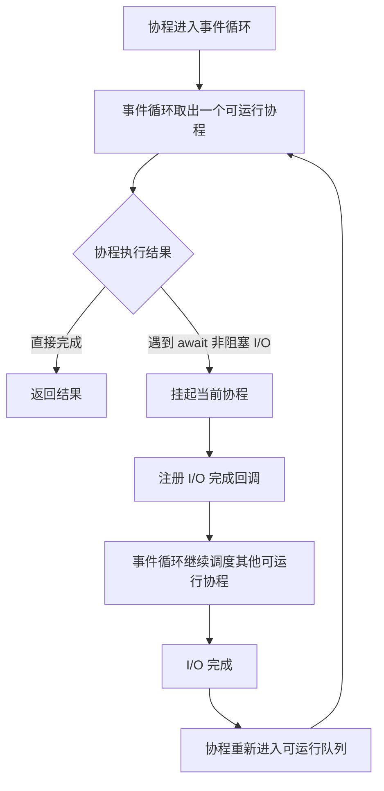

# FastAPI 里什么时候该用 async，什么时候该用线程池

## 先说结论

在 FastAPI 里，真正重要的不是“所有路由都写成 `async def`”，而是你是否明确区分了三类工作：

- 异步 I/O：用 `async def` + `await`
- 同步 I/O：用线程池，或者直接用同步路由
- CPU 密集计算：不要指望 `async` 或线程池解决

很多性能问题不是框架慢，而是阻塞操作跑进了事件循环。

## 先把概念讲清楚：什么是异步

异步最容易被误解的一点是，很多人会把它直接等同于“更快”或者“并行更多”。

但更准确的理解是：

异步的核心不是同时做很多事，而是在等待 I/O 的时候，不阻塞当前主执行流。

这里最关键的是“等待”。

如果一个任务正在等待数据库返回结果、等待文件读写完成、等待外部 API 响应，那么 CPU 在这段时间里其实没有真正工作。
异步框架的价值，就是在这段等待期间先去处理别的任务，等结果回来后再继续。

所以异步的优势主要来自 I/O 等待阶段，而不是来自计算本身。

但要真正理解这件事，还得先搞清楚异步程序到底是谁在“接手等待中的任务切换”。  
这个角色就是事件循环。

## 什么是事件循环

如果把异步程序看成一个调度系统，事件循环就是那个负责调度的核心。

你可以先把它理解成一个很轻量的协调者：

- 某个协程遇到 `await`，表示它现在需要等待
- 事件循环暂时把它挂起
- 然后去处理其他已经可以继续执行的任务
- 等 I/O 完成后，再回来恢复刚才那个协程

这个过程不会神奇地让单个任务变快，但它会显著提高等待型任务的整体利用率。

这里有一个非常容易说错的点：

事件循环并不是“遇到阻塞 I/O 就自动切走”。

更准确地说，它只能在协程遇到**可等待的非阻塞操作**时接管控制权。
如果你在 `async def` 里直接调用了真正的同步阻塞代码，比如 `requests.get()` 或 `time.sleep()`，事件循环其实是拿不到控制权的，它只会被一起卡住。

所以后面讨论 FastAPI async 边界时，真正关键的问题不是“有没有写 `async def`”，而是“你等待的东西是不是真的非阻塞”。



这个图里最重要的一点是：  
事件循环不是只盯着一个协程执行到底，而是在一组可运行协程之间不断调度。  
某个协程只有在遇到 `await` 的非阻塞 I/O 时，才会被挂起并让出执行权；等 I/O 完成后，它再回到可运行队列，等待下一次被调度。

## “染色”问题：为什么 async 会沿着调用链扩散

异步在 Python 里有一种很典型的现象：
一旦某一层开始依赖异步能力，`async` 往往会沿着调用链一路往上传播。

这就是很多人说的“异步染色”。

原因并不复杂：

- 异步函数调用后，拿到的不是最终结果，而是一个可等待对象
- 想得到最终结果，你通常就得在上层继续 `await`
- 于是调用它的那一层也必须进入异步上下文

所以从工程体验上看，异步确实会沿着 service、依赖项、路由这一层层往上扩散。

用代码来看会更直观：

```python
from sqlalchemy import select
from sqlalchemy.ext.asyncio import AsyncSession

# 底层：选了异步数据库驱动，这个函数必须是 async
async def get_user(db: AsyncSession, user_id: int) -> User:
    result = await db.execute(select(User).where(User.id == user_id))
    return result.scalar_one()

# 中间层：因为要 await get_user，这里也必须是 async
async def get_user_with_orders(db: AsyncSession, user_id: int) -> dict:
    user = await get_user(db, user_id)
    orders = await get_orders(db, user_id)
    return {“user”: user, “orders”: orders}

# 路由层：因为要 await service，这里也必须是 async
@router.get(“/users/{user_id}”)
async def read_user(user_id: int, db: AsyncSession = Depends(get_async_db)):
    return await get_user_with_orders(db, user_id)
```

一旦最底层的数据库驱动选了异步，`async` 就从 repository → service → route 一路往上传播。
这就是”染色”最典型的表现。

这里需要特别说明一件事：
FastAPI 并不是帮你”消除了异步染色”，它只是帮你兼容了一部分**入口层**的执行差异。

比如在路由和依赖这一层，FastAPI 会帮你处理这些事情：

- `async def` 路由直接运行在事件循环中
- `def` 路由会被框架自动放进线程池
- 同步和异步依赖项都能接入 `Depends`

这会让异步染色在最外层的体感没有那么强，因为你不用自己手工调度路由函数，也不用自己决定某个依赖到底该怎样被执行。

但这不等于 async/sync 边界消失了。

一旦进入你自己的业务调用链，规则还是一样的：

- 如果 service 依赖异步数据库，它通常还是 async
- 如果依赖项里要 `await` 异步 I/O，它通常还是 async
- 同步函数仍然不能直接自然地消费异步结果
- 异步函数里如果塞进阻塞同步调用，事件循环仍然会被卡住

所以更准确的说法是：

FastAPI 缓解了异步染色在路由入口层的体感，但并没有消除异步染色本身。

关于染色，有一句很实用的记忆法：

**同步不能直接等异步，异步可以碰同步，但不能乱碰阻塞同步。**

前半句说的是传播方向：异步函数返回的是 coroutine，同步代码拿不到最终值，所以调用方也得变成 async。
后半句说的是边界规则：异步代码可以调用轻量同步逻辑，但如果同步代码本身会阻塞（`requests.get()`、`time.sleep()`、同步数据库访问），就不能直接塞进 `async def`。

理解了这两点，后面的实践部分就不会觉得突兀。

## 最容易犯的错：`async def` 里混入阻塞调用

下面这种写法在代码上看起来没问题，在并发下会很糟：

```python
import requests
from fastapi import APIRouter

router = APIRouter()


@router.get("/orders/{order_id}")
async def get_order(order_id: int):
    response = requests.get(f"https://example.com/orders/{order_id}")
    return response.json()
```

问题不是 `requests` 不好，而是它是同步阻塞调用。你把它放进 `async def`，事件循环就拿不到控制权，其他协程也没法顺利切换。

很多人第一次踩坑时，都会把问题归咎于“FastAPI 不够快”或者“Python 异步不稳定”。  
但更常见的真实原因其实是：`async def` 里混入了阻塞同步 I/O。

## 一个简单的判断表

| 任务类型 | 推荐做法 |
| --- | --- |
| 异步数据库、异步 HTTP、异步 Redis | `async def` + `await` |
| 只有同步 SDK、同步 HTTP 客户端、同步文件 I/O | `def` 路由，或者 `run_in_threadpool` |
| 图像处理、压缩、转码、复杂计算 | 进程池或后台任务系统 |

这张表比“默认全 async”更实用。

## 同步 I/O 不是不能用，但边界要清楚

如果整个路由都是同步逻辑，直接写同步路由通常更简单：

```python
import requests
from fastapi import APIRouter

router = APIRouter()


@router.get("/health-from-legacy")
def health_from_legacy():
    response = requests.get("https://legacy.example.com/health")
    return response.json()
```

FastAPI 会把这个同步路由放在线程池里跑。对纯同步场景，这往往比“硬写 async”更诚实。

这里有一个容易混淆的点：
同步路由不适合直接去调用异步 service 拿结果。

```python
# 这样写拿到的是 coroutine 对象，不是实际结果
@router.get("/users/{user_id}")
def get_user(user_id: int):
    result = get_user_from_async_db(user_id)  # 返回 <coroutine object>
    return result  # 不是你想要的数据
```

如果你的 service 本身依赖异步数据库或异步 HTTP，路由通常也应该一起变成 `async def`。

## 混合同步和异步时，用线程池隔离阻塞操作

真正常见的场景其实是混合型：

- 数据库是异步的
- 某个第三方 SDK 只有同步版本
- 你还需要继续做异步写库或发消息

这种时候就不要把整个路由改成同步，应该只把那段阻塞调用丢到线程池里。

```python
from fastapi import APIRouter
from fastapi.concurrency import run_in_threadpool

router = APIRouter()


def charge_with_legacy_sdk(payload: dict) -> dict:
    return {"status": "paid", "provider_id": "p_123"}


@router.post("/payments")
async def create_payment(payload: dict):
    result = await run_in_threadpool(charge_with_legacy_sdk, payload)
    await save_payment_result(result)
    return result
```

这种写法的好处是，阻塞操作被隔离了，其他异步逻辑也还能保持异步。

## 线程池不是无限资源

很多文章在讲线程池时只讲“能解决阻塞”，不讲它的成本。

线程池可以救命，但不是白送的：

- 线程数量有限。
- 线程切换比协程重。
- 如果每个请求都大量占用线程，吞吐量还是会下降。

所以线程池更像是“兼容层”，不是你应该无限依赖的默认方案。

## CPU 密集任务是另一类问题

如果你在做的是：

- 复杂报表计算
- 视频转码
- 图像处理
- 大量数据清洗

那你真正遇到的问题就不是 I/O 阻塞，而是 CPU 争用。

这时：

- `await` 不会让 CPU 计算变快
- 线程池通常也不是理想解法

更稳的做法是进程池、任务队列，或者干脆把这类任务移出请求链路。

## 三层判断框架：理解 FastAPI async 边界

把整篇文章收起来看，它其实在讲三层东西。

第一层是**机制层**：

- 事件循环只能在 `await` 非阻塞 I/O 时切换协程
- 阻塞操作会卡住整个循环

这决定了问题为什么会出现。

第二层是**传播层**：

- 异步能力会沿着调用链向上传播
- FastAPI 帮你缓解了入口层的体感
- 但业务调用链里的 async/sync 边界仍然要自己管理

这决定了问题会出现在哪里。

第三层是**决策层**：

- 你面对一段代码时，真正要判断的不是“要不要写 async”
- 而是“这是异步 I/O、同步阻塞 I/O，还是 CPU 密集任务”
- 然后选择事件循环、线程池或进程/后台任务这条正确路径

这决定了问题应该怎么解决。

理解了第一层，你知道为什么会出问题。
理解了第二层，你知道问题会在哪里扩散。
理解了第三层，你才知道该怎么写代码。

把这三层搞清楚之后，团队的开发体验会明显改善：新人不容易在 `async def` 里误用阻塞库，性能问题更容易定位，代码审查的关注点也会更明确。这类原则不会让你第一天写得更快，但会显著减少后面排查并发问题的时间。

## 落地清单

- 把项目里所有外部调用按“异步 I/O / 同步 I/O / CPU 任务”分类。
- 在 `async def` 中禁用裸用 `requests`、同步 ORM、同步文件重 I/O。
- 只在混合场景下使用 `run_in_threadpool`。
- 对纯同步路由，不要为了统一风格强行改成 `async def`。
- 把 CPU 密集任务从请求处理链路中拆出去。

---

下一篇：[Pydantic 数据模型与配置管理](./03-pydantic-models-and-settings.md)