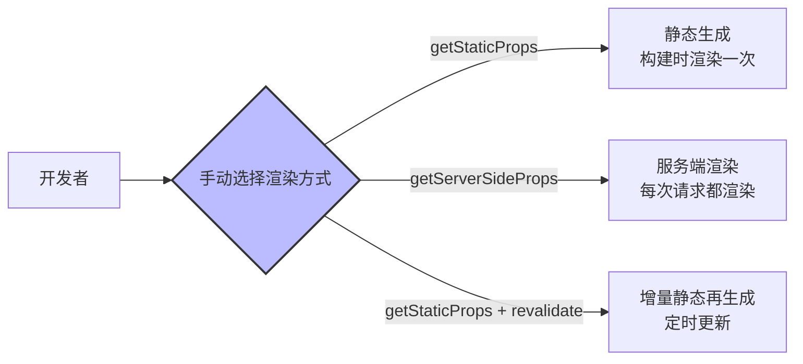
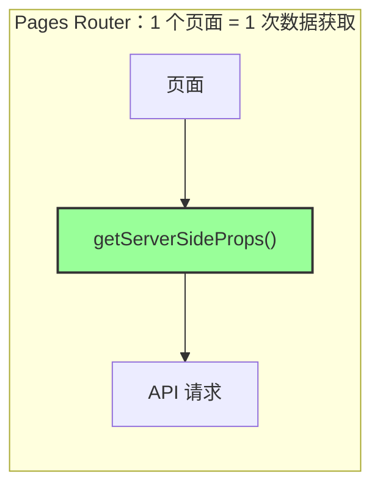
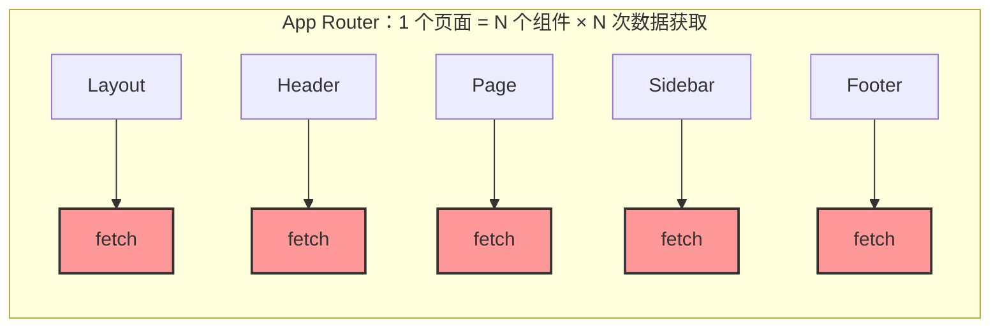
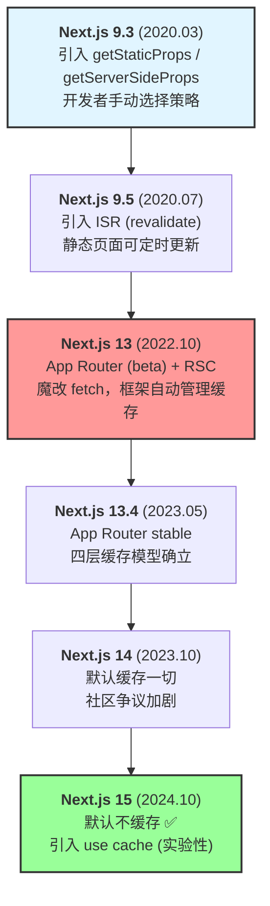
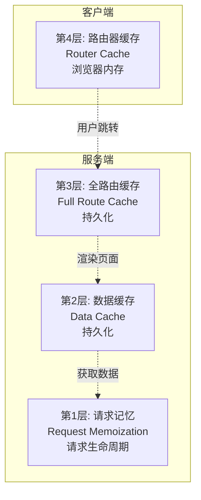
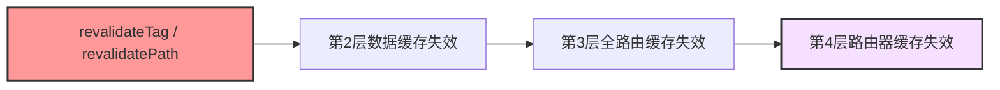
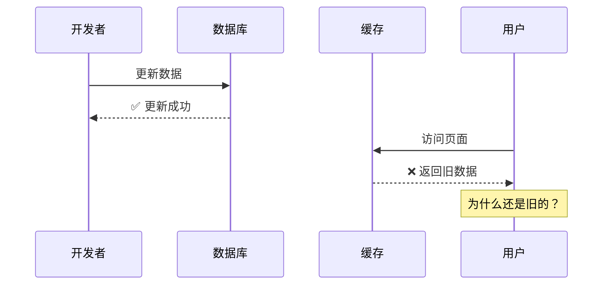
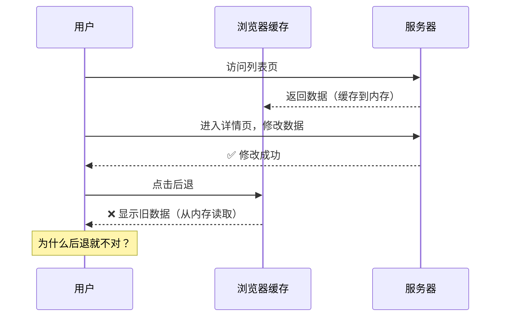
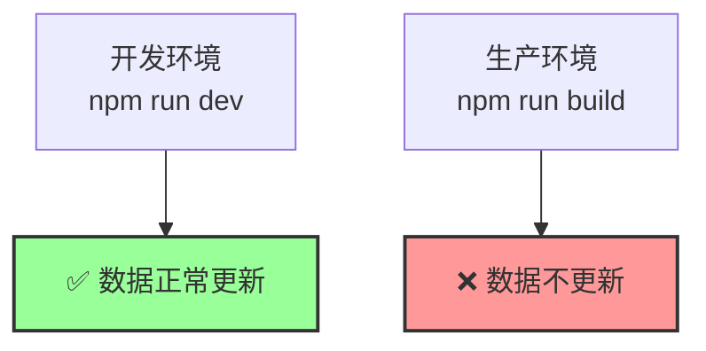

# Next.js 缓存机制 - 背景介绍

> 本系列基于 **Next.js 15+ (App Router)** 编写。

## 为什么要学 Next.js 缓存？

如果你用过 Next.js App Router，大概率遇到过这些场景：

- 数据库明明更新了，页面刷新还是旧数据
- 开发环境一切正常，部署到生产就出问题
- 点后退按钮，看到的是修改前的内容
- 明明加了 `no-store`，数据还是没更新

这些问题几乎都指向同一个根源：**没搞清楚 Next.js 的缓存机制**。

缓存是 App Router 中踩坑最多、最难调试的知识点。它不像路由或组件那样直观，出了问题也不会有明显的报错——数据就是静静地"不对"，让你不知道从哪里下手。

但反过来说，真正理解了缓存，你就掌握了 Next.js 性能优化的核心武器。合理的缓存策略可以让你的应用：

- 大幅减少数据库和 API 的请求次数
- 让静态内容直接从 CDN 返回，响应时间从几百毫秒降到个位数毫秒
- 在高并发场景下保持稳定，而不是让服务器被打垮

学好 Next.js 缓存，是从"能用"到"用好"的关键一步。

---

## Next.js 缓存的前世今生

在深入四层缓存之前，先回顾一下 Next.js 的缓存是怎么一步步走到今天这个局面的。这段历史能帮你理解：为什么缓存会变得这么复杂，以及 Vercel 做出每个设计决策背后的真实原因。

### Pages Router：开发者手动选择缓存策略

在 App Router 之前，Next.js 的缓存模型非常简单——**你选什么就是什么**。Pages Router 提供了三个明确的函数，每个对应一种渲染策略：

```typescript
// SSG - 构建时生成静态页面
export async function getStaticProps() {
  const data = await fetchData();
  return { props: { data } };
}

// SSR - 每次请求时在服务端渲染
export async function getServerSideProps(context) {
  const data = await fetchData();
  return { props: { data } };
}

// ISR - 增量静态再生成：静态页面 + 定时更新
export async function getStaticProps() {
  const data = await fetchData();
  return {
    props: { data },
    revalidate: 60, // 每 60 秒重新生成
  };
}
```



这个模型的优点是**心智负担极低**：用哪个函数就走哪条路，缓不缓存、缓存多久，全是你自己说了算。

### App Router：框架自动管理缓存策略

2022 年 10 月，Next.js 13 引入了 App Router，2023 年 5 月的 13.4 版本正式标记为 stable。这是一次架构级的重构——**React Server Components (RSC)** 成为默认渲染模型。

RSC 带来了一个根本性的变化：`getStaticProps` / `getServerSideProps` 被废弃了，数据获取直接写在组件里。每个组件都可以是 `async` 的，都可以独立 fetch 数据：

```typescript
// App Router：数据获取直接写在组件中
async function Header() {
  const site = await fetch("https://api.example.com/site-config");
  return <header>{site.name}</header>;
}

async function PostList() {
  const posts = await fetch("https://api.example.com/posts");
  return posts.map((p) => <article>{p.title}</article>);
}

async function Sidebar() {
  const tags = await fetch("https://api.example.com/tags");
  return tags.map((t) => <span>{t.name}</span>);
}
```

这种模式在工程上有明显的优势：**数据获取和 UI 渲染放在同一个组件里，局部性和内聚性极强**。

在 Pages Router 中，`getServerSideProps` 需要一次性获取整个页面所需的所有数据，然后通过 props 层层传递给子组件。这意味着一个顶层函数要了解所有子组件的数据需求，组件之间产生了隐式的耦合。而在 App Router 中，每个组件只关心自己需要的数据，删掉一个组件，它的数据获取逻辑也随之消失，不会留下任何残留代码。

但这种设计也带来了一个严重的问题：**服务端渲染的压力急剧增大**。

### 为什么 RSC 让缓存变得不可或缺？

在 Pages Router 时代，一个页面只有一个数据获取入口（`getServerSideProps` 或 `getStaticProps`）。但在 App Router 中，一个页面可能由十几个独立的服务端组件组成，每个组件都可能发起自己的数据请求。





如果不做缓存，每个用户的每次访问都会触发大量的服务端渲染和数据请求。对于 Vercel 这样按计算量计费的平台来说，这意味着巨大的基础设施成本；对于开发者来说，这意味着响应速度变慢、服务器账单飙升。

**这就是 Vercel 在 Next.js 13/14 中选择"默认缓存一切"这个激进策略的根本原因**——不是因为他们觉得缓存比新鲜度重要，而是因为 RSC 架构下，不缓存的代价太大了。

### 社区反弹与 Next.js 15 的修正

但"默认缓存一切"带来了大量的开发者困惑。Vercel 团队在 2024 年 10 月发布了 [Our Journey with Caching](https://nextjs.org/blog/our-journey-with-caching) 一文，坦诚承认了问题：

> fetch() 的默认行为偏向性能（默认缓存），但快速原型开发和高度动态的应用因此受损。对于不使用 fetch 的本地数据库访问，我们没有提供足够的控制手段。

随后 **Next.js 15**（2024 年 10 月）做出了关键调整——**默认不再缓存**：

| 行为 | Next.js 13/14（旧默认） | Next.js 15+（新默认） |
| --- | --- | --- |
| `fetch()` 请求 | `force-cache`（缓存） | `no-store`（不缓存） |
| GET Route Handlers | 缓存 | 不缓存 |
| 客户端路由器缓存 | 缓存 | 不缓存 |

同时引入了实验性的 `use cache` 指令，代表了缓存设计的未来方向——**需要缓存时显式声明，而不是默认缓存一切**：

```typescript
// Next.js 15+ 的未来方向：use cache 指令（实验性）
"use cache";

export default async function Page() {
  const data = await fetchData();
  return <div>{data.title}</div>;
}
```

### 为什么其他框架没有这个问题？

你可能会想：Nuxt、SvelteKit 也是文件系统路由，也支持服务端渲染，为什么只有 Next.js 的缓存这么复杂、这么有争议？

答案跟文件系统路由没有关系，根源在于 **RSC 的组件级数据获取** 和 **Vercel 选择了隐式缓存**。

Nuxt 3 基于 Vue，没有 RSC 的概念。它的 `useFetch` / `useAsyncData` 虽然写在组件里，但本质上还是页面级的数据获取，不会出现"一个页面十几个组件各自独立 fetch"的情况。更关键的是，Nuxt 不会偷偷帮你缓存——缓存策略完全由开发者通过 `getCachedData`、`dedupe` 等选项显式控制。SvelteKit 也类似，数据获取集中在 `load` 函数里，一个路由一个入口，心智模型非常清晰。

| | Next.js (App Router) | Nuxt 3 / SvelteKit |
|---|---|---|
| 数据获取位置 | 分散在每个组件中（RSC） | 集中在页面 / 路由级别 |
| 缓存策略 | 框架自动管理（13/14 默认缓存一切） | 开发者显式控制 |
| 原生 API | 魔改了 `fetch`，添加缓存语义 | 不修改原生 API |
| 服务端渲染粒度 | 组件级 | 页面级 |
| 缓存层数 | 四层，互相联动 | 通常一层，简单直接 |

所以争议的根源不是"缓存"本身，而是 **RSC 架构带来的复杂度 + 隐式缓存的设计选择**。Next.js 15 已经在修正方向（默认不缓存），Next.js 16 的 `use cache` 进一步走向显式声明——这和 Nuxt、SvelteKit 的理念正在趋同。

### 缓存演进时间线



### 为什么这段历史很重要？

因为你在网上搜到的 Next.js 缓存教程，很可能对应的是 13 或 14 的默认行为，和 15+ 完全相反。理解这条演进线，你就能：

- 一眼分辨一篇教程说的是哪个版本的行为
- 理解为什么同一段代码在不同版本表现不同
- 明白四层缓存模型的设计动机——它不是凭空冒出来的，而是 RSC 架构下的必然产物

---

## Next.js 的解决方案：四层缓存

面对"RSC 带来的服务端压力"和"数据必须保持新鲜"这两个相互矛盾的目标，Next.js 设计了一个**四层缓存模型**来应对不同粒度的缓存需求，每一层都有不同的作用和生命周期：



用户发起请求时，缓存从外到内逐层检查，命中就直接返回，不命中才往下走：

### 第 4 层：路由器缓存（Router Cache）

**位置**：浏览器内存 | **生命周期**：静态页面 5 分钟，动态页面 30 秒

用户在站内通过 `<Link>` 跳转时，Next.js 会把访问过的页面 RSC Payload 存在浏览器内存里。再次访问同一个页面时直接从内存读取，不请求服务器，实现瞬间跳转。

这也是最容易被忽视的一层——你更新了数据库，服务端缓存也清了，但用户点后退按钮看到的还是旧数据，就是它在作怪。

### 第 3 层：全路由缓存（Full Route Cache）

**位置**：服务端文件系统 | **生命周期**：持久化，直到重新构建或第 2 层失效

把整个页面的渲染结果（HTML + RSC Payload）缓存到服务端文件系统。多个用户访问同一个静态页面时，Next.js 直接返回缓存文件，完全跳过渲染过程。

这一层解决的是"服务端渲染太贵"的问题——渲染一次，所有人共享结果。

### 第 2 层：数据缓存（Data Cache）

**位置**：服务端文件系统 | **生命周期**：持久化，通过 `revalidateTag` / `revalidate` 失效

把 `fetch` 请求的响应结果缓存到服务端。跨请求、跨用户共享，1000 个用户访问同一个页面，数据库只被查询一次。

这是 Next.js 对原生 `fetch` 进行魔改后新增的能力，也是整个缓存体系的核心。第 2 层失效会连带触发第 3 层失效。

### 第 1 层：请求记忆（Request Memoization）

**位置**：服务端内存 | **生命周期**：单次请求结束即销毁

同一次请求中，多个组件调用了相同 URL 的 `fetch`，只真正发一次网络请求，其余组件复用结果。这是 App Router 不需要 prop drilling 的底层保障——每个组件可以放心地直接 fetch 自己需要的数据，不用担心重复请求。

这一层是独立的，不影响其他三层，也不会导致数据过期问题。

### 层间依赖关系



失效是从内往外传播的：清数据缓存会连带清掉页面缓存和客户端缓存。所以通常只需要调用一次 `revalidateTag`，三层缓存会依次失效。

## 常见问题场景

### 场景 1：数据库更新了，但页面没变



**原因**：可能是第 2 层（数据缓存）或第 3 层（全路由缓存）在作祟。

---

### 场景 2：刷新页面正常，点后退按钮就不对



**原因**：第 4 层（路由器缓存）在浏览器内存中缓存了旧数据。

---

### 场景 3：开发环境正常，生产环境就不对



**原因**：开发环境和生产环境的缓存策略不同，生产环境会启用第 3 层（全路由缓存）。

---

## 为什么要理解这四层？


### 掌握四层缓存后，你能做到：

1. ✅ **快速定位问题**：数据不更新？立刻知道是哪一层的问题
2. ✅ **精准控制缓存**：知道何时该缓存，何时不该缓存
3. ✅ **优化性能**：合理使用缓存，让应用飞起来
4. ✅ **避免踩坑**：不再被"数据不更新"困扰

---

## 四层缓存概览

| 层级        | 名称       | 位置       | 生命周期 | 主要作用           |
| ----------- | ---------- | ---------- | -------- | ------------------ |
| **第 1 层** | 请求记忆   | 服务端内存 | 单次请求 | 去重，避免重复请求 |
| **第 2 层** | 数据缓存   | 服务端文件 | 持久化   | 缓存 API 数据      |
| **第 3 层** | 全路由缓存 | 服务端文件 | 持久化   | 缓存渲染结果       |
| **第 4 层** | 路由器缓存 | 浏览器内存 | 会话期间 | 客户端导航优化     |

---

## 学习路径


接下来，我们将逐层深入，彻底搞懂 Next.js 的缓存机制！

---

## 核心建议

在学习过程中，请记住：

1. **不要害怕**：缓存虽然复杂，但有规律可循
2. **逐层理解**：一次只关注一层，不要混淆
3. **动手实践**：看完每一层后，写代码验证
4. **查表排查**：遇到问题时，按四层顺序排查

让我们开始吧！