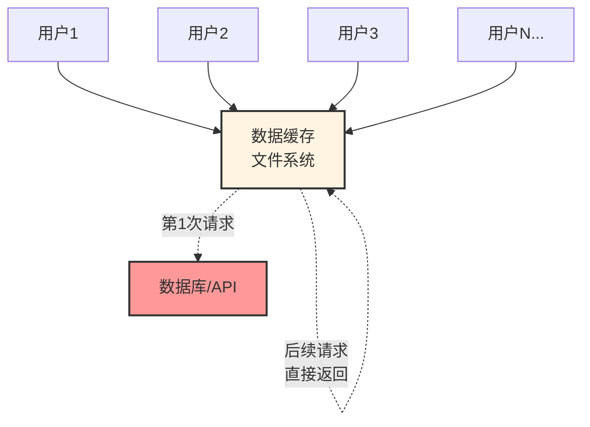
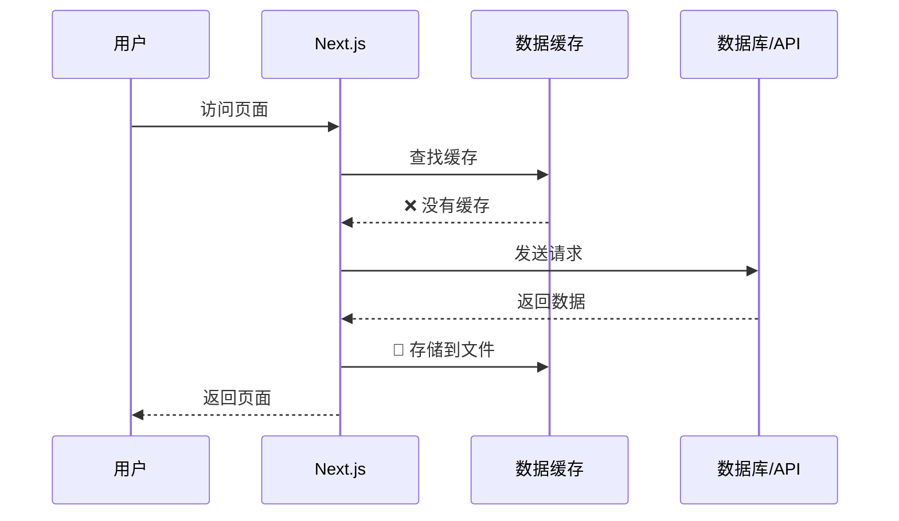
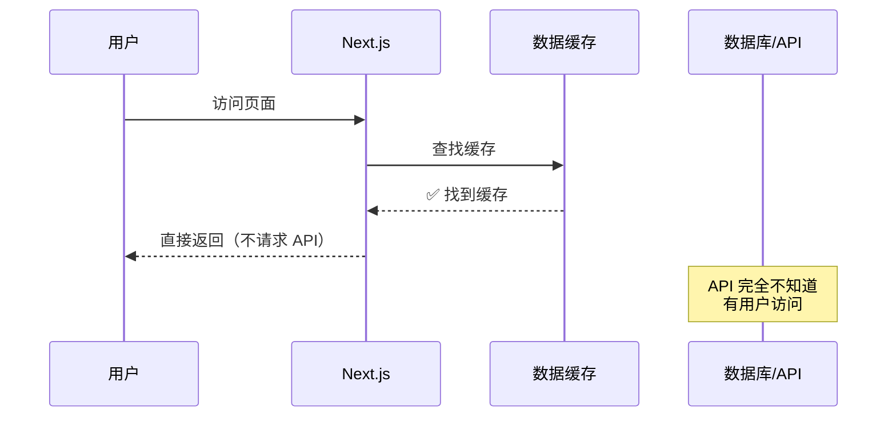
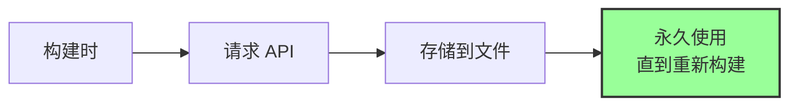
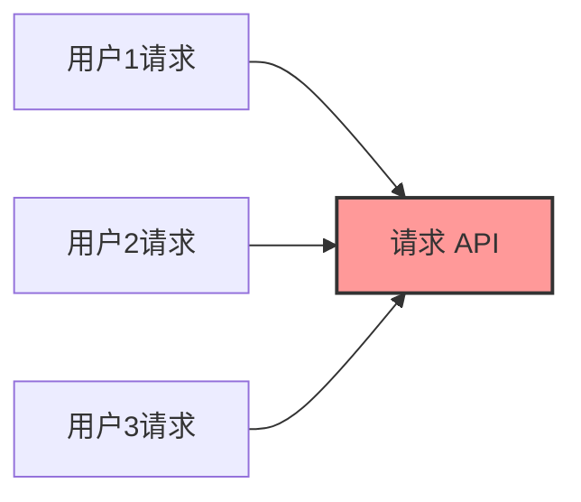
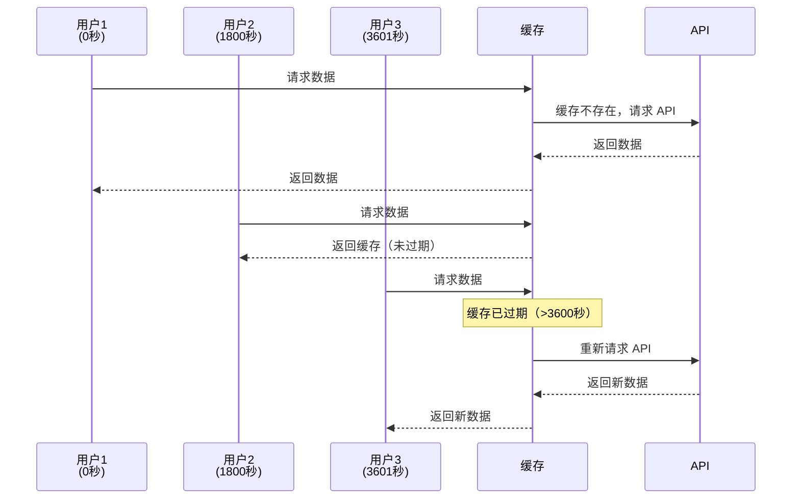
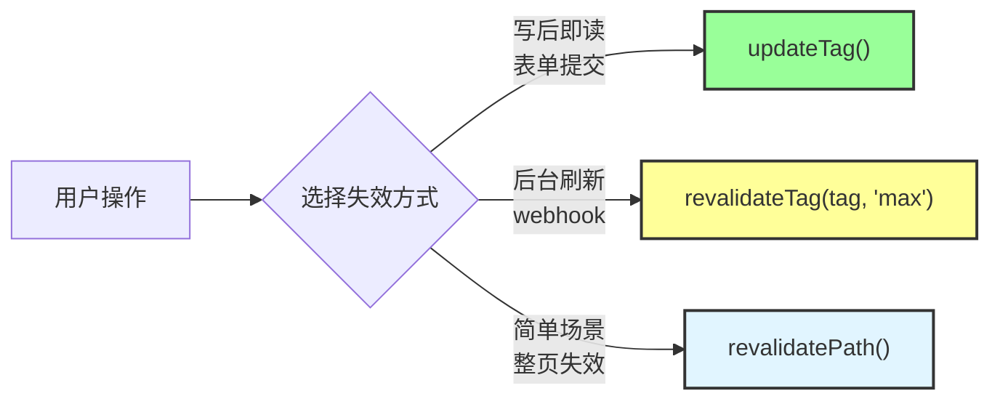
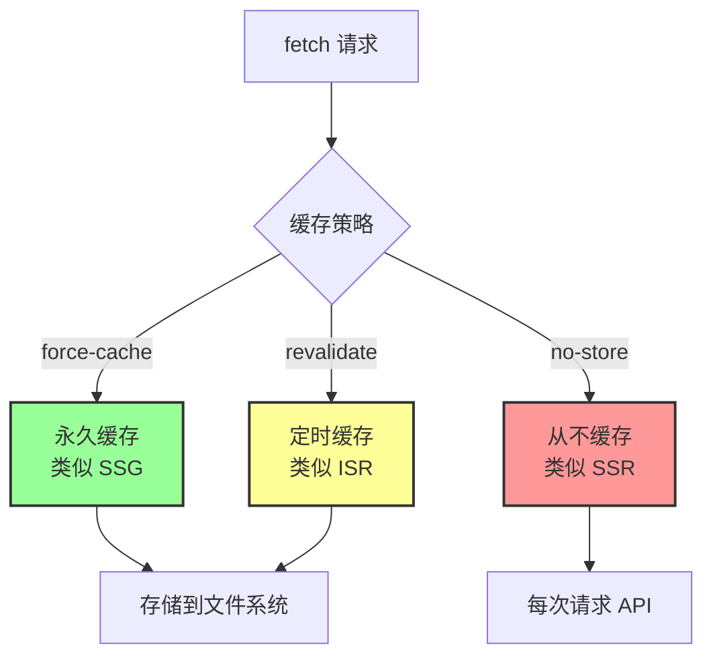

# 第 2 层：数据缓存 (Data Cache)

## 它要解决什么问题？

第 1 层请求记忆解决了"同一次请求内的重复调用"，但它有一个明确的边界：**请求结束就销毁，不同用户之间没有任何共享**。

这意味着如果你的博客有 1000 个用户同时访问文章列表页，即使每个用户的请求内部做了去重，数据库还是被查了 1000 次——每个用户一次。对于热门页面来说，这是不可接受的。

数据缓存（Data Cache）就是为了解决这个问题：**把 `fetch` 的响应结果持久化到服务端文件系统，跨请求、跨用户共享**。第一个用户访问时查一次数据库，结果存成文件，后面 999 个用户直接读文件返回，数据库完全不知道有人来过。

这也是 Next.js 对原生 `fetch` 进行"魔改"的核心产物——它在标准 `fetch` 上叠加了 `cache`、`next.revalidate`、`next.tags` 这些非标准选项，让一个普通的 HTTP 请求变成了带缓存语义的数据获取。

**这一层是大部分"数据不更新"问题的根源**。数据缓存是持久化的，不会因为重新部署而消失（除非你手动失效）。如果你忘了调用失效 API，页面就会一直返回旧数据，而且不会有任何报错——数据就是静静地"不对"。

## 基本信息

| 属性           | 值                                                                                     |
| -------------- | -------------------------------------------------------------------------------------- |
| **位置**       | 服务端（文件系统）                                                                     |
| **生命周期**   | 持久化——跨请求、跨用户共享，甚至跨部署（除非手动失效）                                 |
| **缓存内容**   | `fetch` 请求的响应数据（JSON），以 URL + 参数作为缓存键                                |
| **失效时机**   | `revalidate` 时间到期、`updateTag()` / `revalidateTag()` 被调用、或 `revalidatePath()` |
| **适用范围**   | `fetch` 自动生效；`axios`、`prisma` 等需要用 `use cache` 或 `unstable_cache` 包裹      |
| **跨请求共享** | ✅ 共享——所有用户的所有请求读取同一份缓存                                              |



---

## 工作原理

### 第一次请求



### 后续请求



---

## 三种缓存策略

### 1. 永久缓存

```typescript
// 显式启用永久缓存
const res = await fetch("https://api.example.com/posts", {
  cache: "force-cache",
});
```

> 注意：在 Next.js 13/14 中，`force-cache` 是 `fetch` 的默认行为。但在 Next.js 15+ 中，默认行为已改为 `no-store`（不缓存），需要显式声明 `force-cache` 才会启用永久缓存。

**效果**：类似 SSG（静态站点生成）



**适用场景**：

- ✅ 博客文章（很少更新）
- ✅ 产品文档
- ✅ 静态内容

---

### 2. 从不缓存（Next.js 15+ 默认）

```typescript
// Next.js 15+ 的默认行为，也可以显式声明
const res = await fetch("https://api.example.com/posts", {
  cache: "no-store",
});
```

**效果**：类似 SSR（服务端渲染）



**适用场景**：

- ✅ 实时数据（股票价格）
- ✅ 用户个人信息
- ✅ 购物车

---

### 3. 定时缓存（推荐）

```typescript
// ✅ 推荐：定时重新验证
const res = await fetch("https://api.example.com/posts", {
  next: { revalidate: 3600 }, // 每小时更新一次
});
```

**效果**：类似 ISR（增量静态再生成）



**适用场景**：

- ✅ 新闻列表（每小时更新）
- ✅ 产品列表（每天更新）
- ✅ 评论列表（每分钟更新）

---

## 代码示例

### 示例 1：博客文章列表（定时缓存）

```typescript
// app/blog/page.tsx
export default async function BlogPage() {
  // 每小时重新验证一次
  const res = await fetch("https://api.example.com/posts", {
    next: { revalidate: 3600 },
  });

  const posts = await res.json();

  return (
    <div>
      {posts.map((post) => (
        <article key={post.id}>
          <h2>{post.title}</h2>
          <p>{post.excerpt}</p>
        </article>
      ))}
    </div>
  );
}
```

---

### 示例 2：用户个人信息（从不缓存）

```typescript
// app/profile/page.tsx
export default async function ProfilePage() {
  // 每次都重新获取
  const res = await fetch("https://api.example.com/user/me", {
    cache: "no-store",
    headers: {
      Authorization: `Bearer ${token}`,
    },
  });

  const user = await res.json();

  return (
    <div>
      <h1>{user.name}</h1>
      <p>{user.email}</p>
    </div>
  );
}
```

---

### 示例 3：产品列表（永久缓存）

```typescript
// app/products/page.tsx
export default async function ProductsPage() {
  // Next.js 15+ 必须显式声明 force-cache（13/14 中这是默认行为）
  const res = await fetch("https://api.example.com/products", {
    cache: "force-cache",
  });

  const products = await res.json();

  return (
    <div>
      {products.map((product) => (
        <div key={product.id}>
          <h3>{product.name}</h3>
          <p>${product.price}</p>
        </div>
      ))}
    </div>
  );
}
```

---

## 缓存的标记方式：标签 vs 路径

知道了怎么缓存数据之后，下一个问题是：**当数据更新时，怎么告诉 Next.js "哪些缓存该失效"？**

Next.js 提供了两种标记缓存的方式，它们决定了你后续失效缓存时的精准度。

### 按标签标记（Tags）

在 `fetch` 时通过 `next.tags` 给缓存打标签。一个请求可以打多个标签，多个请求也可以共享同一个标签：

```typescript
// 文章列表——打 'posts' 标签
const posts = await fetch("https://api.example.com/posts", {
  next: { tags: ["posts"] },
});

// 单篇文章——同时打 'posts' 和 'post-123' 两个标签
const post = await fetch("https://api.example.com/posts/123", {
  next: { tags: ["posts", "post-123"] },
});

// 文章评论——打 'posts'、'post-123'、'comments' 三个标签
const comments = await fetch("https://api.example.com/posts/123/comments", {
  next: { tags: ["posts", "post-123", "comments"] },
});
```

失效时可以精准控制：

```typescript
updateTag("posts");       // 失效所有文章相关的缓存
updateTag("post-123");    // 只失效 ID 为 123 的文章及其评论
updateTag("comments");    // 只失效评论
```

### 按路径标记

不需要显式标记，直接通过页面路径来失效。Next.js 会失效该路径下所有关联的缓存：

```typescript
// 具体路径——直接传路径即可
revalidatePath("/blog");
revalidatePath("/blog/123");

// 动态路由——需要传第二个参数指定失效范围
revalidatePath("/blog/[slug]", "page");    // 失效所有匹配的页面
revalidatePath("/blog/[slug]", "layout");  // 失效所有匹配的页面及其共享布局
```

> 规则：如果路径包含动态段（如 `[slug]`），第二个参数 `'page'` 或 `'layout'` 是必需的。如果是具体的 URL（如 `/blog/123`），则不需要。

### 该用哪种？

**绝大多数情况下，优先使用标签。**

原因很简单：数据和页面不是一对一的关系。一份"文章列表"数据可能同时出现在首页、博客列表页、RSS 页面、搜索结果页。用标签的话 `updateTag('posts')` 一次搞定，用路径的话你得逐个列出每个受影响的页面——漏一个就是 bug，而且随着项目变大，受影响的页面只会越来越多。

标签是跟着数据走的，路径是跟着 UI 走的。数据结构比 UI 结构稳定得多，所以标签体系的维护成本远低于路径列表。

| 维度 | 标签（Tags）✅ 推荐 | 路径（Path） |
| --- | --- | --- |
| 精准度 | 高——可以只失效特定数据 | 低——整个页面的所有数据都失效 |
| 跨页面 | ✅ 一个标签可以关联多个页面的数据 | ❌ 只能按单个路径失效 |
| 维护成本 | 需要设计标签体系，但一劳永逸 | 简单直接，但页面多了容易遗漏 |
| 推荐场景 | 几乎所有场景 | 极简单的应用，数据和页面严格一一对应 |

> **标签不仅限于数据缓存。** 在 Next.js 16 中，`cacheTag()` 可以用在任何 `use cache` 标记的缓存单元上——不只是 `fetch` 请求，还包括整个页面、单个组件、甚至一个普通的 async 函数：
>
> ```typescript
> // 给 fetch 请求打标签（数据缓存）
> const res = await fetch("/api/posts", {
>   next: { tags: ["posts"] },
> });
>
> // 给 use cache 组件/函数打标签（Next.js 16+）
> import { cacheTag } from "next/cache";
>
> export async function PostList() {
>   "use cache";
>   cacheTag("posts");  // 标签可以用于组件级缓存
>
>   const posts = await db.post.findMany();
>   return posts.map((p) => <article>{p.title}</article>);
> }
> ```
>
> 这意味着 `updateTag('posts')` 或 `revalidateTag('posts', 'max')` 会同时失效所有打了 `'posts'` 标签的缓存——无论它是 fetch 请求、数据库查询还是整个组件的渲染结果。标签是贯穿整个缓存体系的统一失效机制。

---

## 手动失效缓存

Next.js 提供了三种手动失效缓存的 API，适用于不同场景：

### 方法 1：updateTag —— 写后即读（Server Action 专用）

`updateTag` 是 Next.js 16 新增的 API，专门用于 Server Action 中的"写后即读"场景：用户提交表单后，立刻看到最新数据，不会看到旧内容。

```typescript
// app/actions.ts
'use server';

import { updateTag } from 'next/cache';

export async function createPost(formData: FormData) {
  // 1. 创建文章
  await db.post.create({
    data: {
      title: formData.get('title'),
      content: formData.get('content'),
    },
  });

  // 2. 立即失效缓存——下次请求会等待新数据返回
  updateTag('posts');
}
```

**特点**：

- ✅ 立即失效，下次请求等待新数据（不会返回旧数据）
- ⚠️ 只能在 Server Action 中使用，不能在 Route Handler 中使用

---

### 方法 2：revalidateTag —— 后台刷新（推荐大多数场景）

`revalidateTag` 走的是 stale-while-revalidate 语义：先返回旧数据给用户（保证速度），同时在后台刷新缓存。下一个用户就能看到新数据。

```typescript
// app/actions.ts
'use server';

import { revalidateTag } from 'next/cache';

export async function createPost(formData: FormData) {
  await db.post.create({ data: { ... } });

  // 标记为过期，后台刷新
  revalidateTag('posts', 'max');
}
```

> **关于第二个参数**：`revalidateTag(tag)` 单参数形式在 Next.js 16 中已被废弃，现在必须传入第二个参数来指定缓存的生命周期策略（`cacheLife` profile）。
>
> 这个参数决定了"旧数据还能用多久"——在后台刷新完成之前，用户看到的是旧缓存（stale-while-revalidate）。Next.js 内置了以下 profile：
>
> | Profile | 含义 |
> | --- | --- |
> | `'max'` | 尽可能长时间使用旧缓存，后台刷新（推荐大多数场景） |
> | `'seconds'` | 秒级过期 |
> | `'minutes'` | 分钟级过期 |
> | `'hours'` | 小时级过期 |
> | `'days'` | 天级过期 |
> | `'weeks'` | 周级过期 |
>
> 也可以传入自定义对象 `{ expire: 0 }` 来立即过期（适用于 webhook 等需要立刻生效的场景）。大多数情况下用 `'max'` 就够了。

**特点**：

- ✅ 可以在 Server Action 和 Route Handler 中使用
- ✅ stale-while-revalidate：用户不用等待，先看到旧数据，后台刷新
- ✅ 适合 webhook、定时刷新等场景

---

### 方法 3：revalidatePath —— 按路径失效

```typescript
// app/actions.ts
"use server";

import { revalidatePath } from "next/cache";

export async function createPost(formData: FormData) {
  await db.post.create({
    data: {
      title: formData.get("title"),
      content: formData.get("content"),
    },
  });

  // 失效整个页面路径的缓存
  revalidatePath("/blog");
  revalidatePath("/");
}
```

**特点**：

- ⚠️ 粒度较粗——失效整个路径下的所有数据
- ✅ 简单场景下够用

---

### 三种失效 API 对比

| API | 使用场景 | 行为 | 粒度 | 可用位置 |
| --- | --- | --- | --- | --- |
| `updateTag(tag)` | 用户操作后立刻看到结果 | 立即失效，等待新数据 | 按标签 | Server Action |
| `revalidateTag(tag, profile)` | 后台刷新、webhook | stale-while-revalidate | 按标签 | Server Action + Route Handler |
| `revalidatePath(path)` | 简单场景 | 失效整个路径 | 按路径 | Server Action + Route Handler |



---

## 架构陷阱

### ⚠️ 非 fetch 请求不会自动缓存

```typescript
// ❌ 这些不会被缓存
import axios from "axios";
import { prisma } from "@/lib/prisma";

// 1. axios
const res = await axios.get("https://api.example.com/posts");

// 2. Prisma
const posts = await prisma.post.findMany();

// 3. 其他 HTTP 库
const res = await got("https://api.example.com/posts");
```

---

### ✅ 解决方案：使用 `use cache` 指令（Next.js 16+）或 `unstable_cache`

在 Next.js 16+ 中，推荐使用 `use cache` 指令来缓存非 fetch 的数据获取：

```typescript
import { prisma } from "@/lib/prisma";
import { cacheTag } from "next/cache";

// ✅ 使用 use cache 指令缓存数据库查询
export async function getPosts() {
  "use cache";
  cacheTag("posts");

  return await prisma.post.findMany();
}

// 使用
const posts = await getPosts();
```

如果你还在 Next.js 15 上，可以使用 `unstable_cache`：

```typescript
import { unstable_cache } from "next/cache";
import { prisma } from "@/lib/prisma";

// 包裹数据库查询
export const getPosts = unstable_cache(
  async () => {
    return await prisma.post.findMany();
  },
  ["posts"], // 缓存键
  {
    revalidate: 3600, // 每小时更新
    tags: ["posts"], // 标签
  }
);

// 使用
const posts = await getPosts();
```

---

## 常见问题

### Q1: 如何查看缓存是否生效？

**方法 1：查看日志**

```typescript
export default async function Page() {
  console.log("🔍 开始请求 API");

  const res = await fetch("https://api.example.com/posts", {
    next: { revalidate: 60 },
  });

  console.log("✅ 请求完成");

  return <div>...</div>;
}
```

**如果缓存生效**：

- 第 1 次访问：看到两条日志
- 第 2 次访问：看不到日志（使用缓存）

---

**方法 2：查看 .next 目录**

```bash
# 构建后查看缓存文件
npm run build

# 查看缓存目录
ls -la .next/cache/fetch-cache/
```

---

### Q2: 开发环境和生产环境的缓存行为一样吗？

**不一样！**

| 环境                           | 默认行为           |
| ------------------------------ | ------------------ |
| **开发环境** (`npm run dev`)   | 不缓存（方便调试） |
| **生产环境** (`npm run build`) | 完全缓存           |

**建议**：

- 开发时不用担心缓存
- 部署前一定要测试生产构建：`npm run build && npm start`

---

### Q3: 如何在整个页面禁用数据缓存？

```typescript
// app/page.tsx
export const dynamic = "force-dynamic";

export default async function Page() {
  // 这个页面的所有 fetch 都不会缓存
  const res = await fetch("https://api.example.com/posts");
  return <div>...</div>;
}
```

---

### Q4: revalidatePath、revalidateTag 和 updateTag 有什么区别？

| 特性       | revalidatePath    | revalidateTag          | updateTag              |
| ---------- | ----------------- | ---------------------- | ---------------------- |
| **粒度**   | 按页面路径        | 按数据标签             | 按数据标签             |
| **行为**   | 失效整个路径      | stale-while-revalidate | 立即失效，等待新数据   |
| **可用位置** | Server Action + Route Handler | Server Action + Route Handler | 仅 Server Action |
| **推荐度** | ⚠️ 简单场景       | ✅ 后台刷新            | ✅ 写后即读            |

**示例**：

```typescript
// revalidatePath：失效整个页面
revalidatePath("/blog");

// revalidateTag：后台刷新（stale-while-revalidate）
revalidateTag("posts", "max");

// updateTag：立即失效（写后即读）
updateTag("posts");
```

---

## 实战案例

### 案例：博客系统

```typescript
// lib/api.ts
export async function getPosts() {
  const res = await fetch('https://api.example.com/posts', {
    next: {
      revalidate: 3600, // 每小时更新
      tags: ['posts'] // 打标签
    }
  });
  return res.json();
}

export async function getPost(id: string) {
  const res = await fetch(`https://api.example.com/posts/${id}`, {
    next: {
      revalidate: 3600,
      tags: ['posts', `post-${id}`] // 多个标签
    }
  });
  return res.json();
}

// app/actions.ts
'use server';

import { updateTag } from 'next/cache';

export async function createPost(formData: FormData) {
  // 1. 创建文章
  await db.post.create({ data: { ... } });

  // 2. 立即失效列表缓存（用户提交后立刻看到新文章）
  updateTag('posts');
}

export async function updatePost(id: string, formData: FormData) {
  // 1. 更新文章
  await db.post.update({ where: { id }, data: { ... } });

  // 2. 立即失效列表和详情缓存
  updateTag('posts');
  updateTag(`post-${id}`);
}
```

如果是在 Route Handler 中（比如接收 webhook），则使用 `revalidateTag`：

```typescript
// app/api/webhook/route.ts
import { revalidateTag } from 'next/cache';

export async function POST(request: Request) {
  const { slug } = await request.json();

  // 后台刷新，走 stale-while-revalidate
  revalidateTag('posts', 'max');
  revalidateTag(`post-${slug}`, 'max');

  return Response.json({ revalidated: true });
}
```

---

## 总结

**数据缓存（Data Cache）** 是 Next.js 缓存的第二层：



**核心要点**：

- ✅ 持久化缓存，跨请求、跨用户共享
- ✅ 三种策略：永久（`force-cache`）、从不（`no-store`，Next.js 15+ 默认）、定时（`revalidate`）
- ✅ 使用 `updateTag` 实现写后即读，使用 `revalidateTag(tag, 'max')` 实现后台刷新
- ⚠️ 只对 `fetch` 自动生效，其他数据源需要 `use cache` 或 `unstable_cache`

**下一步**：了解第 3 层 - 全路由缓存（Full Route Cache），它会缓存整个页面的渲染结果。
