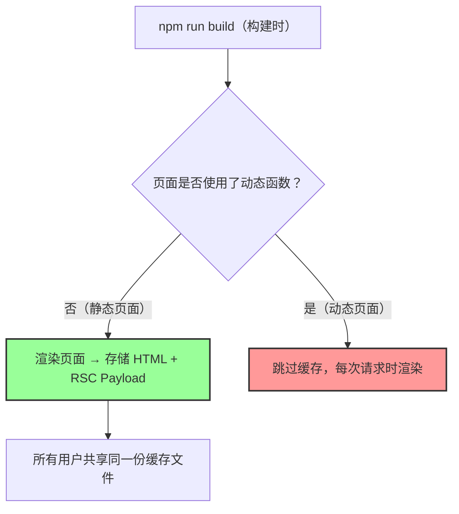
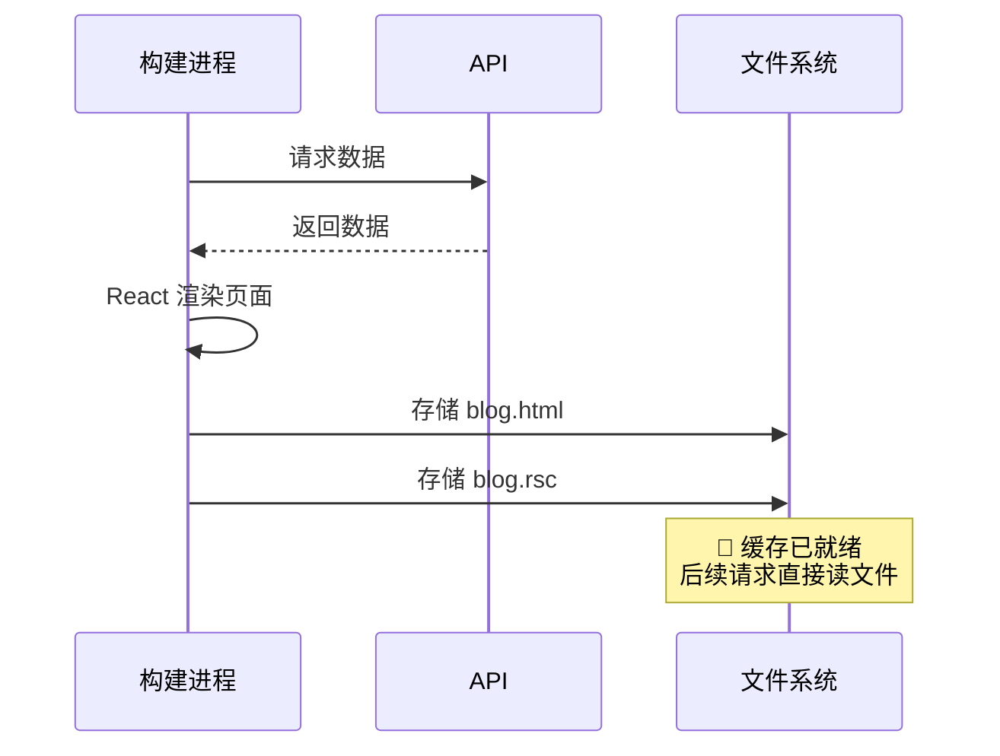
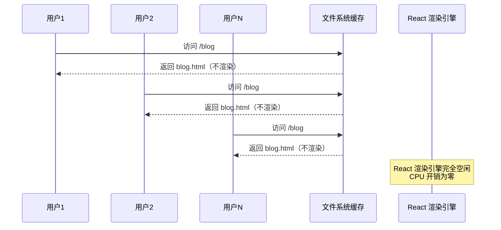
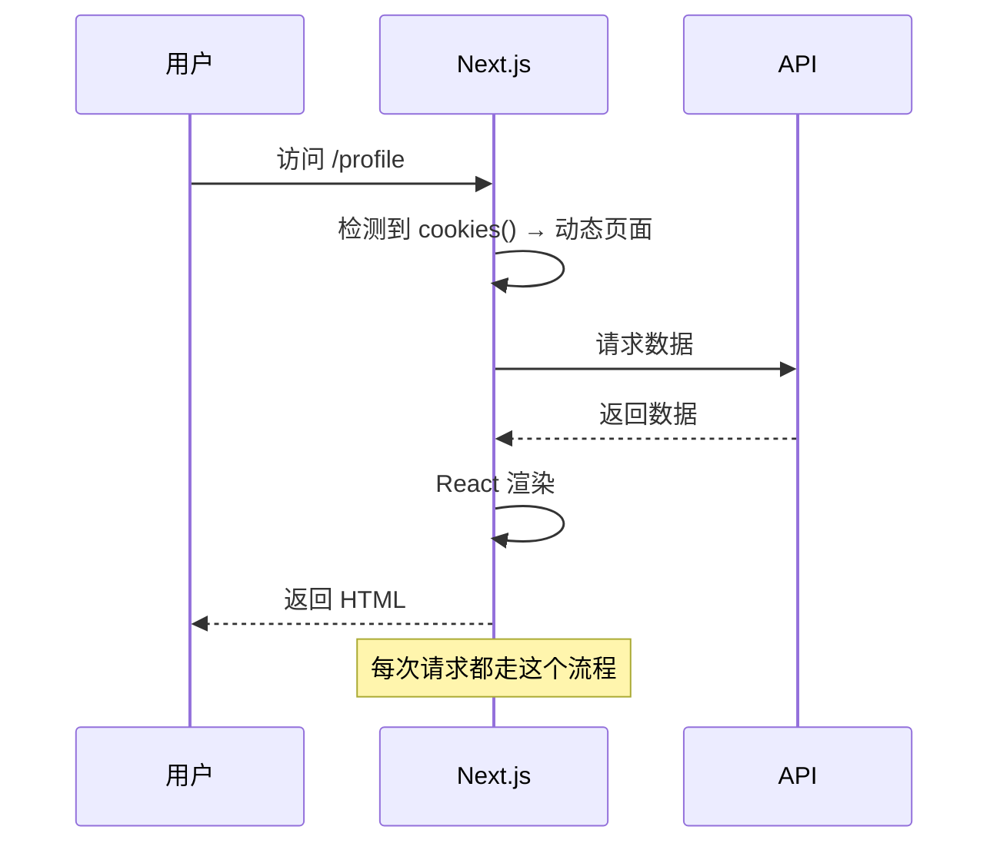
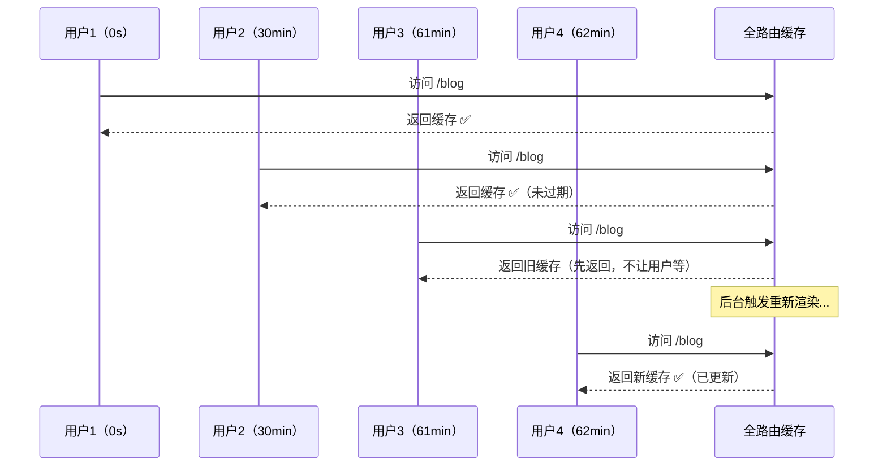
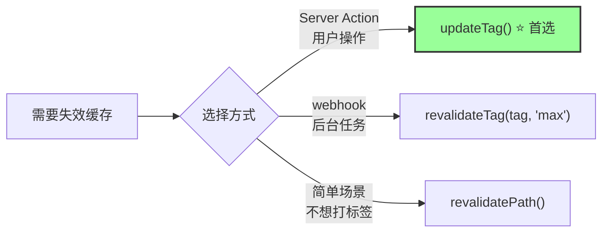
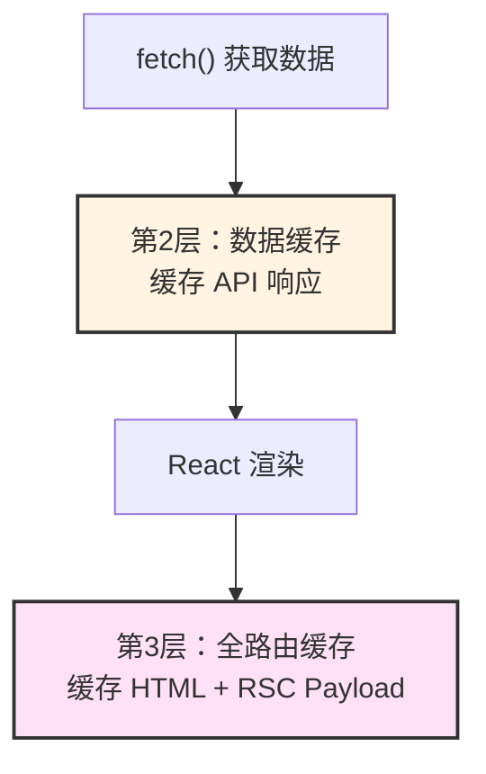
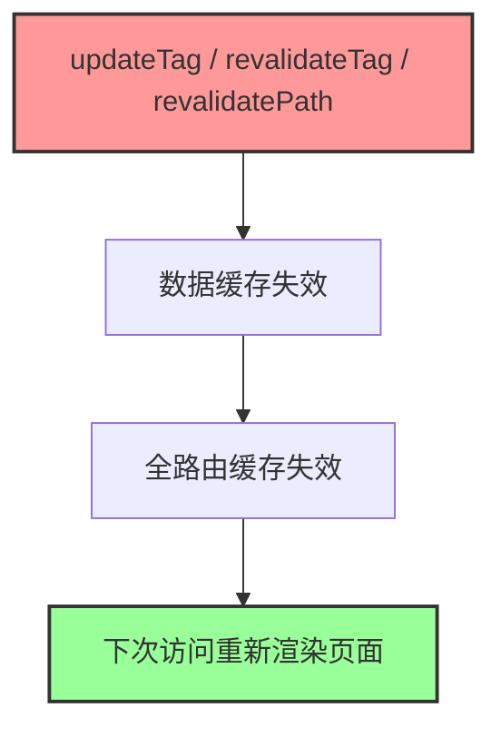

# 第 3 层：全路由缓存 (Full Route Cache)

## 它要解决什么问题？

前两层缓存解决的是"数据"层面的问题——请求记忆避免重复获取数据，数据缓存让数据跨请求共享。但即使数据已经缓存了，Next.js 仍然需要在每次请求时执行 React 渲染：把数据 + 组件树转换成 HTML 和 RSC Payload。

渲染是有 CPU 成本的。一个复杂页面的 React 渲染可能需要几十甚至上百毫秒。如果页面内容本身不会频繁变化（比如博客文章、产品列表、文档页面），每次请求都重新渲染就是纯粹的浪费。

全路由缓存（Full Route Cache）解决的就是这个问题：**把整个页面的渲染结果缓存起来，下次访问直接返回缓存文件，完全跳过 React 渲染过程**。1000 个用户访问同一个博客页面，服务端只渲染一次，剩下 999 次直接返回文件。

如果你熟悉传统的 SSG（Static Site Generation），全路由缓存本质上就是 SSG 在 App Router 中的延续——只不过它现在和数据缓存联动，可以通过 `revalidateTag` 按需更新，而不是每次都要重新构建整个站点。

## 基本信息

| 属性           | 值                                                                                     |
| -------------- | -------------------------------------------------------------------------------------- |
| **位置**       | 服务端（文件系统）                                                                     |
| **生命周期**   | 持久化——直到重新构建（`npm run build`）或数据缓存失效触发重新渲染                      |
| **缓存内容**   | RSC Payload（React 服务端组件的序列化数据）+ HTML                                      |
| **失效时机**   | 重新部署、`revalidatePath` / `revalidateTag` 触发数据缓存失效、`revalidate` 时间到期   |
| **适用范围**   | 仅限静态页面——不使用动态函数（`cookies()`、`headers()`、`searchParams`）的页面          |
| **开发环境**   | ❌ 不生效——`npm run dev` 下每次请求都会重新渲染，全路由缓存只在生产环境生效            |

> ⚠️ 这是最容易让人困惑的一层：开发环境一切正常，部署到生产后数据就"不更新"了——因为开发环境根本没有全路由缓存，而生产环境默认会缓存所有静态页面。

---

## 直观理解



构建完成后，你可以在构建日志中直接看到哪些页面被缓存了：

```bash
npm run build
```

```
Route (app)                              Size     First Load JS
┌ ○ /                                    5 kB       87.2 kB
├ ○ /blog                                3 kB       85.2 kB
├ ƒ /profile                             2 kB       84.2 kB
└ ○ /about                               1 kB       83.2 kB

○  (Static)   构建时渲染，结果被全路由缓存
ƒ  (Dynamic)  每次请求时渲染，不缓存
```

- `○` 表示静态页面——构建时渲染一次，之后所有请求直接返回缓存
- `ƒ` 表示动态页面——每次请求都会重新渲染

这两个符号是判断全路由缓存是否生效的最直接方式。如果你期望一个页面是动态的，但构建日志显示 `○`，说明 Next.js 认为它是静态的，会被缓存。

---

## 工作原理

### 静态页面（会被缓存）

```typescript
// app/blog/page.tsx
export default async function BlogPage() {
  // 没有使用动态函数（cookies、headers、searchParams）
  const res = await fetch("https://api.example.com/posts", {
    next: { revalidate: 3600, tags: ["posts"] },
  });

  const posts = await res.json();

  return (
    <div>
      {posts.map((post) => (
        <article key={post.id}>
          <h2>{post.title}</h2>
        </article>
      ))}
    </div>
  );
}
```

**构建时**：



**用户访问时**：



---

### 动态页面（不会被缓存）

使用了动态函数的页面会被标记为动态，每次请求都重新渲染：

```typescript
// app/profile/page.tsx
import { cookies } from "next/headers";

export default async function ProfilePage() {
  // 使用了动态函数 → 页面变成动态的
  const token = (await cookies()).get("token")?.value;

  const res = await fetch("https://api.example.com/user/me", {
    headers: { Authorization: `Bearer ${token}` },
  });

  const user = await res.json();

  return <div>{user.name}</div>;
}
```



---

## 什么会让页面变成动态的？

以下任何一种情况都会让页面跳过全路由缓存，变成每次请求都渲染：

### 1. 使用动态函数

```typescript
// cookies() — Next.js 15+ 是异步的
import { cookies } from "next/headers";
const token = (await cookies()).get("token");

// headers() — Next.js 15+ 是异步的
import { headers } from "next/headers";
const userAgent = (await headers()).get("user-agent");

// searchParams（Page 组件的 props）
export default async function Page({
  searchParams,
}: {
  searchParams: Promise<{ q: string }>;
}) {
  const { q } = await searchParams;
}
```

> 注意：Next.js 15 将 `cookies()`、`headers()`、`searchParams` 改为了异步 API，需要 `await`。如果你看到不带 `await` 的写法，那是 13/14 的旧语法。

### 2. 动态路由没有 `generateStaticParams`

```typescript
// app/posts/[id]/page.tsx
// 没有 generateStaticParams → 动态
export default async function PostPage({
  params,
}: {
  params: Promise<{ id: string }>;
}) {
  const { id } = await params;
  const post = await getPost(id);
  return <div>{post.title}</div>;
}
```

### 3. 显式配置 `dynamic = 'force-dynamic'`

```typescript
export const dynamic = "force-dynamic";

export default async function Page() {
  // 即使没有动态函数，也会每次渲染
}
```

### 4. 在 Next.js 15+ 中使用未缓存的 fetch

```typescript
// Next.js 15+ 默认 fetch 不缓存（no-store）
// 如果页面中所有 fetch 都没有显式缓存，页面可能被判定为动态
const res = await fetch("https://api.example.com/data");
```

---

## 如何控制全路由缓存？

### 让页面被缓存（静态化）

**方法 1：使用 `revalidate` 配置**

```typescript
// app/blog/page.tsx
// 页面级别的 revalidate：每小时重新生成
export const revalidate = 3600;

export default async function BlogPage() {
  const res = await fetch("https://api.example.com/posts");
  const posts = await res.json();
  return <div>...</div>;
}
```

**方法 2：在 fetch 中声明缓存**

```typescript
// 显式声明 force-cache（Next.js 15+ 需要显式声明）
const res = await fetch("https://api.example.com/posts", {
  cache: "force-cache",
});
```

**方法 3：使用 `generateStaticParams` 预渲染动态路由**

```typescript
// app/posts/[id]/page.tsx
export async function generateStaticParams() {
  const posts = await fetch("https://api.example.com/posts").then((r) =>
    r.json()
  );
  // 预渲染前 50 篇文章
  return posts.slice(0, 50).map((post) => ({ id: String(post.id) }));
}

export default async function PostPage({
  params,
}: {
  params: Promise<{ id: string }>;
}) {
  const { id } = await params;
  const post = await getPost(id);
  return <div>{post.title}</div>;
}
```

**方法 4：`use cache` 指令（Next.js 15 实验性 / 16 稳定）**

```typescript
// 整个页面声明为可缓存
"use cache";

import { cacheLife } from "next/cache";

export default async function BlogPage() {
  cacheLife("hours"); // 缓存 1 小时
  const posts = await getPosts();
  return <div>...</div>;
}
```

---

### 让页面不被缓存（动态化）

**方法 1：使用动态函数**

```typescript
import { cookies } from "next/headers";

export default async function Page() {
  await cookies(); // 读取 cookies，页面变成动态的
  // ...
}
```

**方法 2：配置 `dynamic`**

```typescript
export const dynamic = "force-dynamic";
```

**`dynamic` 配置选项**：

| 值                | 说明                                       |
| ----------------- | ------------------------------------------ |
| `'auto'`          | 默认，Next.js 自动判断页面是静态还是动态   |
| `'force-dynamic'` | 强制动态——每次请求都渲染，跳过全路由缓存   |
| `'force-static'`  | 强制静态——即使有动态函数也尝试静态化       |
| `'error'`         | 如果检测到动态函数就报错（用于确保页面静态）|

---

## 定时重新验证（Time-based Revalidation）

对于"内容偶尔更新"的页面，可以用 `revalidate` 实现定时更新：

```typescript
// app/blog/page.tsx
export const revalidate = 3600; // 3600 秒 = 1 小时

export default async function BlogPage() {
  const res = await fetch("https://api.example.com/posts");
  const posts = await res.json();
  return <div>...</div>;
}
```

**Stale-While-Revalidate 行为**：



注意用户3拿到的仍然是旧数据——这就是 stale-while-revalidate 策略：先返回旧数据保证速度，后台异步更新，下一个用户才能拿到新数据。

---

## 手动失效缓存

全路由缓存依赖数据缓存。当数据缓存失效时，全路由缓存也会跟着失效——你通常不需要单独管理全路由缓存，只要正确失效数据缓存就行：


Next.js 提供了三种失效 API，它们都会同时触发数据缓存和全路由缓存的失效：

### 方法 1：`updateTag` —— 写后即读（Server Action 首选）

`updateTag` 是 Next.js 16 新增的 API，专为 Server Action 设计。它的特点是**立即失效**：调用后，当前请求就能拿到最新数据，用户不会看到旧内容。

```typescript
// app/actions.ts
"use server";

import { updateTag } from "next/cache";

export async function createPost(formData: FormData) {
  // 1. 写入数据库
  await db.post.create({
    data: { title: formData.get("title") as string },
  });

  // 2. 立即失效——用户提交后马上看到新文章
  updateTag("posts");
}
```

**为什么优先用 `updateTag`？** 因为用户在表单提交后期望立刻看到结果。如果用 `revalidateTag`，用户提交后看到的还是旧数据（stale-while-revalidate），需要再刷新一次才能看到新内容——这个体验很差。

### 方法 2：`revalidateTag` —— 后台刷新（webhook / 定时任务）

`revalidateTag` 采用 stale-while-revalidate 策略：先返回旧数据，后台异步更新，下一个请求才拿到新数据。适合不需要立即看到结果的场景。

```typescript
// app/api/webhook/route.ts
import { revalidateTag } from "next/cache";

export async function POST(request: Request) {
  const payload = await request.json();

  // CMS 内容更新时触发
  revalidateTag("posts", "max");

  return Response.json({ revalidated: true });
}
```

> 注意：Next.js 16 要求 `revalidateTag` 传入第二个参数（cacheLife profile），推荐使用 `'max'`。单参数形式 `revalidateTag('posts')` 已被废弃。

### 方法 3：`revalidatePath` —— 按路径失效

不需要显式打标签，直接通过页面路径来失效。适合简单场景或需要一次性失效整个页面的情况：

```typescript
"use server";

import { revalidatePath } from "next/cache";

export async function createPost(formData: FormData) {
  await db.post.create({ data: { ... } });

  // 失效指定路径的全路由缓存
  revalidatePath("/blog");                 // 失效 /blog 页面
  revalidatePath("/blog/[slug]", "page");  // 失效所有 /blog/xxx 页面
  revalidatePath("/", "layout");           // 失效整个站点
}
```

`revalidatePath` 的第二个参数：

| 值         | 说明                                           |
| ---------- | ---------------------------------------------- |
| 不传       | 失效该精确路径                                 |
| `'page'`   | 失效匹配该模式的所有页面（用于动态路由）       |
| `'layout'` | 失效该路径及其所有子路径                       |

### 三种 API 对比

| API | 使用场景 | 行为 | 可用位置 |
| --- | --- | --- | --- |
| `updateTag(tag)` | 用户操作后立刻看到结果 | 立即失效，等待新数据 | Server Action |
| `revalidateTag(tag, profile)` | 后台刷新、webhook | stale-while-revalidate | Server Action + Route Handler |
| `revalidatePath(path)` | 简单场景、整页失效 | 失效整个路径 | Server Action + Route Handler |



> 在 Server Action 中，优先使用 `updateTag`。在 Route Handler 或外部 webhook 中，使用 `revalidateTag`。`revalidatePath` 作为兜底方案，适合不想管理标签的简单场景。

---

## 查看缓存文件

构建后可以直接查看 `.next` 目录来确认缓存状态：

```bash
ls -la .next/server/app/

# 静态页面（被全路由缓存）
blog.html          # HTML 缓存
blog.rsc           # RSC Payload 缓存

# 动态页面（没有缓存文件）
profile.js         # 只有运行时代码
```

有 `.html` 和 `.rsc` 文件的就是被全路由缓存的静态页面，只有 `.js` 文件的就是动态页面。

---

## 与其他层的关系

全路由缓存不是独立工作的，它和数据缓存（第 2 层）紧密联动：

**构建时：数据缓存 → 全路由缓存**



**失效时：数据缓存失效 → 全路由缓存跟着失效**



**关键理解**：全路由缓存是数据缓存的"下游"。数据变了 → 渲染结果自然也要变。所以你通常不需要单独管理全路由缓存，只要正确管理数据缓存的失效（用 `updateTag` 或 `revalidateTag`），全路由缓存会自动跟着更新。

---

## 常见问题

### Q1: 为什么开发环境正常，生产环境数据不更新？

这是全路由缓存最经典的坑。

**原因**：`npm run dev` 下全路由缓存不生效，每次请求都重新渲染。但 `npm run build` + `npm start` 后，静态页面会被缓存，数据不会自动更新。

**解决方案**：

```typescript
// 方案 1（最推荐）：使用 tags + updateTag 按需失效
const res = await fetch("https://api.example.com/posts", {
  next: { tags: ["posts"] },
  cache: "force-cache",
});
// 数据变更时在 Server Action 中调用 updateTag("posts")

// 方案 2：添加 revalidate 定时更新
export const revalidate = 60; // 每分钟检查更新

// 方案 3：强制动态（放弃缓存）
export const dynamic = "force-dynamic";
```

### Q2: `generateStaticParams` 没有覆盖到的路由会怎样？

默认情况下，未被 `generateStaticParams` 覆盖的路由会在首次访问时动态渲染，然后缓存结果供后续访问使用。

你可以通过 `dynamicParams` 控制这个行为：

```typescript
// 只允许 generateStaticParams 返回的路由，其他返回 404
export const dynamicParams = false;

export async function generateStaticParams() {
  return [{ id: "1" }, { id: "2" }, { id: "3" }];
}
```

### Q3: 全路由缓存和传统 SSG 有什么区别？

| 特性         | 传统 SSG（Pages Router）         | 全路由缓存（App Router）                |
| ------------ | -------------------------------- | ---------------------------------------- |
| **触发方式** | `getStaticProps`                 | 自动判断（无动态函数即静态）             |
| **更新方式** | ISR（`revalidate`）或重新构建    | `revalidateTag` / `revalidatePath` / ISR |
| **粒度**     | 页面级                           | 页面级，但数据缓存可以更细粒度控制       |
| **联动**     | 独立                             | 与数据缓存联动，数据失效自动触发重渲染   |

---

## 实战建议

### 博客 / 文档站（内容不常更新）

```typescript
// 使用 tags + revalidate 双保险
export const revalidate = 3600; // 兜底：最多 1 小时更新

export default async function BlogPage() {
  const res = await fetch("https://api.example.com/posts", {
    next: { tags: ["posts"] },
    cache: "force-cache",
  });
  const posts = await res.json();
  return <div>...</div>;
}

// 发布新文章时主动失效
// app/actions.ts
"use server";
import { updateTag } from "next/cache";

export async function publishPost() {
  await db.post.create({ ... });
  updateTag("posts"); // 立即失效，用户马上看到新文章
}
```

### 管理后台（数据频繁变化）

```typescript
// 直接放弃全路由缓存
export const dynamic = "force-dynamic";

export default async function AdminPage() {
  const res = await fetch("https://api.example.com/stats");
  const stats = await res.json();
  return <div>...</div>;
}
```

### 电商网站（混合策略）

```typescript
// 产品列表：静态 + 按需更新
// app/products/page.tsx
export default async function ProductsPage() {
  const res = await fetch("https://api.example.com/products", {
    next: { tags: ["products"], revalidate: 3600 },
    cache: "force-cache",
  });
  const products = await res.json();
  return <div>...</div>;
}

// 购物车：动态（每个用户不同）
// app/cart/page.tsx
import { cookies } from "next/headers";

export default async function CartPage() {
  const token = (await cookies()).get("token")?.value;
  const res = await fetch("https://api.example.com/cart", {
    headers: { Authorization: `Bearer ${token}` },
  });
  const cart = await res.json();
  return <div>...</div>;
}
```

---

## 总结

全路由缓存是四层缓存中"最安静"的一层——你不需要写任何代码来启用它，Next.js 会在构建时自动判断哪些页面可以缓存。但也正因为它的"自动"，才容易让人忽视它的存在，直到生产环境出了问题才意识到。

核心要点：

- ✅ 缓存整个页面的渲染结果（HTML + RSC Payload），省掉 React 渲染的 CPU 开销
- ✅ 只在生产环境生效，开发环境每次都重新渲染
- ✅ 构建日志中 `○` = 静态（被缓存），`ƒ` = 动态（不缓存）
- ✅ 通过数据缓存联动失效——管好 `updateTag` / `revalidateTag`，全路由缓存会自动更新
- ⚠️ Next.js 15+ 中 `cookies()`、`headers()`、`searchParams` 是异步的，需要 `await`
- ⚠️ 开发环境和生产环境行为不同，务必在 `npm run build` + `npm start` 下测试缓存行为

**下一步**：了解第 4 层 - 路由器缓存（Router Cache），它在浏览器端缓存页面导航数据，是"点后退看到旧数据"的元凶。
