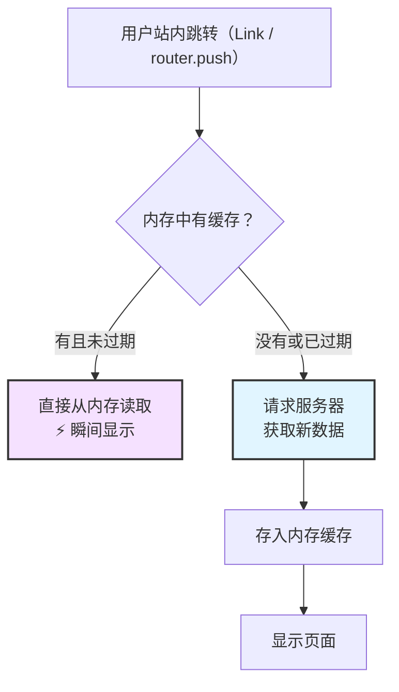
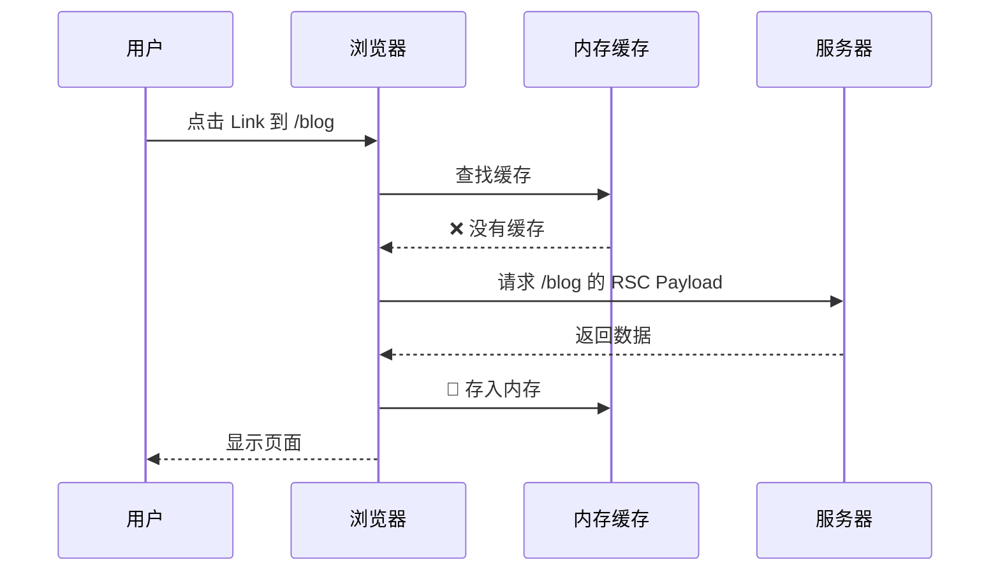
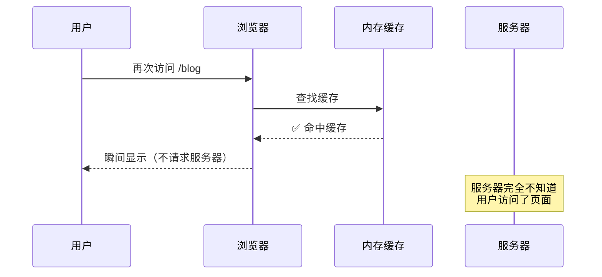
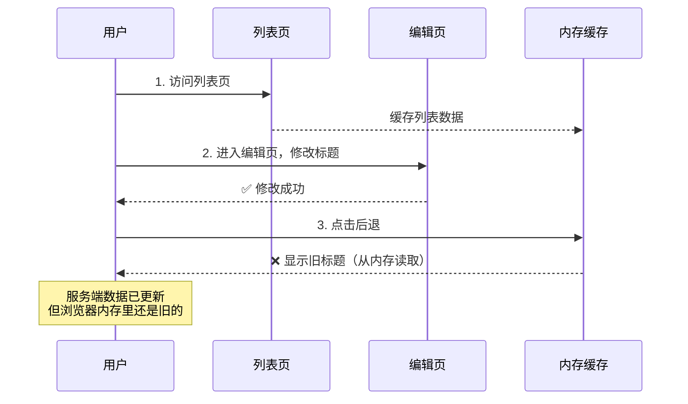
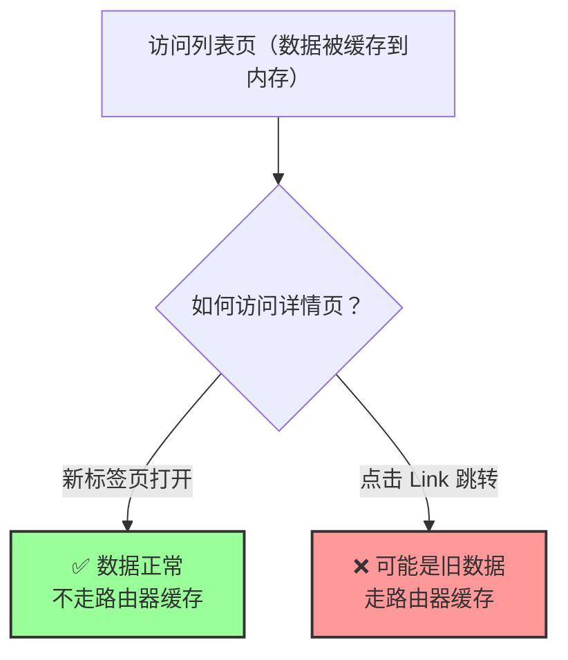
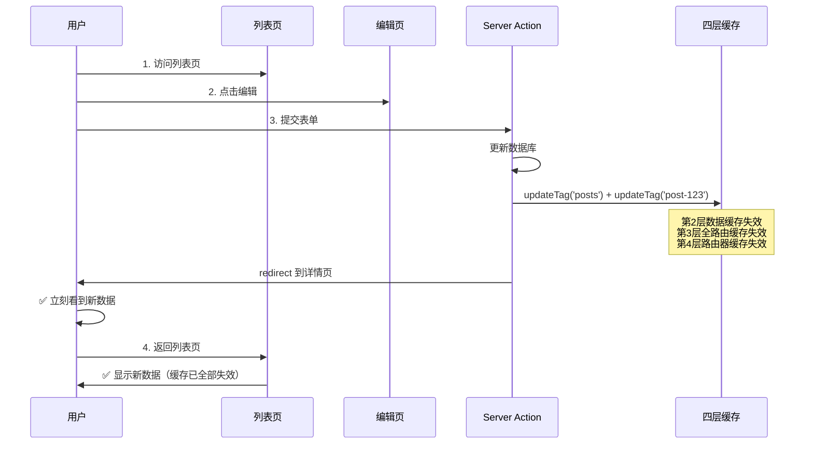

# 第 4 层：路由器缓存 (Router Cache)

## 它要解决什么问题？

前三层缓存都在服务端，解决的是"减少服务器压力"的问题。但还有一个场景它们管不到：**用户在站内来回跳转时的体验**。

用户从列表页点进详情页，再点后退回到列表页——如果每次跳转都要向服务器发请求、等待渲染、返回 HTML，体验就和传统的多页应用没区别了。尤其是后退操作，用户期望的是"瞬间回到刚才的页面"，而不是看到一个 loading。

路由器缓存（Router Cache）解决的就是这个问题：**把用户访问过的页面的 RSC Payload 存在浏览器内存里，站内跳转时直接从内存读取，不请求服务器，实现瞬间导航**。

你可以把它理解成**客户端的页面快照**——用户浏览过的每个页面都在内存里留了一份"照片"，点后退或重新访问时直接展示这张照片。

但这也带来了一个问题：如果数据在服务端已经更新了，但浏览器内存里还是旧的快照，用户看到的就是过期数据。而且这一层在服务端是完全不可见的——你在服务端做的所有失效操作（`updateTag`、`revalidateTag`）都不会直接清掉浏览器内存里的缓存。

## 基本信息

| 属性           | 值                                                                                         |
| -------------- | ------------------------------------------------------------------------------------------ |
| **位置**       | 客户端（浏览器内存）                                                                       |
| **生命周期**   | Next.js 15+：默认 0（不缓存）；13/14：静态页面 5 分钟，动态页面 30 秒                     |
| **缓存内容**   | RSC Payload（React 服务端组件的序列化数据）                                                |
| **失效时机**   | 页面刷新、`router.refresh()`、Server Action 中调用 `revalidatePath` / `revalidateTag`      |
| **触发条件**   | 仅在 `<Link>` 跳转和 `router.push/back` 时生效，直接输入 URL 或刷新页面不走路由器缓存     |
| **开发环境**   | ✅ 机制始终存在（运行在浏览器端，和服务端模式无关）。但 Next.js 15+ 默认缓存时间为 0，开发和生产行为一致——都不缓存，除非手动配置 `staleTimes` |
| **跨标签页**   | ❌ 不共享——每个浏览器标签页有独立的缓存空间                                                |

> ⚠️ Next.js 15+ 的重大变更：路由器缓存默认不再缓存动态页面（缓存时间为 0）。这意味着大部分 13/14 时代的"点后退看到旧数据"问题在升级后会自动消失。但如果你手动配置了 `staleTimes`，或者页面是静态的，仍然需要注意这一层。

---

## 直观理解



关键区别：**只有 `<Link>` 跳转和 `router.push/back` 才走路由器缓存**。直接在地址栏输入 URL、刷新页面、新标签页打开——这些都不走路由器缓存，而是直接请求服务器。

这也是为什么"刷新页面就正常了"——刷新会绕过路由器缓存，直接从服务器获取最新数据。

---

## 工作原理

### 首次访问



### 再次访问（缓存未过期时）



---

## Next.js 13/14 vs 15+ 的行为差异

这是路由器缓存最容易踩坑的地方——网上大量教程描述的是 13/14 的行为，和 15+ 完全不同：

| 行为 | Next.js 13/14 | Next.js 15+ |
| --- | --- | --- |
| 动态页面缓存时间 | 30 秒 | **0（不缓存）** |
| 静态页面缓存时间 | 5 分钟 | **0（不缓存）** |
| `<Link>` 预取 | 自动预取并缓存 | 仅预取静态 shell |

Next.js 15+ 默认每次 `<Link>` 导航都会请求服务器获取最新数据。这大幅降低了路由器缓存导致数据过期的概率，但也意味着导航速度可能比 13/14 稍慢。

### 大多数应用其实需要路由器缓存

Next.js 15+ 默认关闭路由器缓存是一个偏保守的选择——优先保证数据正确性。但对于大多数生产应用来说，没有路由器缓存意味着每次 `<Link>` 跳转都要等服务器响应，用户体验和传统多页应用没有区别，App Router 的 SPA 导航优势就丢了。

路由器缓存是四层中最灵活的一层——完全由你自己决定开不开、缓存多久。不像第 2 层和第 3 层需要理解复杂的失效机制，路由器缓存就是一个配置项的事：框架给你默认值 0，你根据项目需求调整就行。

在实际项目中，推荐根据应用类型手动开启：

```typescript
// next.config.ts
const nextConfig = {
  experimental: {
    staleTimes: {
      dynamic: 30,  // 动态页面缓存 30 秒
      static: 300,  // 静态页面缓存 5 分钟
    },
  },
};

export default nextConfig;
```

### 什么时候不需要路由器缓存？

真正不需要的场景是少数，但都有明确的特征：

- **实时性要求极高**：股票交易、实时聊天、协作编辑——每次导航都必须拿到最新数据，哪怕多等几百毫秒也不能容忍过期
- **权限频繁变化**：用户角色随时可能被修改，缓存的页面可能包含已经没有权限查看的内容
- **开发调试阶段**：排查缓存问题时临时关闭，避免路由器缓存干扰判断

除了这些场景，建议在生产环境开启路由器缓存，配合 Server Action 中的 `updateTag` 来保证数据变更后的及时更新——既有瞬间导航的体验，又不会看到过期数据。

---

## 经典问题场景

### 场景 1：点后退，数据是旧的

这是路由器缓存最经典的问题（主要出现在 13/14 或手动配置了 `staleTimes` 的情况下）：



### 场景 2：新标签页打开正常，站内跳转就不对



新标签页是全新的浏览器上下文，没有内存缓存；而 `<Link>` 跳转会先检查内存缓存。

---

## 如何失效路由器缓存？

路由器缓存的失效分两条路径：**服务端触发**和**客户端触发**。在 Server Action 中调用 `updateTag`、`revalidateTag`、`revalidatePath` 都会自动通知客户端清除对应的路由器缓存——所以你不需要为路由器缓存单独做什么，管好数据缓存的失效就行。客户端的 `router.refresh()` 则是手动清除当前页面缓存的补充手段。

### 方法 1：Server Action 中使用 `updateTag` / `revalidateTag`（推荐）

在 Server Action 中调用失效 API 时，Next.js 会自动通知客户端清除对应的路由器缓存：

```typescript
// app/actions.ts
"use server";

import { updateTag } from "next/cache";

export async function updatePost(id: string, formData: FormData) {
  await db.post.update({
    where: { id },
    data: { title: formData.get("title") as string },
  });

  // 失效数据缓存 → 全路由缓存 → 路由器缓存（三层联动）
  updateTag("posts");
  updateTag(`post-${id}`);
}
```

这是最推荐的方式——一次调用，三层缓存全部失效。

### 方法 2：`router.refresh()`

在客户端组件中手动清除当前页面的路由器缓存：

```typescript
"use client";

import { useRouter } from "next/navigation";

export default function EditForm({ postId }: { postId: string }) {
  const router = useRouter();

  async function handleSubmit(formData: FormData) {
    await fetch(`/api/posts/${postId}`, {
      method: "PUT",
      body: formData,
    });

    // 清除当前页面的路由器缓存，重新从服务器获取
    router.refresh();
  }

  return <form onSubmit={handleSubmit}>...</form>;
}
```

注意：`router.refresh()` 只清除**当前页面**的缓存。如果用户之后跳转到其他页面（比如列表页），那个页面的缓存可能还是旧的。所以它更适合作为临时方案，Server Action + `updateTag` 才是根本解法。

### 方法 3：`revalidatePath`

```typescript
"use server";

import { revalidatePath } from "next/cache";

export async function updatePost(id: string, formData: FormData) {
  await db.post.update({ where: { id }, data: { ... } });

  revalidatePath("/posts");        // 失效列表页
  revalidatePath(`/posts/${id}`);  // 失效详情页
}
```

---

## 预取（Prefetch）行为

`<Link>` 组件默认会在链接进入视口时预取目标页面的数据，提前存入路由器缓存：

```typescript
// 默认行为：进入视口时预取
<Link href="/blog">博客</Link>

// 禁用预取
<Link href="/blog" prefetch={false}>博客</Link>
```

在 Next.js 15+ 中，预取行为也发生了变化：

| | Next.js 13/14 | Next.js 15+ |
|---|---|---|
| 静态页面 | 预取完整页面 | 预取完整页面 |
| 动态页面 | 预取到最近的 `loading.js` 边界 | 预取到最近的 `loading.js` 边界 |
| 预取数据缓存时间 | 5 分钟 | **0（不缓存）** |

`prefetch={false}` 不是说"完全不预取"——它只是不在链接进入视口时预取，但用户 hover 到链接上时仍然会预取。要完全避免预取，可以用 `<a>` 标签代替 `<Link>`，但这会失去 Next.js 的客户端导航优化。

---

## 路由器缓存 vs 浏览器 HTTP 缓存

这两个容易混淆，但完全是不同的东西：

| 特性         | 路由器缓存                     | 浏览器 HTTP 缓存               |
| ------------ | ------------------------------ | ------------------------------- |
| **位置**     | 浏览器内存（JavaScript 管理）  | 浏览器磁盘（浏览器管理）       |
| **触发方式** | `<Link>` / `router.push`      | 任何 HTTP 请求                  |
| **缓存内容** | RSC Payload                    | HTML、CSS、JS、图片等           |
| **生命周期** | 页面关闭即销毁                 | 根据 HTTP Cache-Control 头      |
| **清除方式** | `router.refresh()` / Server Action | 清除浏览器缓存 / 强制刷新     |
| **开发者控制** | Next.js API                  | HTTP 响应头                     |

路由器缓存是 Next.js 在 JavaScript 层面实现的，存在内存里，关闭页面就没了。浏览器 HTTP 缓存是浏览器原生的，存在磁盘上，可以跨会话持久化。

---

## 常见问题

### Q1: 为什么刷新页面就正常了？

刷新页面（F5 / Cmd+R）会清空路由器缓存，直接向服务器发起全新请求。这也是判断问题是否出在路由器缓存的最简单方法——如果刷新后数据正常，那大概率就是路由器缓存的问题。

### Q2: `router.refresh()` 和 Server Action 中的 `revalidateTag` 有什么区别？

| 特性         | `router.refresh()`        | Server Action + `updateTag`     |
| ------------ | ------------------------- | ------------------------------- |
| **执行位置** | 客户端                    | 服务端                          |
| **影响范围** | 仅当前页面的路由器缓存    | 数据缓存 + 全路由缓存 + 路由器缓存 |
| **适用场景** | 临时方案、非 Server Action 场景 | 数据变更后的标准做法        |
| **推荐度**   | ⚠️ 临时方案               | ✅ 推荐                         |

### Q3: Next.js 15+ 还需要担心路由器缓存吗？

15+ 默认不缓存，所以"数据过期"的问题大幅减少。但大多数生产应用会手动开启 `staleTimes` 来获得更好的导航体验，这时候仍需注意：

- 数据变更后要在 Server Action 中调用 `updateTag` 来联动失效路由器缓存
- 用户长时间停留在同一页面时，缓存不会自动更新（需要 `router.refresh()` 或轮询）
- 每个标签页的缓存是独立的，A 标签页的失效不会影响 B 标签页

---

## 实战案例：博客编辑的完整缓存策略

```typescript
// app/posts/page.tsx — 列表页
export default async function PostsPage() {
  const res = await fetch("https://api.example.com/posts", {
    next: { tags: ["posts"] },
    cache: "force-cache",
  });
  const posts = await res.json();

  return (
    <div>
      {posts.map((post) => (
        <Link key={post.id} href={`/posts/${post.id}`}>
          <h2>{post.title}</h2>
        </Link>
      ))}
    </div>
  );
}
```

```typescript
// app/posts/[id]/page.tsx — 详情页
export default async function PostPage({
  params,
}: {
  params: Promise<{ id: string }>;
}) {
  const { id } = await params;
  const res = await fetch(`https://api.example.com/posts/${id}`, {
    next: { tags: ["posts", `post-${id}`] },
    cache: "force-cache",
  });
  const post = await res.json();

  return (
    <div>
      <h1>{post.title}</h1>
      <p>{post.content}</p>
      <Link href={`/posts/${id}/edit`}>编辑</Link>
    </div>
  );
}
```

```typescript
// app/actions.ts — Server Action
"use server";

import { updateTag } from "next/cache";
import { redirect } from "next/navigation";

export async function updatePost(id: string, formData: FormData) {
  // 1. 更新数据库
  await db.post.update({
    where: { id },
    data: {
      title: formData.get("title") as string,
      content: formData.get("content") as string,
    },
  });

  // 2. 一次调用，四层缓存全部处理：
  //    - 第 1 层（请求记忆）：下次请求自动重新获取
  //    - 第 2 层（数据缓存）：updateTag 立即失效
  //    - 第 3 层（全路由缓存）：跟着数据缓存失效
  //    - 第 4 层（路由器缓存）：Server Action 自动通知客户端
  updateTag("posts");
  updateTag(`post-${id}`);

  // 3. 重定向到详情页（用户立刻看到新数据）
  redirect(`/posts/${id}`);
}
```

```typescript
// app/posts/[id]/edit/page.tsx — 编辑页
import { updatePost } from "@/app/actions";

export default async function EditPage({
  params,
}: {
  params: Promise<{ id: string }>;
}) {
  const { id } = await params;

  return (
    <form action={updatePost.bind(null, id)}>
      <input name="title" />
      <textarea name="content" />
      <button type="submit">保存</button>
    </form>
  );
}
```



---

## 总结

路由器缓存是四层中最"隐蔽"的一层——它藏在浏览器内存里，服务端看不到也摸不着。但在 Next.js 15+ 中，它的默认行为已经从"缓存一切"变成了"不缓存"，大幅降低了踩坑概率。

核心要点：

- ✅ 唯一运行在浏览器端的缓存，存储 RSC Payload，实现瞬间导航
- ✅ Next.js 15+ 默认不缓存（缓存时间为 0），13/14 的旧行为已不适用
- ✅ 只在 `<Link>` 跳转和 `router.push/back` 时生效，刷新页面不走这一层
- ✅ Server Action 中调用 `updateTag` / `revalidateTag` 会自动通知客户端清除路由器缓存
- ⚠️ `router.refresh()` 只清除当前页面的缓存，不是全局失效
- ⚠️ 每个浏览器标签页有独立的缓存空间，互不影响

**下一步**：查看总结篇，了解如何综合运用四层缓存构建高效的 Next.js 应用。
