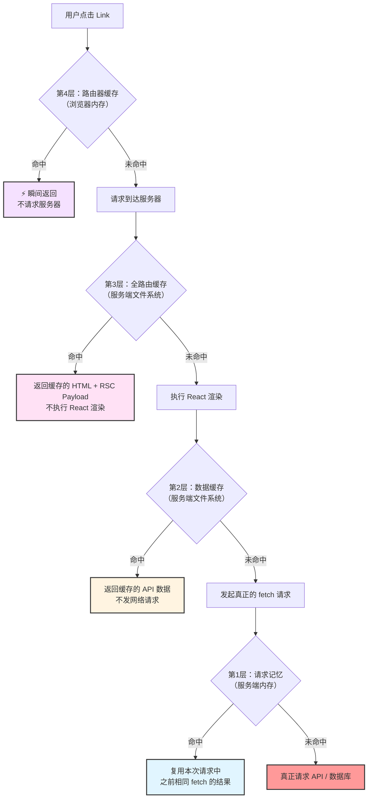
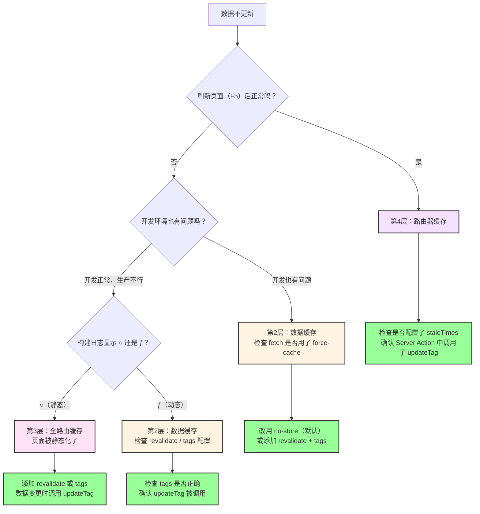
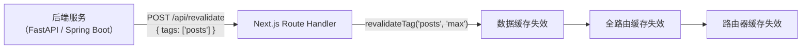
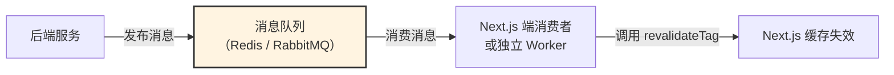

# Next.js 缓存机制 - 总结与实战

经过前面五篇的逐层拆解，你已经了解了 Next.js 四层缓存各自的职责、生命周期和失效方式。这篇总结的目标是把它们串起来——当一个请求从浏览器到达服务器，它会经过哪些缓存层？不同的业务场景该选择什么策略？前后端分离时，后端如何主动通知 Next.js 刷新缓存？

---

## 一个请求的完整缓存旅程

用户点击 `<Link>` 跳转到一个页面时，请求会从外到内依次经过四层缓存，命中任何一层就直接返回，不再往下走：



理解了这个流程，你就知道"数据不更新"时该从哪一层开始排查——从外往内，逐层检查。

---

## 四层缓存速查表

| 层级 | 名称 | 位置 | 生命周期 | 缓存内容 | 失效方式 | 开发环境 |
| --- | --- | --- | --- | --- | --- | --- |
| **第 1 层** | 请求记忆 | 服务端内存 | 单次请求 | fetch 返回值 | 请求结束自动销毁 | ✅ 生效 |
| **第 2 层** | 数据缓存 | 服务端文件 | 持久化 | API 响应数据 | `updateTag` / `revalidateTag` / `revalidatePath` | ✅ 生效 |
| **第 3 层** | 全路由缓存 | 服务端文件 | 持久化 | HTML + RSC Payload | 数据缓存失效时联动失效 | ❌ 不生效 |
| **第 4 层** | 路由器缓存 | 浏览器内存 | 默认 0（可配置） | RSC Payload | Server Action 联动 / `router.refresh()` | 机制存在，默认不缓存 |

层间依赖：调用一次 `updateTag`，第 2、3、4 层依次失效。第 1 层独立运行，不参与联动。

---

## 问题诊断流程

遇到"数据不更新"时，按这个流程排查：



---

## 缓存策略选择

不同的数据特征对应不同的缓存策略，这里给出一个实用的决策框架：

### 按数据更新频率选择

**几乎不变的数据**（关于页面、文档、法律条款）：直接用 `force-cache`，不设 `revalidate`，只在重新部署时更新。这类数据变更极少，不值得为它设计失效机制。

**偶尔更新的数据**（博客文章、产品列表、分类信息）：用 `force-cache` + `tags`，数据变更时调用 `updateTag`。这是最常见的模式——大部分时间从缓存读取，变更时精准失效。可以额外加一个 `revalidate` 作为兜底，防止 `updateTag` 因为某些原因没被调用。

**频繁更新的数据**（购物车、用户个人信息、订单状态）：不缓存，用 Next.js 15+ 的默认行为（`no-store`）。这类数据通常和用户身份绑定，缓存反而会导致数据错乱。使用 `cookies()` 获取用户身份时，页面会自动变成动态的。

**实时数据**（聊天消息、股票行情、协作编辑）：不适合用服务端缓存，应该在客户端组件中用 WebSocket、Server-Sent Events 或 SWR/TanStack Query 的轮询来处理。

### 按应用类型选择

**内容型站点**（博客、文档、营销页）：大量使用缓存。文章列表和详情页用 `force-cache` + `tags`，发布/编辑时 `updateTag`。路由器缓存建议开启（`staleTimes`），提升导航体验。

**电商网站**：混合策略。产品列表和详情页缓存，购物车和结算页不缓存。产品价格/库存变更时通过 webhook 触发 `revalidateTag`。

**管理后台 / Dashboard**：通常不缓存。在 layout 级别设置 `dynamic = 'force-dynamic'`，所有子页面自动继承。数据实时性比性能更重要。

**SaaS 应用**：按功能区分。公共页面（定价页、功能介绍）缓存，用户工作区不缓存。

---

## 前后端分离：后端如何刷新 Next.js 缓存？

前面讨论的 `updateTag` 和 `revalidateTag` 都是在 Next.js 内部调用的——Server Action 或 Route Handler。但在前后端分离的架构中，数据变更发生在独立的后端服务（FastAPI、Spring Boot、Django 等），Next.js 只负责前端渲染。这时候后端怎么通知 Next.js 刷新缓存？

### 核心原理：Webhook + Route Handler

思路很简单：在 Next.js 中暴露一个 Route Handler 作为 webhook 接口，后端数据变更后向这个接口发一个 HTTP 请求，Route Handler 内部调用 `revalidateTag` 来失效缓存。



这里用 `revalidateTag` 而不是 `updateTag`，因为 `updateTag` 只能在 Server Action 中使用（它依赖当前请求的上下文来实现"写后即读"），而 Route Handler 是独立的 HTTP 端点，适合用 `revalidateTag` 的 stale-while-revalidate 策略。

### Next.js 端：Webhook Route Handler

```typescript
// app/api/revalidate/route.ts
import { revalidateTag } from "next/cache";
import { NextRequest } from "next/server";

export async function POST(request: NextRequest) {
  // 1. 验证请求来源（防止恶意调用）
  const authHeader = request.headers.get("authorization");
  if (authHeader !== `Bearer ${process.env.REVALIDATION_SECRET}`) {
    return Response.json({ error: "Unauthorized" }, { status: 401 });
  }

  // 2. 解析要失效的标签
  const { tags } = await request.json();

  if (!tags || !Array.isArray(tags)) {
    return Response.json({ error: "tags is required" }, { status: 400 });
  }

  // 3. 逐个失效标签
  for (const tag of tags) {
    revalidateTag(tag, "max");
  }

  return Response.json({ revalidated: true, tags });
}
```

这个接口做了三件事：验证密钥（防止任何人都能刷你的缓存）、解析标签列表、逐个调用 `revalidateTag`。后端只需要向这个接口发一个 POST 请求就行。

### FastAPI 示例

在 FastAPI 中，数据变更后调用 Next.js 的 webhook 接口：

```python
# services/cache.py
import httpx
from config import settings

async def revalidate_nextjs_cache(tags: list[str]):
    """通知 Next.js 刷新指定标签的缓存"""
    async with httpx.AsyncClient() as client:
        try:
            response = await client.post(
                f"{settings.NEXTJS_URL}/api/revalidate",
                json={"tags": tags},
                headers={
                    "Authorization": f"Bearer {settings.REVALIDATION_SECRET}"
                },
                timeout=5.0,
            )
            response.raise_for_status()
            return response.json()
        except httpx.HTTPError as e:
            # 缓存刷新失败不应该阻塞业务逻辑
            # 记录日志，但不抛异常
            print(f"Cache revalidation failed: {e}")
            return None
```

```python
# routers/posts.py
from fastapi import APIRouter, Depends
from services.cache import revalidate_nextjs_cache

router = APIRouter()

@router.post("/posts")
async def create_post(post: PostCreate, db: Session = Depends(get_db)):
    # 1. 写入数据库
    new_post = crud.create_post(db, post)

    # 2. 通知 Next.js 刷新缓存
    await revalidate_nextjs_cache(["posts"])

    return new_post

@router.put("/posts/{post_id}")
async def update_post(
    post_id: int, post: PostUpdate, db: Session = Depends(get_db)
):
    updated = crud.update_post(db, post_id, post)

    # 失效列表和详情的缓存
    await revalidate_nextjs_cache(["posts", f"post-{post_id}"])

    return updated
```

有几个关键点值得注意：

第一，缓存刷新是"尽力而为"的。`revalidate_nextjs_cache` 失败时只记录日志，不抛异常。因为缓存刷新失败的后果只是用户暂时看到旧数据，不应该因此导致数据写入失败。

第二，标签的命名要和 Next.js 端的 `fetch` 标签保持一致。Next.js 端用 `tags: ["posts"]` 标记缓存，后端就要发 `["posts"]` 来失效。这需要前后端约定好标签命名规范。

第三，如果后端的写入操作很频繁（比如每秒几十次），不需要每次都调用 webhook。可以用防抖（debounce）或批量合并的方式，比如每 5 秒收集一次变更的标签，统一发一次请求。

### Spring Boot 示例

Spring Boot 中的实现思路完全一样，只是语言和 HTTP 客户端不同：

```java
// service/CacheRevalidationService.java
@Service
public class CacheRevalidationService {

    private final WebClient webClient;

    @Value("${nextjs.url}")
    private String nextjsUrl;

    @Value("${nextjs.revalidation-secret}")
    private String revalidationSecret;

    public CacheRevalidationService(WebClient.Builder webClientBuilder) {
        this.webClient = webClientBuilder.build();
    }

    public void revalidateCache(List<String> tags) {
        webClient.post()
            .uri(nextjsUrl + "/api/revalidate")
            .header("Authorization", "Bearer " + revalidationSecret)
            .bodyValue(Map.of("tags", tags))
            .retrieve()
            .bodyToMono(String.class)
            .doOnError(e -> log.warn("Cache revalidation failed: {}", e.getMessage()))
            .onErrorComplete()  // 不阻塞业务逻辑
            .subscribe();
    }
}
```

```java
// service/PostService.java
@Service
public class PostService {

    private final PostRepository postRepository;
    private final CacheRevalidationService cacheService;

    public Post createPost(PostCreateRequest request) {
        Post post = postRepository.save(new Post(request));

        // 异步通知 Next.js 刷新缓存
        cacheService.revalidateCache(List.of("posts"));

        return post;
    }

    public Post updatePost(Long id, PostUpdateRequest request) {
        Post post = postRepository.findById(id)
            .orElseThrow(() -> new NotFoundException("Post not found"));

        post.update(request);
        postRepository.save(post);

        cacheService.revalidateCache(List.of("posts", "post-" + id));

        return post;
    }
}
```

Spring Boot 这里用了 WebClient 的响应式调用（`subscribe()`），缓存刷新在后台异步执行，不会阻塞 API 响应。`onErrorComplete()` 确保刷新失败时不影响业务。

### 更可靠的方案：消息队列

对于大型系统，直接 HTTP 调用可能不够可靠——Next.js 服务可能暂时不可用，或者网络抖动导致请求丢失。这时候可以引入消息队列（RabbitMQ、Kafka、Redis Pub/Sub）作为中间层：



消息队列的好处是解耦和可靠性——消息不会丢失，即使 Next.js 暂时不可用，恢复后也能消费积压的消息。但对于大多数中小型项目，直接 HTTP webhook 已经足够了，不需要引入额外的基础设施复杂度。

### Next.js 全栈模式 vs 前后端分离

如果你用 Next.js 做全栈（Server Action 直接操作数据库），缓存管理会简单很多——数据变更和缓存失效在同一个进程里，直接调用 `updateTag` 就行，不需要 webhook。

前后端分离时多了一个"跨服务通知"的环节，但核心逻辑不变：数据变了 → 告诉 Next.js 哪些标签需要失效 → Next.js 清除对应缓存。区别只是"告诉"的方式从函数调用变成了 HTTP 请求。

| | Next.js 全栈 | 前后端分离 |
|---|---|---|
| 数据变更位置 | Server Action | 独立后端服务 |
| 失效方式 | `updateTag`（写后即读） | webhook → `revalidateTag`（stale-while-revalidate） |
| 一致性 | 强一致（用户立刻看到新数据） | 最终一致（下一次请求看到新数据） |
| 复杂度 | 低 | 中（需要维护 webhook 接口和密钥） |
| 适用场景 | 中小型项目、快速迭代 | 大型项目、多端共享后端 |

前后端分离的一个限制是无法使用 `updateTag`（它只在 Server Action 中可用），所以用户在前端提交表单后不能立刻看到最新数据——需要等后端处理完、调用 webhook、Next.js 刷新缓存后，下一次请求才能拿到新数据。如果对一致性要求高，可以在前端用乐观更新（Optimistic Update）来弥补这个延迟。

---

## 三种失效 API 速查

| API | 行为 | 适用场景 | 可用位置 |
| --- | --- | --- | --- |
| `updateTag(tag)` | 立即失效，写后即读 | Server Action 中用户操作后 | Server Action |
| `revalidateTag(tag, profile)` | stale-while-revalidate | webhook、定时任务、后台刷新 | Server Action + Route Handler |
| `revalidatePath(path)` | 失效整个路径 | 简单场景、不想管理标签 | Server Action + Route Handler |

Server Action 中优先用 `updateTag`，Route Handler / webhook 中用 `revalidateTag`。

---

## 实践指南

### 标签优于路径

标签是跟着数据走的，路径是跟着 UI 走的。一份数据可能出现在多个页面，用标签 `updateTag('posts')` 一次搞定，用路径你得逐个列出每个受影响的页面——漏一个就是 bug。

### 标签设计：粗细结合

```typescript
// 列表页：粗粒度标签
fetch("/api/posts", {
  next: { tags: ["posts"] },
  cache: "force-cache",
});

// 详情页：粗 + 细粒度标签
fetch(`/api/posts/${id}`, {
  next: { tags: ["posts", `post-${id}`] },
  cache: "force-cache",
});

// 更新单篇文章：只失效该文章 + 列表
updateTag(`post-${id}`);
updateTag("posts");
```

### Next.js 15+ 需要显式声明缓存

```typescript
// 默认不缓存（no-store），这行代码每次都会请求 API
const res = await fetch("/api/posts");

// 需要缓存时必须显式声明
const res = await fetch("/api/posts", {
  next: { tags: ["posts"] },
  cache: "force-cache",
});
```

### `revalidateTag` 必须传第二个参数

```typescript
// ❌ Next.js 16 已废弃单参数形式
revalidateTag("posts");

// ✅ 必须传 cacheLife profile
revalidateTag("posts", "max");
```

### 生产环境测试缓存

开发环境不启用全路由缓存，很多问题只在生产环境出现。部署前务必：

```bash
npm run build  # 查看 ○ 和 ƒ 标记
npm start      # 用生产模式测试
```

### 路由器缓存按需开启

```typescript
// next.config.ts — 大多数生产应用建议开启
const nextConfig = {
  experimental: {
    staleTimes: {
      dynamic: 30,
      static: 300,
    },
  },
};
```

---

## 快速参考

```typescript
// ========== 数据获取 ==========
fetch("/api/data");                                              // 不缓存（15+ 默认）
fetch("/api/data", { cache: "force-cache" });                    // 显式缓存
fetch("/api/data", { next: { tags: ["data"] }, cache: "force-cache" }); // 缓存 + 标签（推荐）
fetch("/api/data", { next: { revalidate: 3600 }, cache: "force-cache" }); // 缓存 + 定时

// ========== 缓存失效 ==========
updateTag("data");                        // Server Action：写后即读
revalidateTag("data", "max");             // Route Handler：stale-while-revalidate
revalidatePath("/page");                  // 按路径失效
revalidatePath("/blog/[slug]", "page");   // 失效动态路由的所有页面
revalidatePath("/", "layout");            // 失效整个站点

// ========== 页面级配置 ==========
export const dynamic = "force-dynamic";   // 强制动态
export const revalidate = 3600;           // 定时重新验证

// ========== 客户端 ==========
router.refresh();                         // 清除当前页面的路由器缓存
```

---

## 一句话总结

Next.js 的四层缓存看起来复杂，但核心就一件事：**给 fetch 打上 tags，数据变更时调用 `updateTag`**。做到这一点，四层缓存会自动联动，你不需要逐层管理。前后端分离时，多一步 webhook 通知，原理完全一样。
