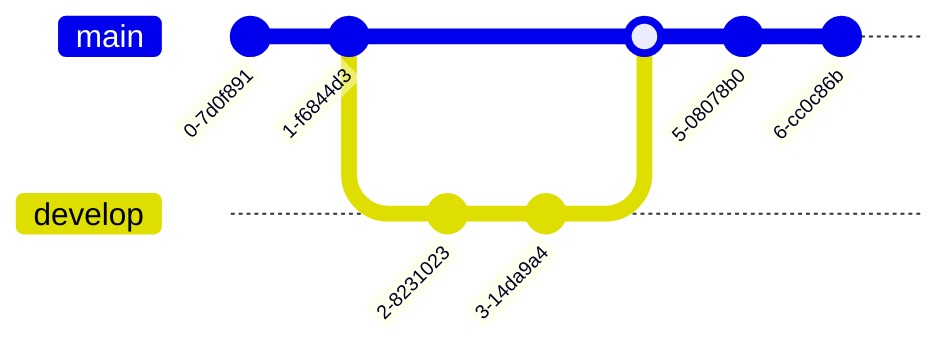

# 测试 Push

这篇文章的主要目的是为了测试 Git 的 Push 流程以及 CI/CD 部署是否正常。

## 1. 验证元数据

检查 `author` 字段是否正确显示为 **tomyi**。

## 2. 验证内容渲染

### 代码块

```javascript
console.log("Hello, Blog!");
const isDeployed = true;
if (isDeployed) {
  console.log("Deployment successful!");
}
```

### 数学公式

验证 LaTeX 渲染：

$$
f(x) = \int_{0}^{x} t^2 dt = \frac{x^3}{3}
$$

### 流程图

验证 Mermaid 渲染：

