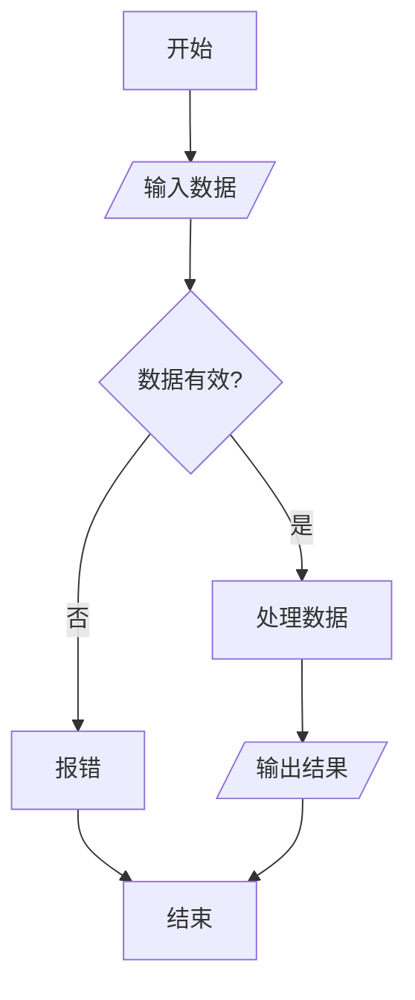

# 测试文章

这是测试内容，旨在展示博客对代码、数学公式和流程图的支持。

## 1. 代码高亮示例

下面是一段 Python 代码：

```python
def fibonacci(n):
    if n <= 1:
        return n
    else:
        return fibonacci(n-1) + fibonacci(n-2)

print(fibonacci(10))
```

## 2. 数学公式示例

我们支持 LaTeX 格式的数学公式。

**行内公式**：
质能方程是 $E=mc^2$。

**块级公式**：
欧拉公式被认为是数学中最优美的公式之一：

$$
e^{i\pi} + 1 = 0
$$

或者高斯积分：

$$
\int_{-\infty}^{\infty} e^{-x^2} dx = \sqrt{\pi}
$$

## 3. 流程图示例 (Mermaid)

下面是一个使用 Mermaid 语法的简单流程图：

