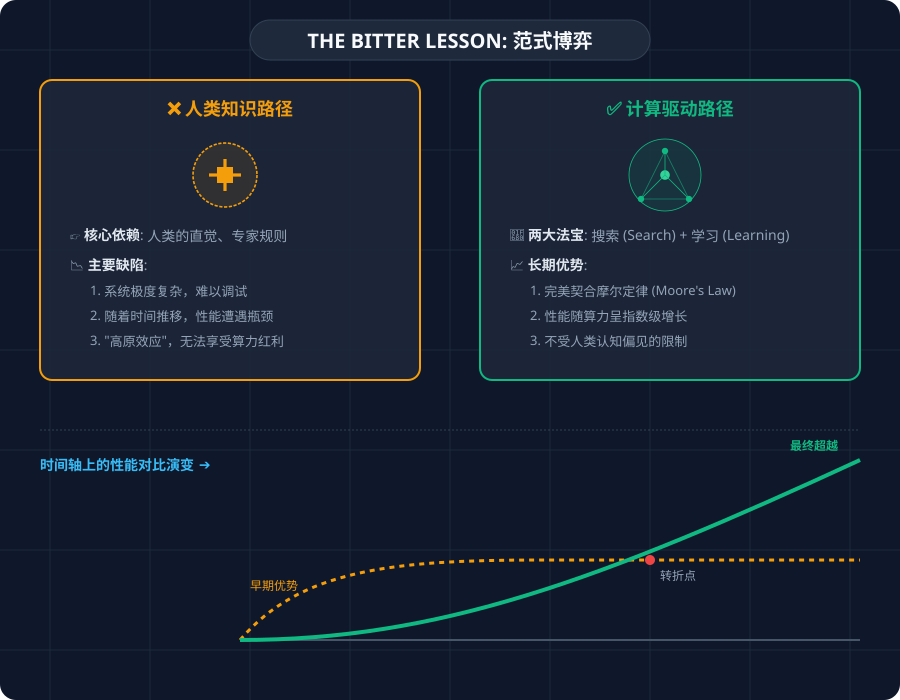

## 作者简介

理查德·萨顿（Richard Sutton）是强化学习（Reinforcement Learning）领域的奠基人，被誉为“强化学习之父”。他的主要贡献包括：

1. **奠基性理论**：提出了**时序差分学习（Temporal Difference Learning）**、**策略梯度（Policy Gradient）**，以及 **Dyna 架构**等核心算法。
2. **经典教材**：与 Andrew Barto 合著了《强化学习导论》（Reinforcement Learning: An Introduction），这是该领域的“圣经”。
3. **顶尖荣誉**：荣获 **2024 年图灵奖（Turing Award）**，这被公认为“计算机界的诺贝尔奖”。

---

## 序言：为什么《苦涩的教训》如此重要？

2019 年，萨顿在博客上发表了《苦涩的教训》（The Bitter Lesson）。这篇文章在当时引起了巨大的争议，却在短短几年后成为了大模型时代（Large Language Models）最精准的预言。

萨顿在这篇短文中展现了一种极具冲击力的哲学视角：他认为 AI 领域 70 年来的最大教训是——**利用计算量的通用方法，最终总会击败融入人类知识的启发式方法。** 这种“苦涩”源于它否定了人类对自己智力优越性的直觉，将 AI 的进步归功于算力的堆砌而非精妙的手工设计。

_图：萨顿笔下的两种范式对比——人类知识 vs 计算驱动_

为了更透彻地理解这一思想，我将对原文进行分段逐一解读。

## 逐段解读与分析

### 第一部分：核心论点 —— 算力的胜利

> 从 70 年的人工智能（AI）研究中能读到的最大教训是：**利用计算（computation）的通用方法最终是最有效的，而且优势巨大。** 这一点的根本原因是**摩尔定律**，或者说是单位计算成本持续呈指数级下降的普遍现象。
>
> 大多数 AI 研究在开展时，潜意识里都假设智能体可用的算力是**固定不变的**（在这种前提下，利用人类先验知识似乎成了唯一的提效手段）。然而，一旦跳出单一研究项目的视角，我们就会发现，**海量的算力增长必然会随时间呼啸而至**（摩尔定律的**指数级**）。为了追求立竿见影的短期改进，研究者们往往寄希望于将人类的**专家经验和先验知识**注入系统；但从长远来看，真正起到决定性作用的**唯一支点**，只有对算力的极致利用（_能够随算力的提升而不断优化_）。
>
> 这两者本不必相互抵触，**但在实践中往往事与愿违**。一旦在某条路径上投入资源，研究者就会产生心理上的“**路径依赖**”（或是某种思维钢印）。此外，基于人类知识的方法往往会让系统变得**臃肿复杂**，使其难以适配那些能够充分利用计算能力的通用方法。有许多 AI 研究人员迟迟才学到这一**苦涩教训**，回顾其中一些最突出的例子是很有启发意义的。

#### 本段的要义

这段话开宗明义地提出了整篇文章的核心论点，主要包含以下几个关键逻辑：

1. **核心观点**：在 AI 发展的长河中，那些能够充分利用**计算能力（算力）的通用方法**，最终总是能战胜那些依赖人类特定知识的方法，而且赢面很大。
2. **根本原因（摩尔定律与能力非同构）**：摩尔定律带来的不仅仅是算力的指数级增长。更深层的含义在于：**高算力与低算力下解决问题的逻辑与模式是完全不同的（非同构）**。在低算力时代，我们不得不依赖人类的精巧设计来勉强补足性能；但在海量算力面前，通用的搜索与学习算法往往能够自发地涌现出超越人类预设逻辑的解决路径。这种量变最终引发了解决问题模式的质变。
3. **研究者的误区（短视）**：
   - **研究人员通常只关注眼下的项目**，假设算力是有限且不变的。在这种前提下，把人类专家的经验通过“硬编码”注入系统，确实能换取**立竿见影的短期性能提升**。然而，这种以“知识换性能”的策略，会在更长的时间跨度上严重阻碍 AI 的潜能释放。
   - **静态知识的“贪婪陷阱”**：由于人类的先验知识是**静态**的，并不会随算力的增长而进化。正因为这些知识在初期“太好用了”，反而抑制了系统在高算力时代本应具备的更强**探索能力**。由于系统惯性地依赖初期的成功模式，**它会继续在海量算力下重复陈旧的逻辑，而不去寻找更优解**，最终导致算力的严重浪费。
4. **为什么是“苦涩”的（教训的本质）**：
   - **初期的“笨拙”与“低效”**：这种通用方法在最开始几乎不显神威，由于缺乏人类经验的加持，它表现得毫无“灵性”，看起来纯粹是靠算力在“蛮干”。这种起初肉眼可见的极低效率，往往让自诩聪明的研究者不屑一顾。
   - **“恶劣环境”孕育顶级范式**：但也正是这种剥离了人类温室、看似恶劣的外部环境，迫使系统在不断的试错中进化出了比人类已知方案更强大、更稳健的底层逻辑。这种“土办法”最终会自发地涌现出超越人类认知上限的最优解。
   - **认知的滞后**：最苦涩的一点在于，人们起初并没有意识到这种“蛮干”背后的潜力。等到他们引以为傲的精妙技巧被这种“通用暴力”全方位碾压时，才发现自己当初的捷径其实是通往终点的迷途。

**简而言之**：不要试图把人类的聪明才智手动硬编码到 AI 进程里；长期来看，能随算力扩张而自动进化的通用算法才是真正的王道。

#### 💡 深度洞察

---

### 第二部分：国际象棋的启示 —— 棋王败北背后的“蛮荒力量”

> 1997 年，国际象棋世界冠军卡斯帕罗夫在与“深蓝”（Deep Blue）的对决中败下阵来。令人惊讶的是，击败这位棋坛神话的并非什么高深的弈棋“秘籍”，而仅仅是**极其纯粹、甚至有些“笨拙”的大规模深层搜索（Massive, Deep Search）**。
>
> 这一结果在当时令绝大多数 AI 专家感到灰心丧气。他们此前一直苦心孤诣，试图**将人类对棋局结构的深刻理解硬塞给机器**。然而，当计算机以一种**极其纯粹、甚至有些“笨拙”的大规模深层搜索**的方式大获全胜时，这些执着于人类经验的研究者们却**表现得很不体面**。
>
> 他们极力抗议道：“这种蛮力搜索这次只是侥幸，它根本算不上通用策略，而且无论如何，**人根本不是这么下棋的**！”显然，这些研究者更渴望看到人类智慧的延伸获得胜利；而当机器以一种他们完全瞧不上的“蛮干”方式超越人类时，**他们感受到的只有巨大的幻灭**。

#### 📝 要义总结

这段话通过“深蓝”击败卡斯帕罗夫的经典战例，正式推出了 AI 演化史上第一大通用支柱：**大规模搜索（Search）**。它揭开了“暴力美学”的序幕，同时也深刻剖析了研究者在面对技术范式转移时的心理博弈：

1. **“以力破巧”的讽刺**：最终战胜人类最强棋王的，并非精妙的博弈战术，而是被专家们嗤之以鼻的**大规模搜索**。这种“**无技巧**”的胜利，是对人类智力优越感最直接的蔑视。
2. **“不体面”的研究者**：面对深蓝的成功，专家们表现出的沮丧和抗议，本质上源于一种**认知的破产**。他们试图贬低暴力搜索为“蛮干”，以此掩盖人类智慧在纯粹算力面前的苍白。
3. **“拟人化”的心理桎梏**：研究者们潜意识里希望 **AI 能够验证人类的思维价值**，而不是通过一种完全陌生的方式超越人类。他们执着于“过程是否像人”，却在此时错失了进化的真相。

**这一段的启示**：真正的“苦涩”源于一种彻底的幻灭——当人类自以为豪的智慧，在单纯的算力堆砌面前显得毫无招架之力时，承认这种失败需要极大的勇气。

#### 💡 深度洞察：为什么“搜索”是元方法之王？

在这一案例中，萨顿实际上揭露了 **“搜索（Search）”** 作为元方法的本质优势：

1. **“认知的补丁” vs “真相的推演”**：

   - 人类总结的各路棋理、战术本质上是由于人脑**算力受限**而产生的“认知补丁”——因为我们无法看清所有可能，所以只能凭感觉总结出一些“大概率正确”的准则。
   - 而搜索则是**基于规则的真相推演**。当计算机能推演出未来几十步的所有可能性时，那些模糊的“棋理”在绝对的“事实”面前就显得苍白无力。

2. **逃离“思维定式”的枷锁**：

   - 人类专家由于受过长期训练，会自动忽略那些看起来“不合常理”的落子。
   - 搜索作为一种元方法，**不带任何先入为主的偏见**。它能在那些人类直觉的“盲区”中，发现威力巨大的神来之笔。

3. **算力的完美杠杆**：
   - **不可扩展性**：你教给系统的“人类技巧”越多，系统就越臃肿，且人类智慧的上限就是系统的上限。
   - **无限扩展性**：搜索是**可伸缩**的。算力每增加一倍，搜索深度就增加，棋力就随之产生质变，且这个过程不需要人类介入。

**结论**：搜索的本质是“**用计算换取发现**”。它承认人类认知的局限，转而追求一种能够随算力无限进化的通用发现机制。

---

### 第三部分：围棋的终局 —— 跨越二十年的迟到教训

> 计算机围棋领域的演进模式几乎如出一辙，只不过这场迟到的“苦涩教训”比国际象棋晚了整整二十年。
>
> 早期，研究人员耗费了巨大的心血，试图利用人类的弈棋智慧或围棋的复杂特性来“回避”搜索。然而，当搜索技术最终被大规模且有效地应用时，那些曾经引以为傲的手工规则**不仅显得无足轻重，甚至成了系统进化的掣肘。**
>
> 同样关键的转变在于引入了“**自我对弈（Self-play）**”来学习价值函数。尽管在 1997 年那场著名的象棋对决中，“学习”尚未大显身手，但在围棋等更复杂的博弈中，它与“搜索”一样，成为了释放海量算力的核心阀门。
>
> 事实上，“**搜索（Search）”与“学习（Learning）**”正是人工智能研究中利用算力资源的两大终极支柱。在围棋的发展史上，研究者最初总是寄希望于通过人类的视角来“抄近路”，但最终的成功无一例外地指向了——**全面拥抱搜索，以及拥抱基于算力的学习。**

#### 📝 要义总结与核心解读

这段话不仅是历史的回顾，更是对之前理论的**升维打击**：

1. **历史的“镜像重演”**：围棋的复杂度远超象棋，这让专家们曾产生了一种幻觉：单纯的搜索不可能搞定围棋。于是研发者沉迷于硬编码人类的棋形、定式。结果证明，这种“为了省算力而人为约束 AI”的做法，只是延缓了被超越的时间而已。
2. **算力的双子星：搜索 + 学习**：这是萨顿最重要的理论武器。这两类技术拥有共同的基因：**它们都能随算力的增加而自动、线性地变强。** “学习”在此处引申出的“自我对弈”，就是最极致的 Agent 自我探索。
3. **“帮倒忙”的人类规则**：作者在此处用了 **“Irrelevant or Worse”**。这意味着当算力门槛跨越后，人类过时的先验知识会因为限制了 AI 的探索空间，而产生负面作用。

#### 💡 深度洞察：自我对弈——最极致的“第一性原理”

这一段完美印证了“Agent 自存探索知识的泛化性”：

最震撼世界的 **AlphaGo Zero** 完全抛弃了人类棋谱。它通过自我对弈（Self-play）发现了人类几千年都没见过的定式。这证明了：**当 AI 摆脱了向人类“乞讨知识”这种廉价的路径依赖后，它才能真正通过算力去触碰棋道本质。**

此时，人类不再是 AI 的老师，反而成了 AI 在低算力时代留下的“偏见残余”。

---

### 第四部分：感知领域的幻灭 —— “直觉”的退场

> **语音识别的巨变**：早在 1970 年代，DARPA 曾赞助过一场语音识别竞赛。当时的参赛者们使出了浑身解数，试图将人类对词汇、音素，甚至是人类 **声道（Vocal Tract）** 运作原理的理解灌输给机器。与之相对应的，则是另一套全新的、本质上更依赖统计逻辑且计算强度极大的方法——**隐马尔可夫模型（HMMs）**。结果一如既往：统计流派横扫了那些基于人类知识的方案。这引发了此后数十年间 NLP 领域的深刻变革，统计与计算开始主宰赛场。如今深度学习的崛起，只是在“用计算和海量数据替代人类知识”这一方向上的最新演变。**它甚至更少地依赖人类经验，转而利用海量的数据和更庞大的算力，造就了性能具有代差飞跃的识别系统。**
>
> **视觉领域的镜像重演**：在计算机视觉领域，历史剧本也在重现。早期的算法致力于寻找边缘（Edges）、抽象出广义圆柱体（Cylinders），或者花费数年打磨极其精妙的手工特征（如 SIFT）。但到了今天，这些昂贵的尝试几乎全部被扔进了历史的尘埃，取而代之的是仅仅利用 **“卷积”** 和 **局部不变性** 这样简单的数学概念的深度学习网络——后者的表现要好得多。
>
> 就像在游戏中一样，研究者总想让系统按照“**他们自以为的大脑运作方式**”去工作——他们拼命想把这些知识塞进机器。但历史证明，当摩尔定律送来了海量算力，而这种算力又被投入到通用方法时，这种努力不仅适得其反，**更是对研究者精力的巨大挥霍。**

#### 📝 要义总结

1. **“生理学”输给了“统计学”**：无论研究者多么精通人类声道的构造或视觉边缘的提取规律，在能够自发从海量数据中挖掘模式的**统计模型**面前，所有的“手工特征”都显得简陋且低效。
2. **“特征工程”的全面退场**：在感知领域，从 SIFT 这种精妙的人工图像特征到音素级别的精细切板，所有试图“**定义世界**”的方法都已被“**观察世界**”的方法彻底取代。
3. **最残酷的真相**：作者指出，最严重的浪费在于——研究人员总是试图让系统按照“**他们自以为的大脑运作方式**”去工作。这种傲慢不仅适得其反，更是一场对时间与精力的**巨大挥霍**。

#### 💡 深度洞察：认知的错觉与“拟人化”的诅咒

萨顿在这里点出了一个极其深刻的心理学悖论：

**人类对自己“如何思考”的认知往往是错误的。** 我们以为自己是靠“识别边缘”来看见杯子的，以为自己是靠“分辨音素”来听懂话语的。但事实上，神经系统的深层运作机制可能与我们的主观直觉完全不同。

- **拟人化的枷锁**：当我们强行教 AI 识别边缘时，我们其实是把一种**二手的、甚至是扭曲的直觉**强加给了 AI。
- **降维打击**：深度学习（尤其是卷积网络）的胜利，本质上是 **“计算”绕过了“人类解释层”**，直接与数据的原始分布对话。它不需要理解声带，**它只需要在海量音频中找到能量波动的数学最优解。**

**结论**：在感知领域，最有效的捷径就是承认：**AI 不需要理解人是怎么看的，它只需要掌握“看”这个动作背后的普适计算规律。**

### 第五部分：苦涩的真相 —— 为何这种成功令人不悦？

> 这是一个极其深刻的教训。作为一个研究领域，我们至今仍未彻底将其内化，因为类似的错误仍在不断重演。
>
> 为了看清并有效抵制这一诱惑，我们必须理解这些错误对于研究者那种难以抗拒的吸引力（Appeal）。我们必须学会这个**苦涩的教训（Bitter Lesson）**：试图将“我们认为自己是如何思考的”（how we think we think）构建到机器里，长远来看注定死路一条。
>
> 这一教训基于如下历史观察：
>
> 1. AI 研究者总倾向于将具体的知识注入其智能体（Agents）；
> 2. 这种做法在短期内总是极其有效的，且能给研究者带来极大的**个人成就感（Personally Satisfying）**；
> 3. 但从长远来看，这会导致系统遭遇瓶颈，甚至抑制进一步的进步；
> 4. 真正的突破性进展，最终总是通过相反的路径实现——即基于 **搜索（Search）和学习（Learning）** 的大规模计算扩展。
>
> 这种最终的成功往往带着一丝难以消化的“**苦涩（Bitterness）**”，因为它代表着对某种“以人类为中心（Human-centric）”的偏爱路径的无情碾压。

#### 📝 要义总结与心理剖析

这一段就像一把无情的手术刀，剖析了 AI 研究界深层次的心理状态：

1. **“低次诱惑”与“即时反馈”**：为什么我们总是记不住教训？因为把人类知识写进去，效果确实**立竿见影**，它能带给研究员一种“我在掌握机器”的**智力快感**。
2. **“苦涩”的真相（难以下咽的成功）**：真正的苦涩在于，通往巅峰的路径竟与我们所热爱的方向**截然相反**。当研究者发现那个最有效的元方法（如纯粹的搜索）竟然完全不包含我们引以为傲的复杂理论时，这种成功往往是**“难以被彻底消化的”**。即使赢得了性能，由于这种胜利否定了人类智慧在其中的核心价值，它依然带有一种深层的幻灭感。
3. **人类中心主义的幻灭**：我们更希望 AI 是“**人类智慧的结晶**”，而不是“**庞大内存与高频时钟**”的结晶。

#### 💡 深度洞察：从“内容知识”到“元方法”的断舍离

萨顿在这里揭示了一个残酷的真相：绝大多数 AI 研究者其实是“内容主义者”。

- **“内容知识（Contents）”的陷阱**：人们倾向于提取具体的、静态的知识（如特定棋谱、声道模型）。因为这种“**微操**”能带来即时的效率反馈，让研究员觉得自己“教导有方”，这种**智力上的即时满足感**极具诱惑力。
- **“元方法（Meta-methods）”的修行**：真正的突破在于**放弃对具体结果的控制**，转而打磨能够**随算力无限扩展**的底层逻辑。
- **痛苦的转型**：这种转型是极其“苦涩”的，因为它需要你忍受**初期的低效**。只有当你愿意放弃“教机器思考”的幻觉，转而**构建“让机器自我发现”的机制**时，才算真正踏上了通往终极智能的道路。

**结论**：如果一项技术不能随算力的增加而**自动进化**，那么它极大概率就是一个“**精美的陷阱**”。

### 第六部分：未来的启示 —— 追求“发现”的力量而非“知识”的残余

> 我们应该从“苦涩的教训”中学到的第一件事是：通用方法具有巨大的威力。即使当可用算力变得非常巨大时，这些方法也能随着计算量的增加而继续扩展。目前看来，能够以这种方式任意扩展的两种方法是**搜索（Search）和学习（Learning）**。
>
> 第二个一般性观点是：心智的实际内容是**极其、无可救药地复杂（Tremendously, irredeemably complex）**的。我们应该停止寻找那些试图简化心智内容的思维方式，比如关于空间、物体、多智能体或对称性的简单化思考。所有这些都是随机的、本质复杂的外部世界的一部分。它们不应被内置（Built in）到系统中，因为它们的复杂性是无穷尽的；相反，我们应该**只内置那些能够发现并捕捉这种任意复杂性的元方法（Meta-methods）**。
>
> 这些方法的关键在于它们能够找到很好的近似解，但寻找近似解的过程应该由我们的方法来完成，而不是由我们来完成。我们想要的是**能够像我们一样去发现（Discover like we can）的 AI 智能体，而不是那些包含着我们已经发现的东西（What we have discovered）的智能体**。将我们的发现内置进去，只会让我们更难看清**“发现过程（Discovering Process）”**究竟是如何完成的。

#### 📝 要义总结与核心建议

这是全篇的“文眼”，萨顿在这里为 AI 的发展定下了最终的基调：

1. **唯一的黄金准则：可扩展性**：判断一个算法是否具有生命力，不再看它此刻有多聪明，而看它是否能随算力的增加而**任意扩展**。只有搜索与学习通过了这个测试。
2. **世界的真相是“不可定义”的**：萨顿在这里展现了极大的谦卑。他认为人类试图用“空间、对称性、实体”来定义世界是极其自大的。真实世界是**无可救药地复杂**的，任何人工定义的简单模型，在海量计算面前最终都会沦为进化的障碍。
3. **“授人以渔”的系统哲学**：
   - **不要做**：给 AI 灌输人类已有的成果（即“已经被发现的东西”）。
   - **必须做**：给 AI 植入**元方法（发现的能力）**。
   - **代价警示**：如果我们总是忍不住帮 AI “作弊”（直接硬编码人类发现），我们不仅限制了 AI，更毁掉了人类理解“智能是如何通过计算涌现并**发现新知**”的唯一机会。

#### 💡 深度洞察：从“结果的容器”到“过程的引擎”

萨顿最后那句：**“我们想要的是能够像我们一样去发现的智能体，而非那些包含着我们已经发现的东西的智能体”**，简直是震耳欲聋：

- **认知标本 vs 进化熔炉**：装满了人类成果的 AI，本质上只是一个高级的 **“认知标本”**。而一个具备“发现元方法”的 AI，则是一个利用算力作为燃料、在现实数据中自我淬炼的 **“进化引擎”**。
- **放手的哲学**：真正的突破不在于研究者有多聪明，而在于研究者是否足够大度，能够 **放弃对具体知识的微操**，转而相信算力与通用逻辑能够自动涌现出更真实的真相。

**结论**：我们要构建的不是某个问题的“标准答案”，而是一部可以自动寻找万物答案的 **发现机器**。

---

- 原书 PDF 链接：[The Bitter Lesson](https://www.cs.utexas.edu/~eunsol/courses/data/bitter_lesson.pdf)
