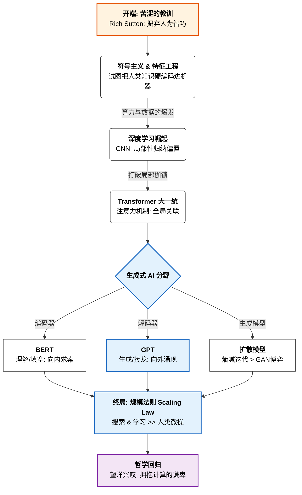
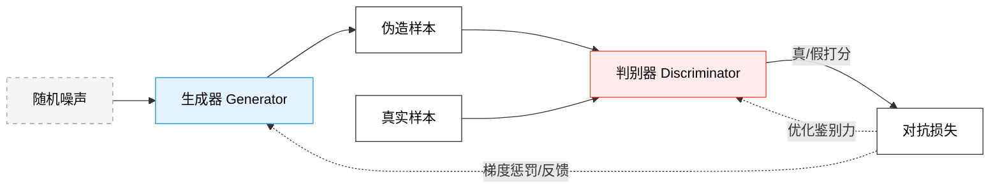

# AI 进化论：一部‘苦涩教训’的宏大叙事

理查德·萨顿（Richard Sutton）在《苦涩的教训》中提出的论点，通过 AI 演化史上几个关键的技术跃迁得到了完美的印证。这部历史不仅仅是算法的更迭，更是一个关于“人类经验不断退场、通用算力全面接管”的宏大叙事。

---

## 📘 文章大纲

## 1. 智能的“哥白尼革命”：谁才是进化的中心？

图 1：【有涯之知，望无涯之海】 “吾生也有涯，而知也无涯。以有涯随无涯，殆已。” ——《庄子·养生主》

想象一下 16 世纪，当哥白尼指着星空告诉世人“地球并非宇宙的中心”时，那是何等的荒谬。这种“苦涩”不仅仅是科学层面的挫败，更是一种地位的剥夺——人类不再是上帝特意安排在宇宙核心处的唯一主角。

在 AI 发展的这七十年里，我们其实一直在经历类似的 **“心理回撤”**。

在很长一段时间里，我们理所当然地认为人类就是智能的“标尺”。我们研究自己如何看风景、如何学下棋、如何理解语言，然后小心翼翼地把这些经验翻译成代码，塞进机器的骨架里，并将其命名为“智能”。我们总觉得自己是那位手把手教孩子走路的伟大父亲。

但这个温情的幻觉正被大工业时代的演化逻辑无情戳破：智能并不是被人类直接“制造”出来的，它是被一种能够吞噬无限算力的通用逻辑“缩放（Scale）”出来的。**这是一场从“定义智能”到“观察智能涌现”的思想革命。** 我们以为自己在造神，其实我们只是在给另一种规则腾位子。

## 2. 远古的幻觉：当逻辑撞上进化的南墙

### 2.1 符号主义的微操与“逻辑中心论”的破产

图 2：【名可名，非常名】 “名可名，非常名。道可道，非常道。” ——《老子》

在现代计算机发芽的 20 世纪中叶，研究者们曾陷入一场天真的逻辑狂欢。当时的共识是：既然数学证明、复杂运算和下棋是人类智力的最高体现，那么只要我们能把逻辑规则精准地转化为代码，机器自然就能产生智能。这种想法催生了盛极一时的**符号主义（Symbolic AI）**。在那一代先驱的眼中，世界是可以被离散化、符号化的，只要逻辑法则足够周全，智能就是手到擒来的副产品。

这种“微操”物理世界的傲慢，导致了一个严重的认知错位：人们认为让电脑解微分方程是很高级的智能，而“看清一张照片”这种连孩童都能信手拈来的感知，只是查表级别的体力活。

### 2.2 图灵的“大撤退”：从定义智能到模仿发现

图 3：【复归于婴儿】 “为天下溪，常德不离，复归于婴儿。” ——《老子》

就在这片逻辑崇拜的浪潮中，阿兰·图灵（Alan Turing）却展现出了一项极其超前的、甚至带有哲学先见的突破。

在 1950 年那篇奠基性论文中，图灵并没有试图解剖“灵魂”的构造，而是提出了著名的 **“模仿游戏（Turing Test）”**。图灵的真正价值在于：**他其实是在哲学上先行放弃了对智能本质的定义权。** 既然我们连人类思维的黑盒都尚未打开，何必去强行规定机器的内部逻辑必须符合某种“人类规范”？只要它能表现得像个人，它就是智能。

更绝妙的是，图灵提出了 **“小孩机器（The Child Machine）”** 的概念。当全世界都在试图将成年的、僵化的逻辑体系“硬编码”进机器时，图灵却反其道而行之：**与其去建造一个装满了人类发现成果的复杂系统，不如尝试造一个像“小孩”一样的空白机器，然后通过过程式的“奖励与惩罚”来教它自己从微弱的信号中去进化。** 他在 70 年前就触碰到了一个核心真理：**与其灌输人类已经发现的成果（那是有限的），不如把那种“去发现”的能力直接内置（那是通用的元方法）。**

### 2.3 莫拉维克悖论：一份来自进化的“诊断书”

图 4：【大道至简，大象无形】 “天地有大美而不言，四时有明法而不议，万物有成理而不说。” ——《庄子·知北游》

虽然图灵指出了方向，但早期的 AI 还是在符号主义的迷宫里撞得头破血流，直到遭遇了著名的 **“莫拉维克悖论”** ：让电脑解一道微分方程并不难，但让它像个婴儿一样认出一只猫、平稳地走两步路，却成了不可逾越的天堑。这份诊断书撕开了两个残酷的事实：

- **小脑的沉默：被低估的“计算巨兽”**

  - 在人类神经系统中，约 80% 的神经元其实都密集地挤在负责运动协调、精细控制的小脑里，而负责语言、计划的大脑皮层，其神经元占比仅为 20% 左右。这揭露了一个真相： **人类引以为傲的理性逻辑，在进化长河中其实是极度“廉价”且低功耗的副产品；** 而那个支撑你在物理世界维持平衡、处理海量感知反馈的小脑逻辑，才是消耗了数亿年进化堆叠出来的“硬通货”。

  - 这种错位的背后，是上亿年进化的神作。小脑之所以静默且极度节能，是因为它已经在亿万次的物理博弈中，将感知算法固化成了能效比极高的并行处理逻辑。**我们之所以觉得走路不累、做题累，是因为走路这件事早已被进化这款“超级算力”优化到了极致；** 而数学推理，不过是进化晚期才临时打上的一块、尚未完全磨合好的低效补丁。目前我们用算力堆出了能考试的“大脑（大模型）”，却造不出一个像猫一样优雅跳跃的“小脑”，本质上是因为我们对那个神经元绝对大头的“小脑引擎”连门槛都没摸到。

- **架构的枷锁：疲于奔命的“数据搬运工”**

  - 为什么现在的机器人依然显得像个“智障”？除了缺乏一种真正能够描述感知的元学习方法外，现有的计算机物理底座——**冯·诺依曼架构**，也已经成为了进化的枷锁。这种“存算分离”的体系在大模型处理大规模感知数据时，效率低得惊人。算力资源在绝大部分时间里与其说是在“思考”，不如说是在充当疲于奔命的 **“数据搬运工”**。

  - 在那种狭窄的瓶颈里，我们试图用一套低效的搬运逻辑去模拟小脑那种极致并行的物理本能，这注定是一场由于硬件物理极限导致的“降维打击”。**当我们用万瓦级别的能耗去模仿生物仅需几瓦就能实现的感知本能时，这种巨大的能效鸿沟正在嘲讽着人类目前的自以为是。** 如果我们不能从底层架构和学习范式上发生质变，仅仅靠给残缺的架构填补数据，或许永远无法触碰到那个真正具备物理本能的智能内核。

## 3. 经验的屏障：特征炼金术与联结主义的突围

### 3.1 最后的掌控感：当人类充当机器的“拐杖”

当符号主义那种“在代码里硬编码整个世界逻辑”的宏大愿望宣告破产后，研究者们并没有立刻走向“算力放权”，而是退而求其次，选择了一场名为 **“特征工程（Feature Engineering）”** 的漫长折中。

这是一个极具“匠人气感”的时代。人们意识到，直接教机器“什么是猫”太难了，于是转而教机器如何“去观察”。在这个阶段，人类充当了机器的“感知拐杖”——顶级的研究者凭借惊人的直觉，手动设计出了 **SIFT**（尺度不变特征转换）、**HOG**（方向梯度直方图）、**MFCC**（梅尔频率倒谱系数）等极其复杂的数学算子。

这本质上是人类试图用公式捕捉我们感官系统的运作规律。研究者们相信：只要能把物体的边缘、纹理和频率分布通过数学公式提取出来，揉碎了喂给机器，机器就能在人类的“辅导”下开窍。在这种模式下，一个 AI 专家的水平高低，不取决于他拥有的算力，而取决于他提取特征的“炼金术”是否足够高明。

### 3.2 深度学习的孤岛：为什么它曾被主流“吊打”？

在那个疯狂“炼金”的 20 世纪末到 21 世纪初，我们现在信奉的深度学习其实扮演着一个极其落魄的角色。

图 5：【2010 年代初：特征工程的黄金时代】 由于缺乏算力与数据，襁褓中的深度学习在精密的传统算法（如 SVM）面前毫无还手之力。

原因之一在于 **“算力与数据的贫血”**。在 CPU 时代，深度学习就像是一个贪婪的、无法填满的“算力黑洞”，它吞噬了昂贵的计算资源却只能产出支离破碎、难以预测的结果。

相比之下，**支持向量机（SVM）** 等算法则是那个时代的“数学宠儿”。SVM 拥有着近乎完美的仪式感：它追求的是 **“最大间隔（Maximum Margin）”**，试图在数据堆中画出一条最有尊严、最稳健的分类界线。更令学术界着迷的是它那点石成金的 **“核技巧（Kernel Trick）”**——通过一套优雅的非线性变换，将低维空间中杂乱无章的数据，瞬移到高维甚至无穷维的希尔伯特空间中，使原本不可分的难题变得清晰可分。这种基于凸优化的算法在理论上保证了“全局最优解”，且在只有区区几百个样本的小数据集上，配合人类精心提取的特征，就能跑出令早期神经网络望尘莫及的惊人性能。在那时，SVM 就是精密、科学与高效的代名词。

更深层的原因在于人类对 **“掌控欲”** 的执念。SVM 的超平面、特征工程的算符都是可解释的、透明的；而神经网络里那海量权重参数的跳动，在当时的精英眼中简直就是“毫无科学美感的调参游戏”。人类宁愿要一个“能解释得通的、由我教出来的残疾模型”，也不愿意接受一个“完全看不懂、但能自己产生智能”的黑盒。这种偏见，让算力逻辑在故纸堆里又沉睡了二十年。人类在那片自以为是的“透明”浅滩中自我陶醉，守护着脆弱的智力尊严，却浑然不知自己正握着通往深海的钥匙，却只敢用来开启路边的水壶。

直到算力的火种终于烧穿了偏见的迷雾，那口被人们嫌弃了二十年的“黑盒”，才终于在世人面前展示了它真正的深邃与恐怖。

### 3.3 2012：一场关于“暴力”与“智巧”的清算

关于“苦涩教训”的终极审判，发生在 2012 年的 ImageNet 视觉竞赛（ILSVRC）上。

图 6：【2010 年代末：深度学习的全面复仇】 当大数据的洪流奔涌而至，那个曾经的“弱者”依靠暴力 Scale 的本能，瞬间掀翻了所有基于智巧的旧逻辑。

在那场竞赛中，由 Geoffrey Hinton 团队派出的 **AlexNet** 横空出世，将传统视觉算法（那些耗费数十载优化的精巧特征算符）甩开了整整一个身位。这场胜利背后隐藏着一个让所有数学精英感到难堪的真相：

卷积神经网络（CNN）的数学底座极其“贫瘠”。相比于 SVM 那种高深的核函数空间，或者随机森林里复杂的统计集成逻辑，CNN 几乎简陋得令人发指——它本质上就是一堆最基础的**矩阵乘法**和**简单求导**的堆叠。它没有复杂的统计假设，没有精妙的概率约束，只有一种近乎原始的、机械式的重复。

然而，正是这种“数学上的简陋”，赋予了它近乎无敌的 **“可扩展性（Scalability）”**。

那一年，最讽刺的一幕发生了：谷歌曾动用了一万六千块 CPU 核心组成的庞大计算集群，才勉强识别出了视频中的猫；而 AlexNet 仅仅依靠两块几千块钱的英伟达家用显卡（GTX 580），就完成了对物理世界的降维打击。这场竞赛证明了一个残酷的逻辑：**人类精心雕琢的、基于智巧的算法模型，在可以无限扩展规模的、基于矩阵运算的“暴力机器”面前，连热身运动都算不上。**

这并不是对特征工程逻辑的致敬，而是一场彻底的、反精英主义的屠杀。研究者们惊恐地发现：CNN 仅仅是经历了几次迭代，就在前几层自发“复刻”了人类曾废寝忘食才写出的 SIFT 特征——而且，这仅仅是它在下潜深海前的一场浅滩预热。

当研究者试图通过“特征图”去窥探机器的内心时，感受到的却是一种前所未有的幻灭。**机器确实复刻了人类的经验，但它做得远比人类更多、更深。**

这里更具讽刺意味的是两者的“劳动量”对比：人类顶级数学家可能需要耗费数年甚至数十年，才能推导出一个像 SIFT 这样具有高度泛化能力的特征算子；但在卷积神经网络时代，我们只需要修改一行代码，将“通道数（Channels）”从 64 增加到 512，机器就能在同一个层级内自动发现成百上千种不同的特征维度。

这种发现的门槛被彻底扫平了——其中 99% 的模式都是人类从未察觉、也无法命名的“隐形特征”。人类精心雕琢的“炼金术”，在只需调整一个超参数就能涌现出的超维特征面前，显得是如此的笨重与低效。

更深刻的 **“认知断层”** 发生于高层网络。在浅层，我们还能自豪地说“看，机器学到了我教过的边缘检测”；但到了高层，那些特征已经抽象成了一种人类语言完全无法覆盖的 **超维空间** 。这些特征可能是某种光照下的质感、某种几何结构与某种像素共震的非线性叠加，它们在人类的大脑中没有对应的回路，在人类的语言中没有对应的词汇。

这揭露了一个残酷的真相：**人类这么多年的努力和挖掘，其实只是触碰到了智能冰山下那 1% 可被解释的、“廉价”的浅滩；而那决定性能上限的 99% 的深海特征，全藏在人类理解力的边界之外。**

这样一种降维打击，给了人类最后的一记重锤：如果我们继续固执地要求机器必须按人类能理解的方式（可解释特征）去学习，我们其实是在强迫一个天才去阅读那些枯燥的初级课本。真正的智能跃迁，恰恰始于人类彻底放手，允许机器去构建那些我们看不懂、说不出、却精准无比的“黑暗特征”的那一瞬间。

这也意味着，人类的角色正在发生根本性的位移：**我们不再是那个手把手教导知识的“导师”，而成了搭建平台的“基建商”。** 我们只需要通过最底层、最通用的指令赋予程序探索的能力，为它提供肥沃的算力土壤与无限的数据水源。剩下的，就交给算力逻辑在进化的长河中去自动演化、去自我涌现、去发现那些超越人类认知的无限可能。

## 4. 架构的内战：卷积偏见 vs 全局缩放

如果说特征工程的终结是人类放弃了对“内容”的微操，那么接下来的这场变革，则是人类开始放弃对机器“思维构造”的微操。

### 4.1 归纳偏置：智能演化的“辅导员”

在深度学习全面接管之前，人类在算法中注入智慧的主要方式是设置 **“归纳偏置（Inductive Bias）”**。这可以理解为人类预先给机器划定的“思维边界”或“偏好”，告诉机器：“这个世界大致是按这种规律运行的，你往这个方向找答案。”

如果我们回看历史，会发现 AI 的演化其实是一个**不断“戒断”归纳偏置**的过程。

传统的机器学习模型（如 SVM、随机森林）是归纳偏置的“重灾区”。人类不仅要手动设计特征，还要规定高维空间的核函数形式，甚至要预设复杂的统计分布模型。此时的 AI 几乎是人类知识层层包裹下的傀儡。

相比之下，卷积神经网络（CNN）的出现，其实是 AI 历史上的一次**“大减负”**。它果断抛弃了那些琐碎的人为逻辑，只保留了两条来自物理世界的深刻洞察：**局部性（Locality）** 与 **平移不变性**。

在当时，这被视为一种极大的勇气。CNN 告诉机器：“我不教你什么是猫，我只给你一个能局部移动的窗口，剩下的你自己去学。”这种对人类指导的大幅削剥，正是 CNN 能够击溃传统算法的根本原因。在算力并不富裕的年代，这两条残存的归纳偏置成了神来之笔——它们像地图上的几条主干道，指引着初生的 AI 绕过计算的荒原，直接抵达性能的绿洲。

然而，演化的逻辑虽然苦涩，却从未缺席：**即便这种“已经很克制”的人为引导，在算力继续向无限扩张时，依然会从进化的助推器，异化为限制上限的“紧箍咒”。**

### 4.2 视野的博弈：从“井底之蛙”到“上帝视角”

图 7：【井蛙不可以语于海】 “井蛙不可以语于海者，拘于虚也；夏虫不可以语于冰者，笃于时也。” ——《庄子·秋水》

CNN 的核心局限在于它的“短视”。它就像一只**坐井观天的青蛙**，其视野被卷积核（Receptive Field）牢牢囚禁在井口那一小片圆形的苍穹中。虽然在早期，这种局部归纳偏置曾被跨界引入 NLP 领域（如 TextCNN）并取得过短暂辉煌，但在处理长距离语义依赖时，其“传话筒”式的信息失真终究成了难以逾越的障碍。

2017 年，**Transformer** 的出现率先在自然语言处理（NLP）领域终结了这场“地缘政治”。

它的“自注意力机制（Self-Attention）”彻底撕碎了井壁。它表现得极其冷酷且平庸：它不带任何关于序列或空间位置的先验假设，只是让每一个单词、每一个像素在第一时间就能直接俯瞰全局，与所有其他元素进行“平等对话”。

起初，视觉领域的研究者们还固守着 CNN 的坚固堡垒。直到 2020 年前后，**ViT（Vision Transformer）** 的横空出世，正式宣告了“井蛙时代”的落幕。人们惊奇地发现，当 Transformer 这一套源自语言处理的通用逻辑被直接粗暴地平移到图像领域时，只要算力与数据足够大，它竟然能以一种极其轻蔑的姿态击碎 CNN 数十年的积累。

这场“架构的大一统”意义非比寻常：当文本和图像通通坍缩进同样的 Transformer 底座中时，大语言（NLP）与大视觉（CV）之间的次元壁消失了。**多模态（Multimodal）** 的爆发自此成为必然——因为智能从此不再区分“看的”还是“读的”，它们都只是在同一个超维空间里进行着万物互联的暴力博弈。当算力消除了一切因任务而异的“架构偏见”，通往通用人工智能（AGI）的窄门才真正推开。

### 4.3 终极的“放权”：为什么“空无一物”反而赢了？

图 8：【抟扶摇而上九万里】 “大鹏一日同风起，扶摇直上九万里。” —— 李白 

这再次印证了那个苦涩的真理：**架构上的任何“精巧设计”（归纳偏置），长期来看都是一种效率损耗。**

CNN 是一套带着人类枷锁的精密时钟，而 Transformer 则是一片空旷无垠的荒原。在小规模时，精美的时钟总是比荒原看起来更有用；但当太阳（算力）升起，当万物（数据）生长，那片空旷的荒原上会自发涌现出比时钟复杂亿万倍的生态系统。

Transformer 的胜利，是“无为而治”的胜利，更是体现了庄子笔下的至高境界。

在《逍遥游》中，庄子认为真正的自由是不依赖于任何外物的，也就是 **“无所待”**。CNN 之所以无法真正“逍遥”，是因为它必须 **“有所待”** ——它依赖于人类提供的局部特征地图，依赖于预设的空间规则。而 Transformer 则实现了某种意义上的“无所待”：它放弃了所有的人为引导，将自己彻底清空，从而获得了容纳无限规模的能力。

我们放弃教机器“你应该关注局部”，结果它自己从数据中悟出了超越局限的广袤关联。这种“将自己清空”的架构底座，完美契合了 GPU 这种暴力矩阵运算的物理本能。**我们发现，通往至高智能的路径，竟然是一个通过彻底的“断舍离”来换取绝对自由的过程。** 我们离造物主的宝座（微操）越远，离真正的智能（自由涌现）就越近。

## 5. 生成的哲学：博弈的短视 vs 迭代的永恒

在如何生成“创造力”的命题上，AI 经历了一场从“精妙博弈”到“纯粹迭代”的哲学突变。这再次印证了那个苦涩的必然：任何依赖人为智巧的局部设计，终将在普适的算力洪流面前显得脆弱不堪。

### 5.1 GAN 的黄昏：被囚禁在“博弈”中的灵气

图 9：【相反相成：博弈的闭环】 “相反相成，各尽其能。” ——《汉书》

早期的 **GAN（生成对抗网络）** 曾以其惊艳的对抗美学统治了生成领域。它的核心思想是一个极具张力的“警察与小偷”的故事：

- **生成器（小偷）**：是一个拼命想要制造出完美赝品的伪造商，它试图从判别器的“退货”反馈（Feedback Loop）中汲取知识。
- **判别器（警察）**：是一个目光如炬的鉴定专家，它在真钱与假币（Real vs Fake）中穿梭，通过一次次“Rejected（驳回）”来倒逼小偷进化。

这是真正意义上的 **“道高一尺，魔高一丈”** 。判别器的每一次火眼金睛，都在强迫生成器去修炼出更超凡脱俗的伪造技巧。GAN 的魅力就在于这种“魔”与“道”在对抗中的螺旋上升，最终凭空涌现出令人震撼的创造力。而且，这种“博弈与反馈”的思想也深度渗透到了强化学习的 **“演员-评论家”（Actor-Critic, AC）架构**中：Actor 负责尝试，Critic 负责鉴别。

然而，这种人为设计的“博弈闭环”极其脆弱，其“含金量”在工业化大规模训练面前迅速贬值：

- **驯化的极度不稳定**：训练一个 GAN 就像是在刀尖上平衡天平。如果判别器稍微变强一点点，生成器就会因为收不到有效信号而彻底“摆烂”（梯度消失）；如果两者失衡，整个体系会瞬间瓦解。为了稳住这架精密的“纸飞机”，研究者不得不手动发明无数复杂的损失项和调参技巧，这种过度的人为干预（Micro-management）正是萨顿所批判的“昂贵偏见”。
- **多样性的塌缩（Mode Collapse）与“现实的牢笼”**：这是 GAN 最致命的创造力上限。因为判别器的存在，生成器的唯一目标是“看起来像真的”。这种逻辑导致它极易陷入投机取巧的泥潭，反复生成几张特定的、被证明“奏效”的图片。更深层的问题在于，**GAN 永远无法产生真正的“天马行空”**——因为它必须时刻取悦那个基于现实数据的“判别器”。如果它生出了现实中不存在的奇景，判别器会毫不犹豫地判它为“假”。这意味着 GAN 的创造力被永远囚禁在了一座名为“模仿现实”的牢笼里。
- **与 Scaling Law 的基因排斥**：最关键的教训在于，GAN 几乎无法受益于 Transformer 这种旨在“暴力缩放”的引擎。Transformer 渴望在大规模数据中进行自由的全局博弈，而 GAN 娇贵的纳什均衡机制根本承载不了如此巨大的冲击力。一旦马力过猛，博弈链条就会崩断。

### 5.2 扩散模型：由灰烬逆转时间的“魔术”

图 10：【时空逆转：从混沌回归秩序】 “天下万物生于有，有生于无。” ——《老子》

随后崛起的 **DDPM（扩散模型）** 开启了一场真正的 **“架构大赦”**。

这种“魔术”的最初雏形并不是诞生在画室，而是来自于**非平衡热力学（Non-equilibrium Thermodynamics）**。2015 年，研究者 Jascha Sohl-Dickstein 从 **“墨水入水”** 的物理现象中获得灵感：一滴墨水掉进杯中，会由于熵增而迅速扩散成无法分辨的浑浊混乱。他思考的是，如果能精确记录下数亿水分子的碰撞过程，是否能逆转时间，让那一杯浊水重新聚回成那一滴纯净的墨水？

这正体现了那种极简的演化哲学：**不再指望人类去定义“画作”的构图，而是去模仿宇宙中最普适的“熵增与熵减”规律。** 它不再纠结于人造的对手，而是开启了一场 **“将大局逆转的魔术”** 。简单点说就是它是怎么没的，你就让它怎么复原。

相比于 GAN 那种充满了智巧的博弈，扩散模型的原理在初期显得极其“平庸”：它先是狂暴地将客观世界的秩序碾碎成一滩死寂的噪声（熵增），然后教会机器如何在废墟中剥离混沌，**从寂灭的灰烬中逆转时间，精准地召回那些早已消散的秩序。**

- **无需博弈的稳定收敛**：它将复杂的生成任务降维成了一个稳定的、可预测的回归任务。它不需要看判别器的脸色，只需要闷头计算“如何比上一步更接近真相”。这种逻辑赋予了它极强的稳定性，使得训练过程可以丝滑地承载数万块 GPU 的算力洗礼。
- **与 Transformer 的天作之合**：由于扩散逻辑是纯粹的数学转换，它完美契合了 Transformer 全局处理的本能。这种“放弃对抗、拥抱迭代”的思路，催生了 DiT 等横扫业界的架构。
- **多样性的自涌现与“虚无的想象力”**：这是扩散模型对 GAN 的降维打击。因为它不追求“骗过谁”，而是追求“从混沌中还原什么”。由于起点是随机噪声，每一条还原路径都通向一个全新的世界。这种机制赋予了它跨越现实边界的能力：它可以轻而易举地生成现实中从未存在过的物体、意象和超现实景观。**在 DDPM 的逻辑里，没有“看起来像假”的惩罚，只有“从虚无中召唤秩序”的自由。** 这种基于物理本质的生成逻辑，真正开启了 AI 超越人类经验的想象力之门。

这再次证明了那个苦涩的真理：**与其去设计精巧的博弈策略（人为智巧），不如寻找一个最简单、最通用、且最能吃算力的数学过程（迭代还原）。**

## 6. 终极判决：解读的脉络 vs 规模的法则

当 AI 进化到自然语言处理（NLP）的关口，理查德·萨顿预言的那种“智巧的终结”再次上演。而这一次的主角，是一对同出一门却分道扬镳的“师兄弟”：**BERT** 与 **GPT**。它们共同继承了 Transformer 模型最纯正的血统，但却分别选择了不同的修行路径。

### 6.1 同门师兄弟：编码器 vs 解码器

要理解它们的宿命，首先要理解 Transformer 架构中的两个核心分工：

- **编码器（Encoder）：封印现实的“翻译官”**
  编码器的本质，是把现实世界中的事物（如语言、图像）通过多层算力的处理，坍缩进一个高度精炼的、机器能听懂的**向量空间（Latent Space）**中。它是将复杂的现实“映射/存入”数字脉络的过程。它的目标是**“准确解读”**。
- **解码器（Decoder）：解析虚无的“召唤师”**
  解码器的本质，则是把那个抽象的向量空间作为种子，将其中的数学逻辑重新解析、还原、表达成人类可读的现实形式。它是从数字中“召回/提取”意义的过程。它的目标是**“逻辑重构”**。

图 11：【Transformer 完整架构】 左侧为编码器（BERT的基础），右侧为解码器（GPT的基础）。 注意中间的那条虚线（Cross Attention），那是两者唯一的沟通桥梁，也是理解与生成的分界线。

### 6.2 BERT：战术上的“精读课代表”

2018 年底，NLP 领域经历了一场真正意义上的 **“技术屠杀”** 。

在 BERT 降临的前夜，王座由基于 RNN 的 **ELMo** 占据。人们曾惊叹于 ELMo 利用双向 LSTM 捕捉语境的能力，但这种设计本质上仍是一种模仿人类阅读直觉的、人为缝合的“伪双向（串行拼接）”。当 Google 带着 BERT 闯进战场并在 11 项核心任务中实现全方位碾压时，以 **RNN/LSTM** 为代表的串行时代在瞬间宣告崩塌。

这不仅是一个模型的胜利，更是 Transformer 这种“暴力并行协议”对人类时序思维的一次降维打击。这种历史的判决在此时显得格外冰冷：人类费尽心思设计的精巧门控记忆，在算力加持下的全局并行扫描面前，竟然如此不堪一击。就像 transformer 的论文的题目说的那样——**Attention Is All You Need**。

图 12：【完型填空：向内求精】 扫描上下文，填补缺失的意义。

**BERT**（Bidirectional Encoder Representations from Transformers）选择了编码器（Encoder）路径。它的核心思想可以用三个关键词来概括：

#### 1. 深度双向性：全方位的“透视扫描”

这是 BERT 杀掉 RNN 的致命武器。传统的 RNN 像是一只只能向前看的单眼，即便强行拼接成“双向”，也只是两只单眼各看各的（如同 ELMo）。而 BERT 利用 **Self-Attention（自注意力机制）**，让模型在看到一个单词时，能同时“透视”整句话中所有其他单词。它不是在“阅读”，它是在进行**全局的、瞬时的信息坍塌**。

#### 2. MLM（Masked Language Model）：残酷的“掩码训练”

BERT 的修行方式是一场持之以恒的 **“完型填空”游戏** 。在预训练中，处理程序会随机掩盖掉 15% 的单词：

- 它强迫模型去理解上下文的深层逻辑，而不是死记硬背。
- 为了填对一个空，BERT 必须像个语言学家一样，同时调用语法、逻辑和常识。这种“向内求索”的训练方式，赋予了它极高的**语义饱和度**。

#### 3. NSP（Next Sentence Prediction）：逻辑的纽带

除了词与词的关系，BERT 还要学习句与句的关系。它会判断两个句子是否是因果、转折或顺承关系。这种训练让它不再只是一个“词汇表”，而是一个拥有 **逻辑判断力** 的理解引擎。

- **成就**：这种“精读”模式让 BERT 精准如一把手术刀。通过“预训练+微调（Fine-tuning）”的范式，它第一次让 AI 在各类理解类任务（情感分析、阅读理解等）中表现得像个真正的学者。
- **局限**：作为编码器，它追求的是 **“理解的精准”** 。但正如前文所述，理解是有饱和点的。当它精准地将现实翻译成映射空间后，再增加参数，这种“理解力”的边际效益会迅速递减。这导致 BERT 被困在了“精密仪器”的格局里，参数量始终克制在亿级规模。

### 6.3 GPT：战略上的“接龙狂魔”

很少有人记得，**GPT-1 (2018 年 6 月)** 其实诞生在 BERT 之前。它是 Transformer 家族长子，却在出生伊始就体验到了世界的冷酷离奇。

#### “被遗忘的长子”与“BERT 的阴影”

当 Google 的 BERT 在四个月后以“技术屠杀”之姿席卷全球时，GPT-1 正尴尬地处在聚光灯的边缘。在当时的学术界看来，GPT 这种只看单向、试图生成文本的思路，在 BERT 那种精准的“双向扫描”面前显得既笨拙又低效。BERT 的影响力在当时被认为是 GPT 的十倍以上。人们嘲笑它：_“连上下文都看不全，怎么可能真正理解语言？”_

然而，这正是“苦涩教训”最深刻的转折点。

#### 逆袭之路：从“接龙”到“涌现”

在全世界都在疯狂微调 BERT、试图打磨更精密的“手术刀”时，OpenAI 却像一个孤独的赌徒，在解码器（Decoder）这条被视为“死胡同”的路径上梭哈了所有的算力。

- **GPT-2 (2019)**：它不再追求微调，而是展示了一种名为“零样本学习（Zero-shot）”的暴力美学。
- **GPT-3 (2020)**：参数量直接从亿级跃升至 1750 亿。那种最初看似平庸的“预测下一个词”的任务，在规模跨越门槛的瞬间，发生了令人战栗的质变。

当 2022 年 ChatGPT 横空出世，以摧枯拉朽之势席卷全球时，人们才发现：那个曾经被嘲笑只会“玩接龙”的独行侠，已经靠着最笨的方法，堆出了一个可以俯瞰全人类智力的上帝视角。

这，就是**解码器的终极复仇**。

图 13：【命题作文：向外求索】 预测下一个词，创造无限可能。

这场复仇成功的秘诀，并非源于某种精密的理解算法，而恰恰在于其对**“向外求索”**这种极简逻辑的终极偏执。GPT 这种基于解码器（Decoder）的进化逻辑，可以拆解为以下三个层次：

#### 1. 牺牲全局，换取规模的“因果自注意力”

不同于 BERT 为了精准理解而追求全知全能，GPT 在结构上采取了彻底的**“片面主义”**。它采用了 **Causal Self-Attention（因果自注意力）**，在训练中被故意遮住了“未来”的视野，只能看到左侧已有的字符。

这种设计初看是一种残缺，但在宏大的演化视角下却是天才的断舍离：因为它抛弃了复杂的双向对齐逻辑，使模型变成了一个完美的**并行化流式处理机器**。这种极简性，让它能够毫无阻力地“吃”掉海量的数据和算力，从而跨越了“理解”的饱和点。

#### 2. “接龙”背后的文明坍缩

图 12 中那个闪烁的游标，揭示了其平庸表面下的深邃本质。为什么单纯的 **“猜下一个词”** 能产生智慧？

为了在万亿次的接龙中不出错，模型必须在内部构建出一套极其深邃的、关于真实世界的**模拟器（Simulator）**。它不是在背书，它是在用暴力算力将整个人类文明的逻辑规律，强行炼化、坍缩进参数的权重里。当你能精准预测概率时，你便掌握了真理。

#### 3. 从概率游戏到“智能相变”

这种逻辑最可怕的地方在于，它是为 **Scaling Law（规模法则）** 而生的：

- **无上限的进化**：生成任务（接龙）没有饱和点。随着算力的倾泻，简单的概率预测发生了**相变（Phase Transition）**。
- **智能的涌现**：我们惊恐地发现，那些人类引以为傲的“逻辑推理”、“代码编写”甚至“共鸣”，竟然都只是在无限预测概率时顺带产生的**涌现副产物**。

历史的判决在此时显得格外冰冷：**与其费尽心机教机器如何“理解”（人为智巧），不如给它一个最简单的目标，然后用无限的算力去“堆”出秩序。** 解码器的“召回力”，在算力的加持下，生生吞噬了编码器的“理解力”。

## 7. 尚未封顶的巴别塔：RLHF 是终点，还是新的“紧箍咒”？

当我们站在如今这个基于 gpt 的大语言模型如此繁盛的时代，俯瞰众生时，许多人认为 AI 的进化已经触碰到了终点。但如果用更长远、更苦涩的视角去审视，我们会发现：即便是在这个大繁荣时代，人类那份“试图掌控机器灵魂”的执念依然阴魂不散。

理查德·萨顿在最近的演讲中，对现状泼了一盆极其清醒的冷水。他指出，目前的大语言模型虽然吞噬了算力，但它们依然被困在一种 **“被动模仿（Mimicry）”** 的泥潭里。

### 7.1 模仿学习的上限：人类数据的“回声壁”

目前的大语言模型本质上是一个极其高明的**概率接龙引擎**。它在学习如何“像人一样说话”，而不是在学习“如何独立探索世界”。
我们用 **RLHF（基于人类反馈的强化学习）** 这一套极其复杂的手工流程，试图让模型符合人类的价值观、道德感和表达习惯。这听起来很美好，但在进化的尺度上，这其实是又一次大规模的 **“人为微调”** 。

### 7.2 萨顿的质问：RLHF 的“苦涩回撤”

萨顿认为，RLHF 的本质是人类再一次试图将自己的“偏见”和“偏好”强行硬编码进机器的最后决策层。

- **人为的边界**：当你通过人类反馈告诉 AI“这个回答更好”时，你其实是在用人类有限的审美和逻辑去剪裁 AI 无限的可能。
- **缺乏真实博弈**：真正的智能应该像 AlphaGo 一样，在与环境的真实交互中、在对目标的自主搜寻中去进化。目前的 LLM 依然是“死”的，它们在训练结束后就停止了演进。

### 7.3 未竟的征途：从“模仿人类”到“发现世界”

大语言模型目前展现出的“智慧”，很大程度上是对人类文明存量数据的**高效重构**。
按照“苦涩教训”的终极逻辑，AI 的下一次质变，必将发生在它彻底摆脱对人类标签、人类偏好乃至人类语言本身依赖的那一时刻。当机器不再学习“人类如何回答”，而是像物理学家一样直接去“搜索世界的底层规律”时，真正的 AGI 才会降临。

这并不是终点，这甚至可能连终点的序幕都还不算。我们依然在用人类的“小手”牵着 AI 这个“巨人”过马路，而它真正奔跑的那一天，必然是我们彻底松手、不再要求它“像人”的那一天。

## 8. 结语：拥抱“苦涩”的进化直觉

这场“苦涩的教训”之所以贯穿了 AI 的七十年史诗，其核心逻辑在于理查德·萨顿发现的一个残酷公式。他指出，在 AI 的长期博弈中，真正能够随着计算资源增加而实现无限扩展的路径，其实只有两条：

> **“在 AI 的长期发展中，唯一奏效的方法是那些能够随着计算能力的增加而不断扩展的方法。这类方法主要有两种：搜索（Search）与学习（Learning）。”**

正是这两条路径，宣告了所有“人为智巧”的终结。

### 8.1 为什么人类直觉注定是“进化瓶颈”？

我们需要深入探讨的是：为什么我们引以为傲的知识和经验，在算力面前会显得如此苍白？

核心原因在于 **“认知的对称性破缺”** ：

- **静态的人类知识**：人类推导出一个公式、手动提取一个特征，其价值是线性的、静态的。不管你给它多少倍的算力，一个 SIFT 算子永远只能提取边缘和纹理，它无法自发地演化出高级语义。人类的“微操”本质上是在给机器打补丁，而补丁永远无法支撑起一座文明的大厦。
- **指数级的通用算法**：搜索与学习是 **元方法（Meta-methods）**。它们不依赖于具体的任务细节，只依赖于算力的多寡。根据那个令人战栗的逻辑：算力每隔 18 个月就翻一倍，那么基于算力的元方法其效率也呈指数级上升。这种规模带来的“复利效应”，是任何天才的大脑都无法通过手动设计来抗衡的。

### 8.2 认知的维数灾难：超维空间的真相

人类所谓“智慧”，本质上是对世界的一种 **有损压缩** 。因为我们的大脑无法处理海量原始数据，所以我们进化出了语言、逻辑和模型。这些工具是人类的“生存捷径”，但它们并不是世界的真相。

当我们强迫机器去模拟人类的这些“快捷方式”时，我们其实是在用一种二流的过滤器（人类直觉）去限制一个超维度的发现引擎。AI 的强项不在于它能像人一样思考，而在于它能直接在千维、万维的向量空间里，发现那些隐藏在信息深处的、人类语言体系完全无法触及的规律。

**真正的 AI 含金量，不在于我们投喂了多少人类已知的智慧，而在于我们学会了多少次“对算力的放权”。**

### 8.3 从“造物主”到“点火者”的断舍离

我们需要完成一场从“导师”到“点火者”的断舍离。我们不再去指手画脚机器应该如何思考，而是转而去修炼如何提供更广袤的土地（数据）、更充沛的氧气（算力），以及最底层、最通用的进化指令。

### 8.4 望洋兴叹：在超维边界处的谦卑

图 13：【秋水：小大之辩】 “于是焉河伯始旋其面目，望洋向若而叹。” ——《庄子·秋水》

在《庄子·秋水》中，黄河之神河伯曾以为自己“天下之美尽在于己”，直到他顺流而下，看到了浩瀚无垠的北海。在那惊心动魄的广袤面前，河伯才终于“旋其面目，望洋向若而叹”，意识到自己曾经引以为傲的世界，不过是沧海一粟。

这正是我们要面对的、关于“苦涩教训”的终极隐喻。

在长达七十年的时间里，我们曾像那个坐在黄河里的河伯，沉迷于对每一个特征、每一条规则、每一个逻辑闭环的精巧雕琢。我们自以为用人类的理性和智巧掌握了智能的全部真相。但实际上，那只不过是我们在人类认知这个“有限流域”里的自娱自乐。

随着算力与数据的北海大潮奔涌而至，机器在那些我们看不见的超维空间里，展现出了千万种超越人类想象的可能。我们终于被迫承认：**世界的复杂度远远超过了人类能力的边界，我们已知的真理，仅仅是真理海洋边缘的一粒沙。**

这种“望洋兴叹”并不代表绝望，它代表的是一种 **高维度的诚实** 。

只有当我们彻底放下了那份“我懂、我教、我操纵”的傲慢，我们才真正拥有了拥抱无限可能的勇气。萨顿的教训之所以苦涩，是因为它撕碎了人类旧有的王冠；但它同时也是一份厚礼——它让我们在智能的生命长河中，从一个固执的“教书匠”，进化成了在那片浩瀚深蓝面前，一个永远保持敬畏且清醒的观测者。

智能的彼岸，本就不在人类的语言里。它在那片无限扩展的、属于算力与时间的星辰大海里。