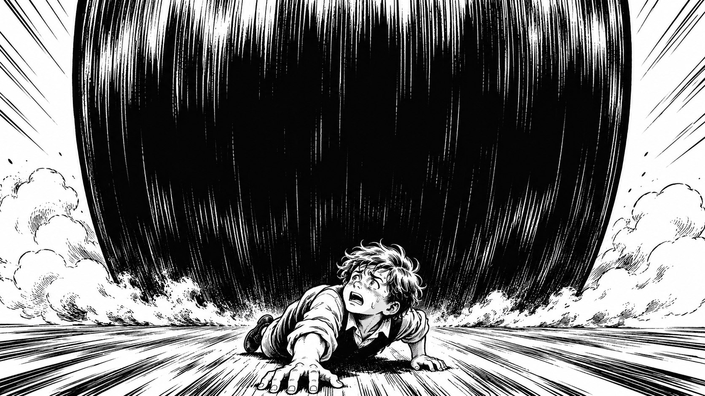
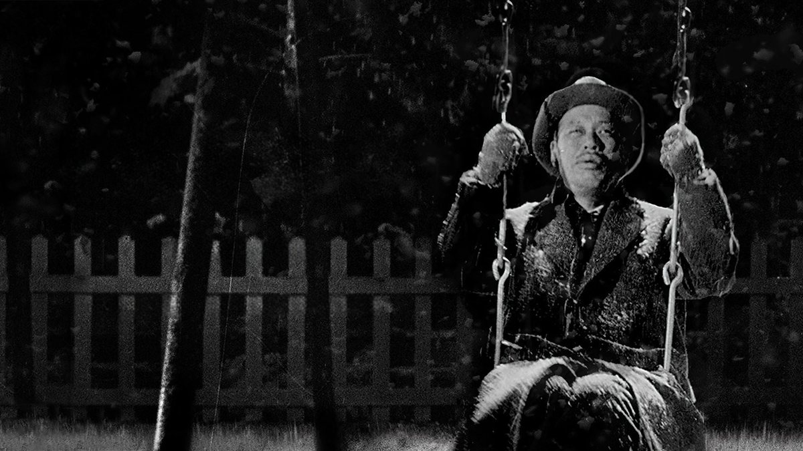

# 我觉得我的人生需要一点折腾

“从何时开始忌讳空山无人，从何时开始怕遥望星尘。” ——林夕《任我行》

之前在 B 站刷到过一类让人哭笑不得的视频，主题叫作“中国人一生的关键时刻”。

从六岁上小学开始，小升初很关键，中考很关键，高考很关键；好不容易上了大学，选专业很关键，毕业找第一份工作很关键，紧接着买房很关键，结婚生子很关键，甚至连将来孩子上哪所学校、自己退了休怎么养老，步步都是“不能走错的关键一步”。

看完之后我忍不住自嘲：原来我们从记事起一直“关键”到入土老死，这一辈子活脱脱成了被节点推着走的“键人”。

在这张排得密不透风的时间表里，每个年龄都被提前预设好了指定的任务。而到了三十岁前后，时间表上的问题好像一下子全凑到了眼前：工作、收入、婚姻，每一项都有人替你惦记着。

---

## 一、被安排好的人生：我们到底是在生活，还是在“完成任务”？

每逢佳节回家，围绕在你身边的寒暄往往都会集中到几个固定的问题上：工作稳不稳定？收入怎么样了？什么时候结婚？

在世俗默认的标尺里，三十岁是一个必须见到“阶段性成果”的年纪。倘若你在这个节点还没能混出个世俗认可的模样、没能进入一段稳定的婚姻，在旁人眼中，这就不仅仅是一种个人状态，而更像是一场人生的重大失利。

可只要把时间线拉长一点对比，就会发现这套标准里藏着一种明显的割裂。

在学校读书的时候，大人对你的要求只有一个——好好学习。那时候，课本之外的一点走神、对异性的一点懵懂好感，都会让父母和老师如临大敌，恨不得替你把所有情感枝杈都修剪干净，死死摁在“考学”这一个指定位置上。

然而一旦大学毕业、跨出校门，原本被严防死守的东西，突然又成了必须立刻兑现的指标。前二十年不准你练习如何去爱、如何与另一个人建立深度连接，一过二十五岁，却要求你无缝衔接地相亲、恋爱，一夜之间交出一段成熟的婚姻。

### 为什么长辈们很少觉得这中间有什么矛盾？

很多父母常挂在嘴边的一句话，或许就透露了其中的逻辑：**“你不结婚，我们的任务就没完成。”**

如果从“情感如何自然生长”的角度看，前二十年严禁早恋与毕业后疯狂催婚确实荒诞；但如果你换一个视角，从**“阶段性指标交付”**的逻辑去看，这两件事非但没有矛盾，反而高度自洽：

在这套评价体系里，无论是当年的考学，还是如今的成家，都容易被看成“任务”的结算，至于一个人如何成长、如何建立关系，反而退到了后面。读书的时候，感情被视为干扰升学指标的噪音，所以必须清除；到了三十岁，婚姻和孩子成了这个阶段必须勾选的考核项，所以又得立刻兑现。

更耐人寻味的是，在这整套催促的话语里，**唯独很少听到关于“爱情”本身的探讨**。

这倒不是说父母不希望你过得好——恰恰相反，他们是真的担心你往后受苦、害怕你老无所依。可或许是被他们那一辈人的生存经验与焦虑推着走，他们太急于看到一个能让自己安心的“确定结果”了。于是你会发现，长辈在催促你成家时，很少会和你聊起爱情本身有多美好、两个人灵魂契合有多幸福；伴随关心而来的，往往是一套我们从小听到大的**“恐惧驱动话术”**——“三十岁还不结婚以后会怎样怎样”、“老了没有孩子会有多凄凉”，就像读书时那句“现在不好好学习以后就只能去扫大街”如出一辙。

**当对子女的关切被装进这套焦虑的时间表里，“按时交出的安全结果”就容易占据全部注意力；至于其中的人是如何学会去爱的、在关系里是否真正快乐，反而被挤到了视野之外。**

### 在车轮之下，掉队的人会怎样？

赫尔曼·黑塞在《在轮下》里，就写过一个被这样推着走的少年汉斯。

汉斯原本是个灵气十足的孩子，喜欢在溪边钓鱼，喜欢在夏日里发呆，对世界有着最天然的好奇。他身边的父亲、校长和牧师也并非恶人，他们都真心实意地盼着汉斯出人头地。可正是在这种“为你好”的期许下，所有与考进神学院无关的爱好，都被当成了不务正业的浪费。汉斯一步步放弃了钓鱼、放弃了玩伴、放弃了休息，拼命迎合着大人们为他规划的荣耀轨道，直到他的精神再也承受不住这种日复一日的紧绷，最终在疲惫中掉队，无声地倒在了车轮之下。

汉斯的故事过去了一百多年，但那套让人不敢停下来的逻辑似乎并没有变。到了三十岁，如果没能按规定混出个模样、没能按时成家，那种隐隐约约的“失利感”就会从四面八方围拢过来。

**在这台轰隆作响的车轮面前，人很容易生出一种恐惧：一旦没能按时完成阶段性的任务，就会被视为掉队的失利者，连停下来喘口气都像是一种过错。**

---

## 二、满分答卷背后的追问：当“活得体面”取代了“活得真实”

当然，并不是所有人都会像《在轮下》的汉斯那样在半途掉队。长辈们之所以在三十岁这个节点如此焦虑地催促，是因为在他们心里，早就存在着一份关于“完美人生”的终极范本：

读书时是让人省心的优等生，一路考进好大学；毕业后考公上岸进入体制内端起稳定的饭碗，或者找一份体面的好工作；接着在恰当的年纪成家立业，娶一个温和贤惠的媳妇，生一个健康的孩子；从此日子一眼望得到头，衣食无忧，邻里敬重，一辈子兢兢业业、本本分分，不在任何人生节点上出格。

不可否认，这套范本有着巨大的吸引力。它提供了实实在在的确定感与世俗尊严——只要沿着这条被大多数人认可的路走，你就始终站在社会共识的安全区里，至少不必时时向别人解释自己的选择，也不必面对旁人异样的眼光。

### 这样的人生，真的如看起来那样完美吗？

如果一个人真的足够幸运、也足够努力，把这套“满分范本”原原本本地实现了，等待他的就一定是内心的笃定与圆满吗？

早在一百多年前，托尔斯泰就在《伊凡·伊里奇之死》里，把这样一段无懈可击的体面人生推演到了终点。

书里的伊凡·伊里奇，过的正是这种让所有人羡慕的日子。他年轻时成绩出众，毕业后进入司法体制内一路顺风顺水地当上法官，拿着优渥的俸禄；他按部就班地娶了门当户对的妻子，有了孩子，住进宽敞的新居。他一辈子做出的每一个决定——进什么部门、娶什么样的伴侣、交什么样的朋友、甚至客厅挂什么样式的窗帘——依据的都是同一条标准：“社会上有身份的人认为这样做是体面的。”

在长达几十年的顺境里，这套逻辑运转得毫无破绽。直到他在亲自布置新居时意外摔伤侧腹，此后身体日渐恶化、被绝症死死按在病榻上，那层体面的外壳才终于裂开了缝隙：

在漫长的病痛中，家里人把他的垂死当成破坏体面秩序的麻烦，只用虚伪的敷衍假装他一切正常；反而是那个地位卑微、不在体面圈子里的年轻仆人盖拉西姆，愿意整夜把他的腿架在肩上，给他久违的坦诚与安慰。甚至等他刚一咽气，同事们听到死讯的第一反应，只是盘算着谁能顶替他留下的职位空缺；妻子最关心的，则是怎样从政府那里多领一笔抚恤金。

托尔斯泰在书里写下了一段极为残酷的对照：在众人看来，他好像一直在走上坡路；其实他脚下的生活却在一点点往下滑——爬得越高，离真实的生命就越远，等到抵达终点，一切也就彻底结束了。

### 究竟什么是人生的“目的”，什么又是“体验”？

伊凡的悲剧，其实戳破了那种“标准完美人生”最隐蔽的一个盲区：**当我们忙着达成人生的一个个“目的”时，有没有忽略身在其中的“体验”？**

工作、婚姻、家庭，既可以是我们真心向往的目标，也包含着感受冷暖、建立真实连接的**体验**。可在那张世俗的时间表里，这些需要漫长投入的体验，却容易被压缩成一个个只求打卡过关的**目的**——好像只要考上了编、结了婚、生了娃，阶段性的任务就圆满结算了；至于在这段关系和往后的岁月里有没有真正爱过、好奇过、为自己心动过，反而成了无关紧要的事。

就像今天许多人的简历、朋友圈和相亲资料一样，上面整整齐齐地罗列着学历、编制、房产与婚姻状况，每一项都足够体面，却唯独像一面严实的屏风，挡住了屏风后面那个具体的人究竟活得快不快乐。

这就引出了一个比“没能按时交卷”更棘手的追问：**当一个人严丝合缝地达成了世俗要求的每一个“目的”，却唯独弄丢了对生命本身的“体验”，那么走到终点的那一刻，这一生究竟算不算真正活过？**

**只可惜，当伊凡·伊里奇在病榻上终于看穿这面体面的屏风、怀疑自己“这一生是不是全都活错了”的时候，时间已经没有给他重来一次的机会了。**

---

## 三、以迂为直：为什么标准答案之外，我们需要一点“偏差”？

如果只顾着完成标准答案，会让人忽略生活本身，那么在追求安稳的同时，我们还能为自己留出些什么？

我想，答案并不是去把现有的生活砸个粉碎，而是**允许自己的人生脱离最短的标准直线，生出一点“偏差”**。

世俗的标准答案，信奉的往往是“两点之间直线最短”——从读书、考编、结婚到养老，最好像一把尺子画出来的直线，一步多余的弯路都不要走。

可中国古典园林的湖面上，偏偏喜欢修一座**九曲回环桥**。如果过桥的唯一目的只是尽快赶去对岸交差，那当然应该修一座笔直的水泥桥，九曲桥上多拐的每一道弯都是浪费时间的“偏差”，在效率的评分表上一分都不加。但造园的人明白，人走到湖面上，本来就不是为了急匆匆赶路的——正是九曲桥故意让你左折一下、右拐一下，你的视线才得以换个角度：这一步看荷叶，下一步看游鱼，再拐一步微风扑面。

《孙子兵法》里有个词叫**“以迂为直”**，原意是讲行军打仗如何借迂回达成胜局；可如果借用这四个字来想人生，会发现生活的体验也是相似的：那些看似绕了远路、脱离了标准直线的“偏差”，往往藏着直线轨道里看不见的风景。

### 当剩下的时间不多，人还能怎样走出那条直线？

当然，现实生活里走出那条标准直线，并不总像在园林里走九曲桥那样从容。有时候，那一点“偏差”意味着明知会遇到麻烦与阻力，依然决定认真去做成一件事。

托尔斯泰没有给伊凡·伊里奇留出弥补的机会；而黑泽明在电影《生之欲》里，却把伊凡没来得及走完的那个问题接着往下推演了一步——如果一个人无法推翻过去三十年按部就班的人生，只在生命尽头剩下了最后几个月，他还能做些什么？

得知身患胃癌晚期之前，市民科长渡边勘治在市政厅按部就班地守了三十年办公桌，几乎从不缺勤，却也从不主动揽事，每天只是机械地在成堆的公文上盖章，把所有棘手的市民请愿推给别的部门，活得像一具安全的“木乃伊”。

当生命突然进入倒计时，渡边最初也不知道该怎么办。他试过揣着积蓄去夜总会买醉放纵，却发现感官的刺激只会加深绝望；他也曾羡慕地靠近过年轻女下属那种鲜活的生命力——女孩辞职去小工厂制作廉价的玩具兔子，却因为觉得那些小兔子能让自己和素不相识的孩子们产生联系而满心欢喜。

在“我剩下的日子究竟还能做什么”的困惑里反复挣扎之后，渡边才终于摸索出了属于自己的答案：他回到那个熟悉的市政厅，决定不再把市民反映已久的那片臭水沟推给下一个人，而是顶着官僚体系的推诿、同僚的冷眼乃至黑帮的威胁，拼尽最后的力气，推动建成了一座儿童公园。

**其实，折腾有时候并不是离开原来的生活，而是在原来的位置上，决定不再麻木地应付差事。** 这座儿童公园不是什么足以改变世界的大工程，在政客的功劳簿上也许并不显赫——甚至在他的葬礼上，官员们还在争论公园到底算谁的政绩，只有少数人心里清楚那是渡边用最后的生命换来的。但它回应了附近居民和孩子实实在在的需要；当渡边在那个风雪夜坐在公园的秋千上轻轻哼起歌时，那几个月承受着麻烦与阻力的奔走，却让他在生命的尽头重新真切地感受到自己在活着。

<em>《生之欲》中，渡边勘治在雪夜的公园里坐在秋千上，轻声唱歌。</em>

绝症并没有给渡边什么超凡的智慧，它只是逼着他提前看清了一个我们平时总在回避的事实：即便没有病痛，每个人手里的生命也原本就是有限的。我们实在不必等到只剩最后几个月，才想起来在笔直的惯性之外，去做一件真正值得的事。

### 哪些“不加分的偏差”，反而值得我们留出余地？

所以我所说的“我的人生需要一点折腾”，指的从来不是为了标新立异去离经叛道，而是在照顾好现实的同时，为那些真正让自己在意的事留出一点探索的余地。

为什么收入、编制、房产和婚姻进度，永远不足以概括一个人的全部价值？因为世俗的满分答卷，本质上只是一张通用的资格清单——那些标准格子能让外人快速看清你的学历、工作和家庭状况，而一个人在乎什么、愿意为什么投入，往往藏在这些标准格子没有记录的地方。

在世俗那张严密的评分表上，有些选择确实不怎么加分——比如在熟门熟路的惯性之外，纯粹出于好奇，去深入钻研一个看似“不能当饭吃”的领域；又比如不只计算眼前的得失，调动自己的想象力与创造力，亲手从无到有地做出一点新东西，或者像渡边那样去认真回应一份真实的需要。

我知道按部就班的生活自有它的安稳，也知道脱离标准答案的探索未必能换来世俗的回报。我并不觉得每个人都需要这样一场折腾，有人真心喜欢安稳的日子，这同样是自己的选择。**只是对我来说，那些看似不加分的“偏差”，恰恰承载着我不愿放下的好奇心、想象力与创造力**——如果有些一直让我心动、想要去尝试和创造的事，只因为眼前算不出性价比就永远搁下，我想自己往后回头看时，一定会觉得不甘心。

---

## 四、走出直线之后：冷眼、亏欠，与那个名为“苦难”的舒适区

当然，有些探索可以从业余时间开始；可也有些事情，一旦认真做下去，就会影响工作、收入，或者改变身边人对你的期待。到了这个时候，“为自己留一点余地”就不再只是一句轻松的话。

在《杀死一只知更鸟》里，父亲阿迪克斯借杜博斯太太戒除吗啡毒瘾的挣扎，对孩子说过一段关于勇气的话：不要错误地以为一个人手里拿着枪就是勇敢；真正的勇敢，是你还没开始的时候就知道自己大概率会输，可你依然要去做，而且无论如何都要把它坚持到底。

而在小说里，当阿迪克斯接受法院指派、替黑人汤姆辩护时，他自己也面对着这样的处境。面对小镇上根深蒂固的偏见，他明知胜算渺茫，甚至会招来周围体面人的冷眼、嘲讽与唾弃，却依然选择认真准备这场官司，尽自己作为律师的责任。

### 当外界的冷眼与内心的亏欠同时袭来

在现实中选择偏离世俗时间表的人，所要面对的阻力在某种意义上也有着相似的底色。

过去这两年里，我自己也选择了一条极为艰难的道路。虽然我投入其中的，确实是自己发自内心喜欢和认同的事；但一旦你偏离了众人眼中的“正常进度”，随之而来的世俗冷眼与嘲讽，远不是局外人轻飘飘一句“做自己”就能消解的。在那个只看阶段性结果的评价体系里，你的探索很容易被看作“不务正业”或“把一手好牌打烂”，每逢旁人问起近况，空气里都带着微妙的审视。

但比外人的冷眼更让我心里发沉的，其实是家人的操心。这段日子里，家里虽然偶尔也还有惯常的压力，但我心里清楚，他们给我的终究是关爱居多——他们没有因为我的停滞就否定我，而是默默给了我一段自由摸索的空间。也正因为真切地体会到了这份家人的温暖，我心里的亏欠与自责反而更重了。说来还有一点哭笑不得的黑色幽默：一路苦熬下来，一个意料之外的“收获”，反倒是父母看我过得这么不容易，连催婚的压力都比从前小了许多。

而在外部的压力与对家人的亏欠之外，最磨人的还有内在的摇摆。即便做着自己真正喜欢的事，在迟迟看不到确定回报的日子里，我也依然会反复陷入自我怀疑——怀疑自己的坚持到底有没有意义，怀疑自己是不是真的选错了路。

### 警惕把“苦难”当成新的舒适区

在这一路挣扎的过程中，我还渐渐发觉了一个更隐蔽、也更需要诚实面对的陷阱：**在日复一日的煎熬里，我自己有时候甚至把“苦难”本身，当成了一种新的舒适区。**

苦难当然并不好受，但它有时却能提供一种奇怪的安全感——只要我还处在这种吃苦和准备的状态里，就可以拿“我已经付出了很多”来安慰自己，把受苦当成逃避现实检验的保护壳，却迟迟不敢推开门去看看哪些方法真的有效、哪些地方需要改变，缺少了真正从苦难里走出来的勇气。

因为往深处想，最难承认的或许并不是自己选了一条少有人走的道路，而是这条道路也可能有走错的时候。我曾经以为，只要出发的理由足够真诚，付出的努力足够多，那么漫长的煎熬总会在未来获得某种解释。可现实并没有义务为我的坚持提供一个圆满的结局——那些已经付出的时间不会因为我更加执着就重新回来，旁人的不理解，也不能反过来证明我的判断一定正确。

《楚辞·渔父》里有一场发生在江畔的对话。被放逐的屈原面对浑浊的世道，说的是“举世皆浊我独清，众人皆醉我独醒”；渔父却劝他：“圣人不凝滞于物，而能与世推移。”最终两人谁也没有说服谁，屈原宁可赴湘流也不肯让清白蒙尘，渔父则莞尔而笑，划船离去。

以前读到这里，我大概会毫不犹豫地站在屈原一边，觉得人生最可贵的就是有所坚持，绝不因旁人的眼光而动摇。可经历了这段日子的摸索与碰壁，我依然相信有些事情值得为之冒险，却开始怀疑，自己是否曾经把“坚持”本身误认为一种美德。如果明知某种方法已经行不通，却只因为过去付出了太多就不肯回头，那么所谓的坚守，会不会也成了另一种“凝滞于物”的执念？

当然，我也不愿把“与世推移”理解成凡事都要随波逐流。倘若一个人为了适应现实，最终连自己真正珍视的东西都可以轻易舍弃，那这样的通达又与放弃自我有什么区别？或许最困难的，从来不是在屈原与渔父之间选一个永远正确的答案，而是在每一次遭遇现实阻力的时候，诚实地去辨认：**真正需要守住的，究竟是最初让我心动的东西，还是某条已经走了很久、因此越来越舍不得离开的道路？**

我想，自由最困难的地方，或许不在于第一次违背他人的期待跳出轨道，而在于此后漫长的日子里，我必须不断重新面对自己的选择。**我不能把人生交给别人的标准，却也不能再用自己的理想替所有错误开脱。** 真正的勇气不应该只有咬牙硬扛这一种模样；如果有一天发现某条具体的方法确实走不通，允许自己停下来换一种方式，而不必将此前的一切解释成失败，或许是需要更大勇气的后半程。

有些为喜欢的事投入的时刻，我至今记得，像夜空里忽然亮起的一簇烟花。只是那一点亮光，还不足以让我看清往后的路。

---

## 五、站在三十岁的路口：答案还没有写完，但我想试一试

走到今天，我还不能说自己已经找到了答案。站在三十岁的节点回望，我的生活并没有变成一张漂亮的答卷，有些被期待按时完成的事，至今也还悬在那里。

我依然会在某些安静下来的深夜里感到孤独，依然希望以后能有安稳的生活、有一个能互诉衷肠的人相伴。只是和从前那种因为害怕落单或掉队、而轻易忽略自己感受的状态相比，这一路走来，我开始慢慢留意：抛开旁人的期待和那张时间表，我自己究竟在意什么。

当我不再急着拿那些标准格子去苛求自己，似乎也更愿意耐下心来认识他人。如今与人交往，我想看见的已经不只是一个人的头衔、地位或者财富，还有他真实的想法，以及他一路走来的经历。在体会过自己的犹豫与挣扎之后，我也更能理解不同人在各自处境下的不易，哪怕是那些看似偏离了正轨的选择。往后的日子里，我也想好好珍惜生命中遇见的每一个具体的人。

回头看走过的这一程，有过想做成一件事的兴奋，也有过怀疑、停滞和不愿让家人操心的愧疚。这些日子还没有换来一份世俗认可的成绩单，却也并非毫无意义。

我还不知道眼下这条路最终会通向哪里。但我愿意多给自己一点时间，去弄清楚那些真正想做的事，也允许自己在走不通的时候停下来，换一种方法。

有些事情既然一直放在心上，我还是想试一试。对我来说，这大概就是人生需要的那一点折腾。